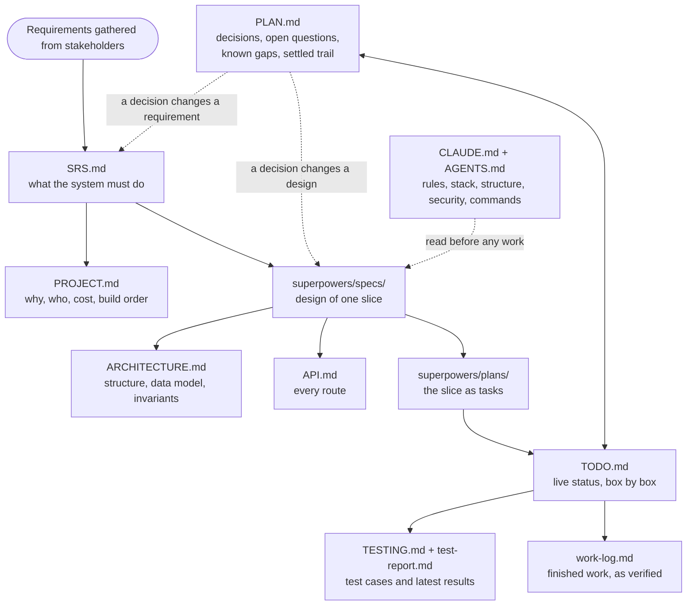

# TOR Radar

Thai government procurement TORs, collected in one place, extracted with AI, matched to vendors, and
published for anyone to audit.

Agencies publish Terms of Reference across dozens of sites as PDFs, scans, and HTML. A small vendor
cannot watch them all; a citizen cannot compare them. TOR Radar collects the published documents,
extracts their fields, emails vendors whose skills match within minutes, and puts the totals on a
public dashboard with a documented statistical-anomaly rule — every figure traceable to an unaltered
original.

> Course project · Software Design, Year 3 Semester 1 · team Momentum. National scope (Thai
> government agencies), seeded from Bangkok sources first.

---

## Quick start

```bash
mkdir secrets                 # then drop in the service-account key files the team gives you
cp .env.example .env          # fill in the secrets; nothing is committed
npm install
npm run dev                   # web :3000 · api :4000
npm test                      # vitest
npm run lint                  # eslint
npm run build                 # all workspaces
```

`secrets/` is gitignored and holds the Google service-account keys `.env` points at —
`gcp-sa.json` (Vertex AI) and, if you're testing against real Google Cloud Storage rather than the
local emulator, `gcs-storage-sa.json`. Ask the team for these files; never commit them.

```bash
docker compose up             # web · api · worker · mongo · gcs (fake-gcs-server emulator)
```

The `web` and `api` Dockerfiles install from the workspace root, so `@tor-radar/shared` resolves
inside the image the same way it does locally (TOR-140). `web`'s image prerenders `/` and
`/methodology` at build time; without `API_BASE_URL` set as a build arg, those two pages bake in
their no-data fallback rather than live figures — worth fixing before either page ships behind
Cloud Run.

Node 22 or newer. CI runs lint, test, and build on every pull request
([.github/workflows/ci.yml](.github/workflows/ci.yml)).

---

## Layout

```
apps/web/         Next.js 16 — app/ is routing only, UI code in src/
apps/api/         Express 5 — feature modules, ports, adapters, worker
packages/shared/  types + Zod schemas both apps import
docs/             requirements, architecture, design specs, benchmark evidence
mockups/          design-canvas source the UI was ported from — never built
tools/            source collection, seed generation, Jira seeding, Vertex checks, scoring
```

---

## Documentation

Start with whichever question you have:

| I want to know… | Read |
| :--- | :--- |
| **How it is put together** — containers, data model, invariants, diagrams | [docs/ARCHITECTURE.md](docs/ARCHITECTURE.md) |
| **What it must do** — every requirement, testable, with verification method | [docs/SRS.md](docs/SRS.md) |
| **Why it exists** — problem, stakeholders, personas, user stories, plan | [docs/PROJECT.md](docs/PROJECT.md) |
| **How the current slice is built** — decisions, seams, security, containers | [docs/superpowers/specs/](docs/superpowers/specs/) |
| **Every route** — body, query parameters, auth | [docs/API.md](docs/API.md) |
| **How it is tested** — commands, test cases, manual acceptance cases | [docs/TESTING.md](docs/TESTING.md) |
| **Which tests pass right now** — every test, grouped by feature (generated) | [docs/test-report.md](docs/test-report.md) |
| **What is being built right now** | [docs/TODO.md](docs/TODO.md) — the live checklist |
| **What the project is doing next** — decided, undecided, and why | [docs/PLAN.md](docs/PLAN.md) |
| **How the current slice is executed** — task by task, with tests | [docs/superpowers/plans/](docs/superpowers/plans/) |
| **What delegated agents built, and how it was verified** (slice 1 only so far) | [docs/work-log.md](docs/work-log.md) |
| **Where the TORs come from** — the BMA eGP API, document formats, taxonomy seeds | [docs/DATA-SOURCES.md](docs/DATA-SOURCES.md) |
| **How accurate the extraction is** | [docs/corpus/BENCHMARK.md](docs/corpus/BENCHMARK.md) |
| **How to set up Vertex AI** | [docs/gcp-setup.md](docs/gcp-setup.md) |

Working in this repo with an AI agent: [CLAUDE.md](CLAUDE.md) (Claude Code) or
[AGENTS.md](AGENTS.md) (any other agent).

### How the documents connect

Each document is produced from the one before it. Several are updated in the same pull request,
and a change late in the flow can send an edit back up it.



| Document | Written when | Read by | Changes when |
| :--- | :--- | :--- | :--- |
| SRS.md | Requirements are agreed with stakeholders | Everyone; every spec cites it | A requirement's meaning or scope changes (extended, never contradicted) |
| PROJECT.md | After the SRS | The team, assessors | Stakeholders, cost or build order change |
| superpowers/specs/ | Before each slice is built (brainstorming) | Implementers, reviewers | Behaviour changes, as a dated revision section |
| ARCHITECTURE.md · API.md | With the first spec, then with every structural change | Anyone touching code | A route, collection, index, module or worker changes (CI checks) |
| superpowers/plans/ | After a slice's spec is approved (writing-plans) | The agent or person building the slice | Rarely; finished plans stay as the trail |
| PLAN.md | Throughout the build | The team, to decide what is next | A pivot is decided, a question opens or closes, a gap is found |
| TODO.md | Throughout the build | Agents and the team, to stay on track | Any task starts, finishes or is discovered |
| TESTING.md · test-report.md | With each tested feature | Reviewers, the demo | A test is added or removed; `npm run test:report` regenerates the report |
| work-log.md | When delegated work is finished and verified | Anyone auditing what was built | Each verified task is archived from its agent log |
| CLAUDE.md · AGENTS.md | At project start | Every agent, before every session | Rules, stack or structure change (both files together) |

Every slice runs the same loop: spec, then plan, then build, with TODO.md and PLAN.md updated as it
goes and the finished work recorded in work-log.md.

---

## Status

All four slices are built: intake and immutable storage on Google Cloud Storage, AI extraction
with confidence tiering and the review queue, search, the dashboard with its anomaly rule and
quality checklist, and vendor accounts, profiles and matching. Still open: CSV export (F11), Google
sign-in, Compose hardening, and match emails, which stay off until the match benchmark exists.
The four slices are described in
[docs/ARCHITECTURE.md](docs/ARCHITECTURE.md) §10, and exact task-level progress lives in
[docs/TODO.md](docs/TODO.md) — the one place it is tracked.

## Stack

Next.js 16 · React 19 · Express 5 · MongoDB Atlas · Google Cloud Storage · Zod 4 · Vitest ·
Vertex AI (Document AI + Gemini) · Docker Compose. The reasoning behind each choice is in
[docs/ARCHITECTURE.md](docs/ARCHITECTURE.md) §8.
