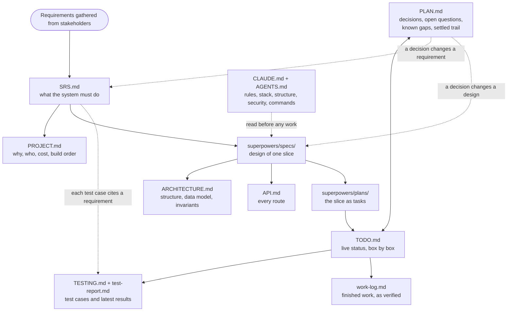

<div align="center">

# TOR Radar

**Thai government procurement TORs, collected in one place, read with AI, matched to vendors,
and published for anyone to audit.**

[](https://tor-radar-web-412311451957.asia-southeast1.run.app/)
[](https://github.com/TORMomentum/Momentum/actions/workflows/ci.yml)
[](https://github.com/TORMomentum/Momentum/actions/workflows/codeql.yml)
[](https://github.com/TORMomentum/Momentum/actions/workflows/semgrep.yml)
[](https://github.com/TORMomentum/Momentum/actions/workflows/deploy.yml)


[**Open the live app**](#production) · [Install](#install-and-run) · [Documentation](#documentation) · [Security](#security) · [Status](#status)

</div>

---

## Why

Agencies publish Terms of Reference across dozens of sites as PDFs, scans, and HTML. A small vendor
cannot watch them all; a citizen cannot compare them. TOR Radar collects the published documents,
extracts their fields, matches them to vendors' skills, and puts the totals on a public dashboard
with a documented statistical-anomaly rule. Every figure traces back to an unaltered original.

> Course project · Software Design, Year 3 Semester 1 · team **Momentum**. National scope (Thai
> government agencies), seeded from Bangkok sources first.

| Area | What it does |
| :--- | :--- |
| Intake | Collects TORs from e-GP sources and admin uploads, and keeps every original immutable in Cloud Storage |
| Extraction | Reads Thai documents with Document AI and Gemini; every value carries its confidence, model and source link |
| Search | Searches the corpus by agency, category, budget and date, with a detail page per TOR |
| Transparency | Publishes a public dashboard with a documented statistical-anomaly rule and a specification-quality checklist |
| Matching | Matches each vendor's profile to new TORs, with a readiness checklist, document vault and AI cover-letter draft |
| Security | Protects accounts with Google sign-in, breached-password checks, session timeouts, rate limits and security logging |

---

## Production

<table>
<tr><td>

**<https://tor-radar-web-412311451957.asia-southeast1.run.app/>**

</td></tr>
</table>

> [!IMPORTANT]
> **How to get in.** The deployment sits behind Google Identity-Aware Proxy and admits only
> **`@ku.th`** Google accounts.
>
> 1. Open **Google Chrome**.
> 2. Sign in to Chrome (or to Google in that browser) with your **`@ku.th`** account.
> 3. Open the link above. Pick the `@ku.th` account if Google asks which one to use.
>
> Any other account (a personal Gmail, for example) is refused by the proxy before it reaches the app.
> Inside the app you can then register with an email and password, or use **เข้าสู่ระบบด้วย Google**.

Every merge to `main` that passes CI deploys to Cloud Run automatically (web, API and worker), then
re-asserts the proxy and smoke-checks each service. How it works, and how to roll back:
[docs/gcp-setup.md](docs/gcp-setup.md) §7.

---

## Install and run

### Prerequisites

- Docker with Compose v2 (`docker compose version`)
- Node.js 22 or newer and npm (only for the tests, the seed script and `npm run dev`; the containers carry their own)
- `openssl` (or Node, below) to generate secrets
- Optional, for real AI extraction: a Google Cloud project with Vertex AI and its service-account key in
  `secrets/gcp-sa.json` (see [docs/gcp-setup.md](docs/gcp-setup.md)). Without it everything runs except
  extraction: uploaded documents stay `queued`, and nothing unextracted is published.

### 1 · Configure

```bash
cp .env.example .env
```

Compose refuses to start without `SESSION_SECRET` and `INTAKE_API_KEYS`. Generate each one on your machine. Never reuse one, and never commit `.env`:

```bash
openssl rand -base64 48     # SESSION_SECRET (32+ characters)
openssl rand -hex 32        # INTAKE_API_KEYS
# without openssl:  node -e "console.log(require('crypto').randomBytes(32).toString('hex'))"
```

`APP_ORIGIN` must be the address you open the web app at (`http://localhost:3000` with the default port):
account routes refuse any other `Origin`. Every other setting has a working default, documented in
`.env.example`. To run on other ports (next to another stack, say) set `COMPOSE_PROJECT_NAME`, `WEB_PORT`,
`API_PORT`, `MONGO_PORT`, `GCS_EMULATOR_PORT`, `MAIL_SMTP_PORT`, `MAIL_UI_PORT`, and change `APP_ORIGIN` to match.

<details>
<summary><b>Optional: Sign in with Google locally</b></summary>

Set `GOOGLE_OAUTH_ENABLED=true`, `GOOGLE_OAUTH_CLIENT_ID` and `GOOGLE_OAUTH_CLIENT_SECRET` in `.env`, and
register `http://localhost:3000/api/auth/google/callback` as a redirect URI on the OAuth client. The full
console steps, for local and Cloud Run, are in [docs/gcp-setup.md](docs/gcp-setup.md) §7.3b.

</details>

### 2 · Start

```bash
docker compose up --build -d
docker compose ps           # web, api, worker, stats-worker, notify-worker, mongo, gcs, mail Up (mongo: healthy)
```

| What | Where (default ports) |
| :--- | :--- |
| Web app | http://localhost:3000 |
| API | http://localhost:4000, health check at `/health` |
| Mailpit, the inbox for every email the app sends | http://localhost:8025 |
| MongoDB / GCS emulator | `localhost:27017` / `localhost:4443` |

Logs: `docker compose logs -f api` (the API writes JSON lines). Without a Vertex credential the worker logs
`extraction_disabled` and records stay `queued`; that is expected. To extract for real, set `GOOGLE_CLOUD_PROJECT`
and `GOOGLE_APPLICATION_CREDENTIALS` (the key file on this machine) in `.env` and add the Vertex override — every
document is then a billed Vertex call:

```bash
docker compose -f docker-compose.yml -f docker-compose.vertex.yml up --build -d
```

Match emails are not sent unless `NOTIFY_DISPATCH_ENABLED=true`; when they are, they land in Mailpit.

### 3 · Seed demo data (optional)

```bash
echo "DEMO_VENDOR_PASSWORD=choose-a-long-unique-password" >> .env
node tools/demo-seed.mjs
```

Creates the two storage buckets the emulator does not create by itself, two verified vendor accounts
(`vendor-a@demo.example`, `vendor-b@demo.example`), one private file in vendor A's vault, and two sample TORs
from `docs/corpus` through the intake API. It is safe to run again. Uploading a document before the buckets
exist returns `500`, so run it (or create `tor-raw` and `tor-vault` yourself) before using intake.
The security demo built on it: [docs/security/demo-script.md](docs/security/demo-script.md).

### 4 · Test

The integration tests use the Compose MongoDB and GCS emulator, so keep them up and install dependencies once:

```bash
npm ci
docker compose up -d mongo gcs
npm test                    # vitest; add TEST_MONGO_URL / TEST_GCS_API_ENDPOINT if you changed ports
npm run lint                # eslint
npm run build               # all workspaces
```

### 5 · Stop

```bash
docker compose down         # stop, keep the data
docker compose down -v      # stop and delete the database, stored files and mail
```

<details>
<summary><b>Without containers, secrets, and image notes</b></summary>

```bash
npm ci
npm run dev                 # web :3000 · api :4000 · extraction worker; needs MongoDB, GCS and SMTP reachable
                            # (e.g. `docker compose up -d mongo gcs mail`) and API_BASE_URL=http://localhost:4000
```

`secrets/` is gitignored and holds the Google service-account keys `.env` points at: `gcp-sa.json` (Vertex AI)
and, only when testing against real Google Cloud Storage instead of the emulator, `gcs-storage-sa.json`. Ask the
team for them; never commit them.

The `web` and `api` Dockerfiles install from the workspace root, so `@tor-radar/shared` resolves inside the image
the same way it does locally. `web`'s image prerenders `/` and `/methodology` at build time; without
`API_BASE_URL` set as a build arg, those two pages bake in their no-data fallback rather than live figures.

</details>

---

## Layout

```
apps/web/         Next.js 16 — app/ is routing only, UI code in src/ (views → features → entities → shared)
apps/api/         Express 5 — feature modules, ports, adapters, workers
packages/shared/  types + Zod schemas both apps import
packages/seeds/   taxonomy, categories, sources
docs/             requirements, architecture, design specs, security, benchmark evidence
mockups/          design-canvas source the UI was ported from — never built
tools/            source collection, seeds, demo seed, ZAP, docs checks, Jira seeding, Vertex checks
```

---

## Security

Built and checked against **OWASP ASVS 5.0** for 01219325 Software Development Security.

| Area | What is in place | Evidence |
| :--- | :--- | :--- |
| Authentication | Sign in with Google (OIDC code flow, PKCE, state, nonce), Argon2 password hashing, breached-password check (HIBP k-anonymity) | [security document](docs/security/security-project-document.md) |
| Sessions | Idle and absolute timeouts, old session revoked at login, cleared at logout | [TODO.md](docs/TODO.md) |
| Access control | Public / vendor / admin matrix, tested so one vendor cannot read another's data | [access-control-matrix.md](docs/security/access-control-matrix.md) |
| Headers and transport | Nonce-based CSP, HSTS, frame denial, CORS allowlist, `nosniff` on originals | [evidence/](docs/security/evidence/) |
| Abuse | Rate limits on login and public APIs; SSRF guard on URL intake | [API.md](docs/API.md) |
| Logging | Structured security events, uncaught-error logging to Cloud Logging | [security document](docs/security/security-project-document.md) |
| SAST | CodeQL and Semgrep on every pull request; `npm audit` gate in CI; no open alerts | [sast-report.md](docs/security/sast-report.md) |
| DAST | OWASP ZAP baseline (signed out and signed in) and active scan on merged `main`: no High or Medium | [dast-report.md](docs/security/dast-report.md) |

Threat model, design principles and the ASVS mapping:
[docs/security/security-project-document.md](docs/security/security-project-document.md) ·
slides: [docs/security/security-slides.html](docs/security/security-slides.html).

---

## Documentation

Start with whichever question you have:

| I want to know… | Read |
| :--- | :--- |
| **How it is put together** — containers, data model, invariants, diagrams | [docs/ARCHITECTURE.md](docs/ARCHITECTURE.md) |
| **What it must do** — every requirement, testable, with verification method | [docs/SRS.md](docs/SRS.md) |
| **Why it exists** — problem, stakeholders, personas, user stories, plan | [docs/PROJECT.md](docs/PROJECT.md) |
| **How each slice is built** — decisions, seams, security, containers | [docs/superpowers/specs/](docs/superpowers/specs/) |
| **Every route** — body, query parameters, auth | [docs/API.md](docs/API.md) |
| **How it is tested** — commands, test cases, manual acceptance cases | [docs/TESTING.md](docs/TESTING.md) |
| **Which tests pass right now** — every test, grouped by feature (generated) | [docs/test-report.md](docs/test-report.md) |
| **What is being built right now** | [docs/TODO.md](docs/TODO.md) — the live checklist |
| **What the project is doing next** — decided, undecided, and why | [docs/PLAN.md](docs/PLAN.md) |
| **How a slice is executed** — task by task, with tests | [docs/superpowers/plans/](docs/superpowers/plans/) |
| **What delegated agents built, and how it was verified** (slice 1 only so far) | [docs/work-log.md](docs/work-log.md) |
| **Where the TORs come from** — the eGP APIs, document formats, taxonomy seeds | [docs/DATA-SOURCES.md](docs/DATA-SOURCES.md) |
| **How accurate the extraction is** | [docs/corpus/BENCHMARK.md](docs/corpus/BENCHMARK.md) |
| **How it is secured** — ASVS mapping, threat model, principles, test process | [docs/security/security-project-document.md](docs/security/security-project-document.md) |
| **How to set up Google Cloud** — Vertex AI, Cloud Run, Google sign-in | [docs/gcp-setup.md](docs/gcp-setup.md) |
| **I am new to the team** | [docs/ONBOARDING.md](docs/ONBOARDING.md) |

Working in this repo with an AI agent: [CLAUDE.md](CLAUDE.md) (Claude Code) or
[AGENTS.md](AGENTS.md) (any other agent).

<details>
<summary><b>How the documents connect</b></summary>

Each document is produced from the one before it. Several are updated in the same pull request,
and a change late in the flow can send an edit back up it.



| Document | Written when | Read by | Changes when |
| :--- | :--- | :--- | :--- |
| SRS.md | Requirements are agreed with stakeholders | Everyone; every spec cites it | A requirement's meaning or scope changes (extended, never contradicted) |
| PROJECT.md | After the SRS | The team, assessors | Stakeholders, cost or build order change |
| superpowers/specs/ | Before each slice is built (brainstorming) | Implementers, reviewers | Behaviour changes, as a dated revision section |
| ARCHITECTURE.md · API.md | With the first spec, then with every structural change | Anyone touching code | A route, collection, index, module or worker changes (CI checks) |
| superpowers/plans/ | After a slice's spec is approved (writing-plans) | The agent or person building the slice | Rarely; finished plans stay as the trail |
| PLAN.md | Throughout the build | The team, to decide what is next | A pivot is decided, a question opens or closes, a gap is found |
| TODO.md | Throughout the build | Agents and the team, to stay on track | Any task starts, finishes or is discovered |
| TESTING.md · test-report.md | With each tested feature | Reviewers, the demo | A test is added or removed; `npm run test:report` regenerates the report |
| work-log.md | When delegated work is finished and verified | Anyone auditing what was built | Each verified task is archived from its agent log |
| CLAUDE.md · AGENTS.md | At project start | Every agent, before every session | Rules, stack or structure change (both files together) |

Every slice runs the same loop: spec, then plan, then build, with TODO.md and PLAN.md updated as it
goes and the finished work recorded in work-log.md.

</details>

---

## Status

| State | Milestone | Scope |
| :--- | :--- | :--- |
| Done | Slices 1–4 | intake and immutable storage on Cloud Storage, AI extraction with confidence tiering and a review queue, search and TOR detail, the dashboard with its anomaly rule and quality checklist, vendor accounts, profiles and matching |
| Done | Sprint 5 | document vault, readiness checklist, AI cover-letter draft, company path, personnel and behaviour-aware matching |
| Done | Sprint 6 | continuous deployment to Cloud Run, Sign in with Google, and the security work above (SAST, DAST, headers, rate limits, logging, sessions, breached passwords) |
| Open | Remaining | CSV export (F11); match emails (the notify worker runs in neither Compose nor Cloud Run); the open values in SRS §8 that wait on real data |

Task-level progress lives in [docs/TODO.md](docs/TODO.md), the one place it is tracked. The slices are
described in [docs/ARCHITECTURE.md](docs/ARCHITECTURE.md) §10.

---

## Stack

Next.js 16 · React 19 · Express 5 · MongoDB Atlas · Google Cloud Storage · Zod 4 · Vitest ·
Vertex AI (Document AI + Gemini) · Docker Compose · Cloud Run · GitHub Actions. The reasoning behind each
choice is in [docs/ARCHITECTURE.md](docs/ARCHITECTURE.md) §8.

<div align="center">

<sub>Made by team Momentum · Kasetsart University</sub>

</div>
