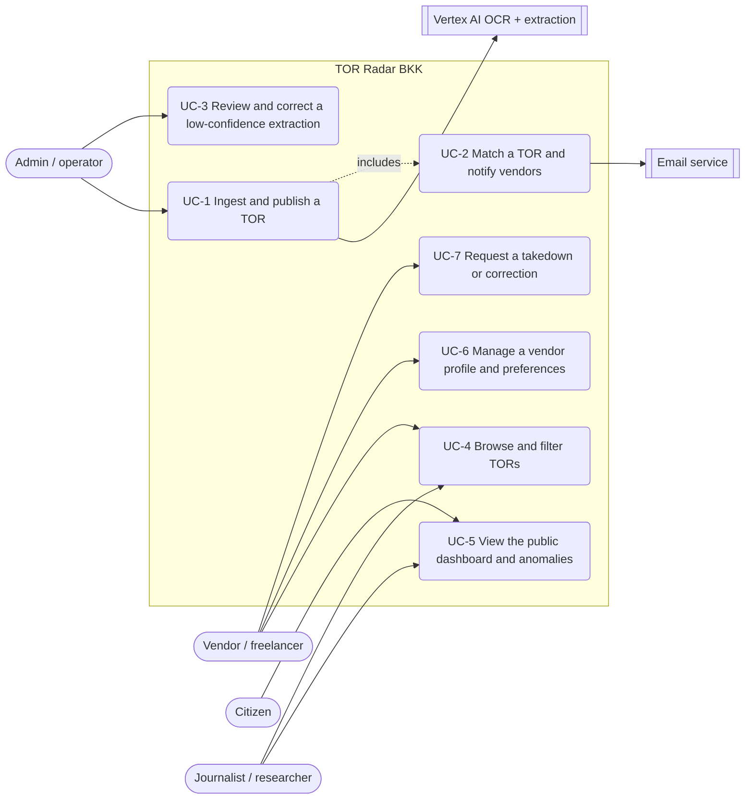

# Software Requirements Specification — TOR Radar BKK

**Team Momentum · Phase 1 · SRS v0.4 (draft)**
Structure follows **ISO/IEC/IEEE 29148:2018** (SRS clause), using the IEEE 830 / Wiegers section
names the team already writes to (Overall Description · External Interface Requirements · System
Features · Other Nonfunctional Requirements · Analysis Models).

### Revision history

| Name | Date | Reason for change | Version |
|---|---|---|---|
| Initial draft | 2026-08-24 | First SRS derived from PROJECT.md | 0.1 |
| 29148 restructure | 2026-08-24 | Requirement attributes, verification, traceability | 0.2 |
| Cross-check pass | 2026-08-24 | Codex critique + audit-of-the-fixes folded in | 0.3 |
| Template merge | 2026-08-24 | Wiegers sections added: user documentation, NFR categories, analysis models (use-case diagram + two fully dressed use cases), feature summary | 0.4 |

> **Sources of truth, in order of weight:**
> 1. [PROJECT.md](PROJECT.md) v2 — scope, requirements, plan (highest weight; conflicts resolve here).
> 2. [TOR-Radar-Proposal.md](TOR-Radar-Proposal.md) + the course slide deck — stakeholder framing,
>    capability grouping, FR01–FR20 numbering, roles, cost.
> 3. [CLAUDE.md](CLAUDE.md) — repository engineering rules. Not an independent source of scope:
>    it restates PROJECT.md decisions as code-review rules.
>
> Requirement IDs (`FR-A1…FR-G3`, `NFR-1…9`, `US-01…16`) are carried over from PROJECT.md
> **unchanged** — never renumber. Where one PROJECT.md requirement bundled several testable
> statements, this SRS adds **suffix sub-IDs** (`FR-A2a`, `FR-A2b`) so each is separately
> verifiable; the parent number is preserved and, used bare (`FR-A2`), means all of its sub-IDs
> collectively. The proposal's `FR01–FR20` are mapped, not replaced (§6.2).

---

## Table of Contents

1. [Introduction](#1-introduction)
2. [Product Overview](#2-product-overview)
3. [External Interface Requirements](#3-external-interface-requirements)
4. [Requirements](#4-requirements) — system features, data, nonfunctional, AI-specific, constraints
5. [Verification](#5-verification)
6. [Traceability](#6-traceability)
7. [Supporting Information](#7-supporting-information)
- [Appendix A: Glossary](#appendix-a-glossary)
- [Appendix B: Analysis Models](#appendix-b-analysis-models) — use-case diagram + fully dressed use cases
- [Appendix C: Document History](#appendix-c-document-history)

---

## 1. Introduction

### 1.1 Purpose
Specifies the software requirements for **TOR Radar BKK**, Phase 1: a centralized, Thai-language
web platform that ingests publicly announced Bangkok Metropolitan Administration (BMA) procurement
TORs in any format, extracts and normalizes them with AI, matches them to vendor skill profiles
with email notification, and publishes a public transparency dashboard with pricing-anomaly
visualization. Audience: the delivery team, the project sponsor (acting as customer proxy), and
course evaluators. This document states **what** the system must do; design and implementation
choices appear only as constraints (§4.7).

### 1.2 Scope
**Product name:** TOR Radar BKK.

**What it does:** ingestion (upload / URL / authenticated API) → Thai OCR + field extraction with
per-field confidence → normalization into a shared skill taxonomy → vendor matching + email
notification → public dashboard with a documented statistical-anomaly rule → rule-based
specification-quality checklist → admin review and correction of the worst extractions.

**What it does not do:** serve agencies as users (no agency accounts, no draft-TOR portal — they
are a data source only); assist with bidding, drafting, or submitting proposals; give legal advice
or corruption judgments; cover any jurisdiction outside BMA; handle payments, contracts, or
award analysis beyond a coarse status label; ship a native mobile app or a non-Thai UI.

**Benefit:** vendors and the public get searchable, structured access to Bangkok TORs — working
entirely from public announcements, requiring no cooperation, account, or integration from any
agency.

### 1.3 Intended Audience and Reading Suggestions
| Reader | Read first | Then |
|---|---|---|
| Developer (backend / frontend / AI) | §4 Requirements — especially the normative subsections §4.2.1 (confidence policy), §4.5.1 (anomaly rule), §4.6.1 (quality checks) | §3 interfaces, §4.11 constraints, Appendix B use cases for the end-to-end flows |
| Tester / QA | §5 Verification (methods, environments, key activities, story acceptance criteria) | §4 for the requirement each test targets; Appendix B alternative flows for negative cases |
| Sponsor / product owner | §1 Introduction and §2 Product Overview | §7.1 priority summary, §7.3 open issues, §7.4 risks |
| Course evaluator | §1, §2, then §4 | §6 traceability matrices, Appendix B analysis models |
| New team member | §1.2 Scope and §2.3 Operational Concept | Appendix A glossary, then §4 |

Everything in this document is a hypothesis until the Sprint-1 validation interviews confirm it
(§1.8 A5) — read it as the current best statement of intent, not as a signed-off contract.

### 1.4 Product Perspective
A new, standalone system. Not an extension of an existing product and not integrated with any BMA
IT system. External dependencies: Vertex AI (Document AI + Gemini) for OCR/extraction, and the
continued public availability of BMA announcement pages as the upstream data source (a constraint,
not an integration). National e-GP is explicitly **not** a source — it mixes non-Bangkok entities.

### 1.5 Product Functions
1. Ingest TOR documents through three routes into one pipeline; store raw files immutably;
   deduplicate; validate Bangkok scope.
2. OCR and extract structured fields with per-field confidence under a two-tier publish policy.
3. Normalize extracted qualifications into the shared skill taxonomy.
4. Score TORs against vendor profiles and notify matches by email with a stated reason.
5. Serve a public, no-login dashboard: per-agency spend, pricing plots with a documented anomaly
   rule, composable filters, permanent historical archive.
6. Produce a rule-based, explainable specification-quality checklist per TOR.
7. Provide an admin review queue for very-low-confidence records, plus taxonomy and agency-list
   management.

### 1.6 User Characteristics
| Class | Maps to | Characteristics | Access |
|---|---|---|---|
| Vendor / freelance professional | S1, P1 ("Nok") | Builds a skill profile; consumes matches and search; technical literacy varies widely | Authenticated (vendor role) |
| Citizen / general public | S3 | Occasional reader of the dashboard; no training assumed | Anonymous |
| Journalist / researcher / watchdog | S4, P3 ("Ploy") | Power user of filters, anomaly data, CSV export (Could) | Anonymous |
| Admin / platform operator | S5, P4 | Seeds corpus, corrects extractions, manages taxonomy | Authenticated (admin role) |
| BMA procurement officer | S2, P2 ("Khun Somchai") | **Not a platform user.** Their published documents are the input; if they browse, they use the public views | Anonymous only |

### 1.7 Limitations
- Phase-1 pilot scale only: hundreds of TORs, tens of concurrent users. No uptime guarantee, no
  horizontal-scaling claim (NFR-9).
- No extraction-accuracy figure is promised before the Sprint-1 benchmark measures it (NFR-1).
- Corpus completeness is not claimed: the dashboard always states that figures reflect the
  ingested corpus, not all BMA procurement (FR-E1).
- **PDPA-aligned**, never "PDPA-compliant" — no legal certification is claimed (NFR-5).
- Outputs are never accusations: "statistical anomaly" and "specification-quality check" only
  (FR-E2, FR-F2).

### 1.8 Assumptions and Dependencies
| # | Assumption / dependency | If it fails |
|---|---|---|
| A1 | BMA announcement pages stay publicly accessible in roughly their current form | Fall back to manual upload/URL seeding; scraping stays Stretch (FR-A-S1) |
| A2 | Sprint-1 benchmark shows extraction accurate enough to build on | Plan is re-cut at the Elaboration exit gate (PROJECT.md §7) |
| A3 | Sponsor acts as acceptance customer proxy (no committed external customer yet) | Open question §7.3-1; recruit a real user group |
| A4 | Vertex AI pricing/free tiers approximately as budgeted | Reduce benchmark re-runs; cap AI headroom spend |
| A5 | Every requirement here is a **hypothesis** until Sprint-1 validation interviews confirm it | Backlog revised at the Inception gate |

### 1.9 Definitions
See [Appendix A: Glossary](#appendix-a-glossary).

### 1.10 Acronyms
BMA · TOR · OCR · PDPA · PII · MVP · MoSCoW · IQR · SRS · DoD · RTM.

### 1.11 Document Conventions
- **Requirement ID:** `FR-<group><n>` (functional), `NFR-<n>` (non-functional), `US-<n>` (user
  story). IDs are stable across document versions.
- **Every requirement carries four attributes** (per ISO/IEC/IEEE 29148 — necessary, singular,
  unambiguous, verifiable, traceable, prioritized):

  | Attribute | Values |
  |---|---|
  | **Priority** | Must / Should / Could / Won't (MoSCoW, from PROJECT.md §7) |
  | **Source** | PROJECT.md §, proposal FR-number, or user story |
  | **Verification** | **T** test · **D** demonstration · **I** inspection · **A** analysis (§5) |
  | **Sprint** | Sprint in which it is delivered (PROJECT.md §7 runway) |

- **MVP** = required for the week-8 feature-complete gate. **Stretch** = not committed in Phase 1.
- "The system shall…" phrasing; one testable statement per requirement.

### 1.12 References
1. [PROJECT.md](PROJECT.md) — TOR Radar BKK product specification & Phase-1 delivery plan, v2.
2. [TOR-Radar-Proposal.md](TOR-Radar-Proposal.md) — course project proposal, v0.1 (+ slide deck).
3. [CLAUDE.md](CLAUDE.md) — repository engineering rules.
4. ISO/IEC/IEEE 29148:2018 — Requirements engineering (SRS structure and requirement attributes).
5. IEEE 830-1998 — Recommended practice for SRS (section naming).
6. Public Procurement and Supplies Management Act B.E. 2560 (Thailand).
7. Personal Data Protection Act B.E. 2562 (PDPA, Thailand).

---

## 2. Product Overview

### 2.1 Operating Environment
| Element | Choice | Note |
|---|---|---|
| Frontend | Next.js | Responsive web, desktop + mobile browsers |
| API | Node.js + Express | REST/JSON |
| Database | MongoDB Atlas (M0 in Phase 1) | Metadata + extracted fields only |
| Object storage | MinIO (S3-compatible), Docker Compose | Raw documents only — never inside Mongo documents |
| AI | Vertex AI: Document AI (OCR), Gemini (extraction, checklist assist) | |
| Email | Nodemailer (SMTP) or Resend | Email-only; no chat/webhook channels |
| Deployment | Docker Compose (dev/CI parity); demo on one small VM or Cloud Run | Target decided in Sprint 1 |

### 2.2 User Classes → Feature Access
| Feature | Anonymous | Vendor | Admin |
|---|---|---|---|
| Public dashboard, pricing plots, filters | ✔ | ✔ | ✔ |
| Shared TOR detail page | ✔ | ✔ | ✔ |
| Profile, matching, email notifications | — | ✔ | — (admin is an operator role, not a vendor account) |
| Bookmarks / personal archive (Could) | — | ✔ | — |
| CSV export (Could) | ✔ | ✔ | ✔ |
| Ingestion (upload/URL/API), review queue, taxonomy | — | — | ✔ |

### 2.3 Operational Concept (main flow)
Admin ingests a public announcement → raw file stored immutably in MinIO → Bangkok-only validation
and deduplication → OCR + field extraction with per-field confidence → confidence tier decides
publish path (clean / tagged "unverified" / tagged **and** queued) → record published to the shared
detail page and dashboard → verified fields feed the anomaly rule and the matching engine →
matched vendors receive an explained email.

### 2.4 User Documentation
Delivered with the system, all in Thai (NFR-7):

| Document | Audience | Content |
|---|---|---|
| Dashboard methodology page | Public, journalists | How the anomaly rule works (§4.5.1), what the coverage note means, what "statistical anomaly" does and does not claim. Linked from every flagged point and every checklist result (FR-F2b) |
| Extraction & confidence note | All readers of a TOR page | What the "unverified extraction" tag means, why some fields are excluded from statistics, how to report a bad extraction |
| Vendor onboarding help | Vendors | Building a skill profile, how matching and match scores work, tuning notification preferences |
| Admin runbook | Admin / operators | Ingesting by upload, URL, and API; working the review queue; editing the taxonomy and agency seed files; re-running the accuracy benchmark |
| PDPA & takedown notice | All users | Consent, export, deletion, and the takedown/correction request route (FR-B5b, FR-D3) |
| README + Docker Compose guide | Team, evaluators | Running the stack, running tests in containers, environment variables (`.env.example`) |

Inline help accompanies every form field that feeds matching, and every error message states what
the user can do next.

---

## 3. External Interface Requirements

### 3.1 User Interfaces
All UI is in Thai (NFR-7); extracted field values are displayed as-is, untranslated.

| Screen | Content | Requirements |
|---|---|---|
| Public dashboard | Per-agency TOR count + total budget, date-range selector, pricing plots with anomaly markers, composable filters, **"data last updated"** timestamp + coverage note | FR-E1, FR-E2, FR-E3 |
| TOR detail (shared by all roles) | Structured fields, link to original document, quality-checklist result + reasons, status history, extraction provenance, "unverified extraction" tag when applicable | FR-E4, FR-B3, FR-F2 |
| Search / browse | Composable filters: agency, category, budget range, deadline, status | FR-E3, US-04 |
| Vendor profile | Skill-tag picker (taxonomy), certifications, past projects, budget range, PDPA consent, notification preferences | FR-D2, FR-D3, FR-C3 |
| Admin review queue | Original document side-by-side with extracted fields, per-field confidence, edit + approve | FR-G1, US-14 |
| Match notification email | TOR summary, matched qualifications, budget fit, days remaining, link to detail page | FR-C2, US-03 |

### 3.2 Hardware Interfaces
None. Standard client hardware (browser) only.

### 3.3 Software Interfaces
| Interface | Direction | Purpose | Requirement |
|---|---|---|---|
| Vertex AI Document AI | Outbound | Thai/English OCR of scans and photographs | FR-B1 |
| Vertex AI Gemini | Outbound | Field extraction, qualification normalization, checklist assist | FR-B2, FR-B4, FR-F1 |
| MongoDB Atlas | Internal | Metadata, extracted fields, profiles, matches; Atlas Search for text search | §4.8 |
| MinIO | Internal | Immutable raw-document storage | FR-A2 |
| SMTP / Resend | Outbound | Match-notification delivery | FR-C2 |
| OAuth provider | Outbound | Vendor sign-in alternative to email + password | FR-D1 |
| Ingestion REST endpoint | **Inbound**, authenticated, rate-limited | Programmatic/admin TOR submission; the seam future scraping plugs into | FR-A1, NFR-8 |

### 3.4 Communications Interfaces
HTTPS on every deployed environment (NFR-8); REST/JSON between frontend and API; SMTP outbound for
email.

---

## 4. Requirements

Each subsection lists the requirement text followed by its attributes. Grouping (A–G) and wording
follow PROJECT.md §6; the bracketed capability name is the proposal's grouping.

### 4.0 System Features at a glance

| # | Feature | Description | Priority | Functional requirements | User stories |
|---|---|---|---|---|---|
| F1 | TOR ingestion | Accepts publicly announced TORs by upload, URL, or authenticated API into one pipeline; stores the original immutably; deduplicates; enforces Bangkok-only scope | Must (High) | FR-A1, FR-A2a, FR-A2b, FR-A3, FR-A4 | US-13 |
| F2 | Thai reading & normalization | OCR of Thai/English scans and photographs; extraction of the nine structured fields; normalization of qualifications into the shared taxonomy | Must (High) | FR-B1, FR-B2, FR-B4 | US-05, US-13 |
| F3 | Confidence & review | Per-field confidence with the two-tier publish policy; "unverified extraction" tag; admin review queue for the worst records; corrections stored as extractor examples | Must (High) | FR-B3, FR-G1, FR-G2 | US-14 |
| F4 | Search & discovery | Composable filters over agency, category, budget range, deadline, status, with the archive always browsable | Must (High) | FR-E3 | US-04, US-10 |
| F5 | Matching & notification | Scores each published TOR against vendor profiles; emails matched vendors with the reason; user-controlled notification preferences | Must (High) | FR-C1, FR-C2, FR-C3 | US-02, US-03 |
| F6 | Profiles & auth | Email/OAuth sign-in with vendor, admin, and anonymous roles; skill-profile CRUD; PDPA consent, export, deletion | Must (High) | FR-D1, FR-D2, FR-D3 | US-01 |
| F7 | Public transparency dashboard | No-login per-agency counts and budgets, trend line, pricing plots with the documented peer-group anomaly rule, freshness and coverage disclosure, status history | Must (High) | FR-E1a, FR-E1b, FR-E1c, FR-E2, FR-E4, FR-E5 | US-08, US-09, US-10 |
| F8 | Specification-quality checklist | Five rule-based checks per TOR, reported as a score with its exact reasons and an AI-generated label, linked to a methodology page | Should (Medium) | FR-F1, FR-F2a, FR-F2b, FR-F3 | US-06, US-11 |
| F9 | Admin tooling | Review queue, field correction and approval, JSON-seeded taxonomy and canonical agency list | Must, minimal (Medium) | FR-G1, FR-G2, FR-G3 | US-14, US-15 |
| F10 | PII & takedown handling | PII minimization in displayed extractions; takedown/correction workflow that restricts access with an audit trail | Must (Medium) | FR-B5a, FR-B5b | — (NFR-5 driven) |
| F11 | Bookmarks & personal archive | Private bookmark list and self-reported pursued/won/completed marks | Could (Low) | FR-D4a, FR-D4b | US-07 |
| F12 | CSV export | Export of the currently filtered list, PII-minimized | Could (Low) | FR-E6 | US-12 |
| F13 | Automated source ingestion | Scraping adapters per announcement page with admin-visible source health | Stretch (Low) | FR-A-S1 | US-16 |

### 4.1 FR-A — TOR Ingestion  *[Ingestion Engine]*

| ID | Requirement | Priority | Source | Verify | Sprint |
|---|---|---|---|---|---|
| **FR-A1** | The system shall accept TOR input via (a) file upload of PDF/JPG/PNG, (b) a submitted URL, and (c) an authenticated REST ingestion endpoint; all three routes shall feed the same processing pipeline. | Must | US-13 / FR01, FR02 | T, D | 2 |
| **FR-A2a** | The system shall store every original document in MinIO object storage and shall never delete or overwrite a stored object. | Must | NFR-2 / FR03 | T, I | 2 |
| **FR-A2b** | The system shall store document bytes only in object storage; MongoDB documents shall hold metadata and a storage reference, never the bytes. | Must | PROJECT.md §6 FR-A2 | I, T | 2 |
| **FR-A3** | The system shall resolve duplicate submissions of the same TOR — arriving through any route — to a single record. | Must | US-13 / FR04 | T | 2 |
| **FR-A4** | The system shall match each record's issuing agency against the canonical BMA agency and district-office list, and shall reject or tag records outside Bangkok jurisdiction. | Must | §2 Bangkok-only rule / FR04 | T | 2 |
| **FR-A-S1** | The system may poll or scrape configured BMA announcement pages through one adapter per source, and shall then show each source's last-successful-fetch time and health state (healthy / failing) on an admin-visible monitoring surface, so a silently broken source is detectable. | **Stretch (Could)** | US-16 | D | — |

### 4.2 FR-B — Extraction & Normalization  *[Thai Reading and Normalization; Confidence and Review]*

| ID | Requirement | Priority | Source | Verify | Sprint |
|---|---|---|---|---|---|
| **FR-B1** | The system shall perform OCR of Thai and English text on scanned and photographed documents, using a Thai-capable OCR model. (Accuracy is not asserted here — it is measured under NFR-1.) | Must | FR05 | T, A | 1–2 |
| **FR-B2** | The system shall extract these structured fields per document: title, issuing agency, budget (฿), category, scope summary, required qualifications, submission deadline, contact, and coarse status (announced / closed / awarded). | Must | FR06 | T | 2 |
| **FR-B3** | The system shall record a confidence score per extracted field and apply the two-tier publish policy of §4.2.1. | Must | FR07 | T, D | 2 |
| **FR-B4** | The system shall normalize extracted qualifications into the shared skill taxonomy used by vendor profiles. | Must | FR08 | T | 2 |
| **FR-B5a** | The system shall minimize personal data in displayed extractions (e.g. officers' personal phone numbers, signatures) while keeping the original document reachable through its source link. | Must | FR20, NFR-5 | I, T | 2 |
| **FR-B5b** | The system shall provide a takedown/correction request workflow; an accepted takedown restricts access to the document and writes an audit-trail entry (never edits or deletes the original — NFR-2). | Must | FR20, NFR-2 | D, I | 4 |

#### 4.2.1 Two-tier confidence publish policy (normative detail of FR-B3)
All records auto-publish; none are silently withheld.

| Tier | Condition | Behaviour |
|---|---|---|
| **High** | all critical fields ≥ `T_high` | Published clean; fields feed dashboard, anomaly rule, and matching |
| **Medium** | `T_low` ≤ confidence < `T_high` | Published with a visible **"unverified extraction"** tag + source link. Below-threshold fields are **excluded** from the anomaly rule (FR-E2) and from match notifications (FR-C2) until verified. **Not** queued; correctable from the TOR page at any time |
| **Very low / suspicious** | confidence < `T_low`, **or** a sanity check fails (missing budget/agency/deadline, implausible value) | Tagged as above **and** routed to the admin review queue (FR-G1) for priority correction |

`T_low` and `T_high` **shall** be set from the Sprint-1 accuracy benchmark on 10–20 real BMA TORs
(NFR-1). Hard-coded guesses are a defect, not a placeholder.

### 4.3 FR-C — Matching & Notification  *[Matching and Notification]*

| ID | Requirement | Priority | Source | Verify | Sprint |
|---|---|---|---|---|---|
| **FR-C1** | The system shall score each published TOR against vendor profiles on qualification tags, category interests, and budget range, using a configurable match threshold. | Must | US-02 / FR11 | T | 4 |
| **FR-C2** | The system shall email matched vendors with the match explanation — including at least the top 3 matched skill tags and budget-range fit — within 5 minutes of publish in the demo environment. | Must | US-02, US-03 / FR12 | T, D | 4 |
| **FR-C3** | The system shall let each vendor configure notification frequency (immediate / daily digest), minimum match score, and category and budget filters. | Must | FR12 | T | 4 |

### 4.4 FR-D — Profiles & Auth  *[Matching and Notification]*

| ID | Requirement | Priority | Source | Verify | Sprint |
|---|---|---|---|---|---|
| **FR-D1** | The system shall support registration and login by email+password and by OAuth, with the roles vendor, admin, and anonymous public. | Must | PROJECT.md §6 FR-D1 / proposal user story "sign up and sign in with email or a Google account" | T | 4 |
| **FR-D2** | The system shall provide skill-profile CRUD with taxonomy tags, certifications, past projects, budget range, and free-text portfolio. | Must | US-01 / FR10 | T | 4 |
| **FR-D3** | The system shall record explicit PDPA consent at signup and provide data export and account deletion. | Must | NFR-5 / FR10, FR20 | T, I | 4 |
| **FR-D4a** | The system may let a vendor bookmark a TOR and view their own bookmark list. | **Could** | US-07 | T | 5 (if green) |
| **FR-D4b** | The system may let a vendor privately mark a bookmarked TOR as pursuing / won / completed, moving completed items to a personal archive view. Marks are self-reported, private, never shown publicly and never presented as a verified award. | **Could** | US-07 | T | 5 (if green) |

### 4.5 FR-E — Public Dashboard & Visualization  *[Public Transparency Dashboard; Search and Discovery]*

| ID | Requirement | Priority | Source | Verify | Sprint |
|---|---|---|---|---|---|
| **FR-E1a** | The system shall serve a login-free public dashboard showing TOR counts and total budget per BMA agency over a selectable date range. | Must | US-08 / FR13 | D, T | 3 |
| **FR-E1b** | The dashboard shall always display a "data last updated" timestamp (time of the latest successful ingestion) and a coverage note stating that figures reflect the ingested corpus, not necessarily all BMA procurement. | Must | US-08, NFR-6 / FR13 | I | 3 |
| **FR-E1c** | The dashboard shall display a per-period trend line of TOR count and total budget for the active filter selection. | Must | US-10 acceptance ("simple trend line per period") / FR13 | T, D | 3 |
| **FR-E2** | The system shall plot budgets by category and flag statistical outliers using the anomaly rule specified in §4.5.1, labelling flagged points **"statistical anomaly"**. | Must | US-09 / FR14 | T, A | 3 |
| **FR-E3** | The system shall provide composable filters — agency, category, date range, budget range, status — and shall keep closed and awarded TORs browsable indefinitely as a historical archive. | Must | US-04, US-10 / FR09, FR19 | T | 3 |
| **FR-E4** | The system shall provide one shared TOR detail page — serving vendors, public, and journalists alike — showing structured fields, the original-document link, the quality-checklist result, status history, and extraction provenance ("extracted `<timestamp>` by `<model/version>`"), updated on re-extraction or admin correction. | Must | US-05, US-11 / FR06, FR17 | D, I | 2 |
| **FR-E5** | The system shall record each TOR status transition with timestamp, source, and actor, originating from admin action or re-ingestion of an updated announcement. | Must | US-07 / FR19 | T | 3 |
| **FR-E6** | The system may export the currently filtered TOR list as CSV, including extracted fields and source links, PII-minimized per FR-B5. | **Could** | US-12 | T | 5 (if green) |

#### 4.5.1 Anomaly rule (normative detail of FR-E2)
Exactly one rule is active per deployment; its parameters are named configuration constants, never
inline literals (§4.11 no-magic-numbers rule). Defaults below come from PROJECT.md FR-E2.

| Parameter | Default | Meaning |
|---|---|---|
| `PEER_GROUP_KEY` | (category, time-window) | Budgets are compared only inside one peer group — never across the whole corpus |
| `PEER_WINDOW` | rolling 12 months | The time-window half of the peer key |
| `PEER_MIN_N` | 8 | Minimum peer-group size; groups smaller than this are rendered **unflagged**, never flagged |
| `ANOMALY_METHOD` | `IQR` | `IQR` = flag budgets outside [Q1 − 1.5·IQR, Q3 + 1.5·IQR]. The documented alternative is `ZSCORE` (flag \|z\| > 3). One method is configured and documented at a time; the dashboard's methodology note states which is active |

Fields below the FR-B3 confidence threshold are excluded from the peer-group statistics entirely
(AI-2), so an OCR error cannot produce or shift a flag.

### 4.6 FR-F — Specification-Quality Checklist  *[Specification-Quality Checklist]*
Scoped deliberately as a **specification-quality checklist**, not an "AI audit": judging
vendor-locking or corruption needs domain expertise and historical data outside this project's
scope, and overclaiming carries defamation risk.

| ID | Requirement | Priority | Source | Verify | Sprint |
|---|---|---|---|---|---|
| **FR-F1** | The system shall compute a specification-quality score per TOR as the aggregate of the five named checks in §4.6.1, each evaluated independently and each contributing its own pass/fail reason. | **Should** | US-06, US-11 / FR17 | T, A | 4 |
| **FR-F2a** | The system shall display the checklist score together with the exact reason for every check, labelled "AI-generated specification-quality check — not a legal or corruption judgment". | **Should** | NFR-6 / FR17 | I | 4 |
| **FR-F2b** | The system shall link from every displayed checklist result to a methodology page describing the checks and the anomaly rule. | **Should** | US-11 acceptance ("score methodology page linked") | I | 4 |
| **FR-F3** | The system shall surface checklist anomalies in the dashboard anomaly view. | **Should** | US-11 | D | 4 |

#### 4.6.1 The five checks (normative detail of FR-F1)
Each check is rule-based and independently testable; no opaque model score is displayed (AI-3).

| # | Check | Passes when | Parameter |
|---|---|---|---|
| F1.1 | Budget present | A budget value was extracted at or above the FR-B3 confidence threshold | — |
| F1.2 | Deadline plausible | A submission deadline exists **and** is at least `MIN_BID_WINDOW_DAYS` after the announcement date | `MIN_BID_WINDOW_DAYS` — **unset**; derived from the Sprint-1 corpus (open issue §7.3-5), never guessed |
| F1.3 | Scope specific | The scope summary meets the configured length and section-count heuristic | `MIN_SCOPE_CHARS`, `MIN_SCOPE_SECTIONS` — calibrated on the corpus |
| F1.4 | Qualifications stated | At least one required qualification was extracted and normalized to a taxonomy tag (FR-B4) | — |
| F1.5 | Budget within peer norm | The budget is not flagged by the §4.5.1 anomaly rule, or its peer group is below `PEER_MIN_N` | Reuses §4.5.1 |

Until `MIN_BID_WINDOW_DAYS` is derived, F1.2 reports "not evaluated" rather than a pass or a fail —
an unset parameter must never silently score a TOR.

### 4.7 FR-G — Admin  *[Admin Tooling]*

| ID | Requirement | Priority | Source | Verify | Sprint |
|---|---|---|---|---|---|
| **FR-G1** | The system shall provide an admin review queue containing **only** FR-B3 tier-3 records (very low confidence or failed sanity check), showing the original document side-by-side with extracted fields; edit + approve shall clear the "unverified" tag and allow the fields to feed anomaly statistics and matching. | Must (ships **with** ingestion in Sprint 2) | US-14 / FR15, FR16 | T, D | 2 |
| **FR-G2** | The system shall store admin corrections and make them reusable as few-shot examples for the extractor. | Must | US-14 / FR16 | T | 2–4 |
| **FR-G3** | The system shall seed the skill taxonomy, categories, and canonical BMA agency list from JSON configuration files; an admin UI for editing them is Stretch. | Must (seed) / Could (UI) | US-15 / FR18 | I, T | 1 |

### 4.8 Data Requirements
Entity outline only; the physical schema is a Sprint-1 design artifact.

| Entity | Key content |
|---|---|
| **TOR record** | title, agency, budget, category, scope summary, qualifications, deadline, contact, status; status history (timestamp/source/actor); per-field confidence + tier; extraction provenance (timestamp + model/version); MinIO source key; duplicate-resolution link |
| **Raw document** | Immutable MinIO object; referenced, never embedded; never edited or deleted in place (NFR-2) |
| **Vendor profile** | Account (email/OAuth), skill tags, certifications, past projects, budget range, notification preferences, PDPA consent record, private bookmarks/archive (Could) |
| **Match record** | vendor ↔ TOR, score, matched tags, budget-fit flag, notification-sent timestamp |
| **Taxonomy** | Skill tags, categories — JSON-seeded (FR-G3) |
| **Canonical agency list** | BMA bureaus + district offices — JSON-seeded; drives FR-A4 |
| **Correction record** | Original vs. corrected field values; reused as few-shot examples (FR-G2) |

### 4.9 Other Nonfunctional Requirements

IDs are unchanged from PROJECT.md; the grouping below is presentational.

#### 4.9.1 Performance
| ID | Requirement | Verify |
|---|---|---|
| **NFR-3** | Public pages shall load in < 3 s on mobile against the demo deployment with the seeded corpus, and the layout shall be responsive. Search and filter results shall return in < 2 s on that corpus. | T |
| **NFR-9** | The system is sized for the Phase-1 pilot — hundreds of TORs, tens of concurrent users. No uptime guarantee or horizontal-scaling claim is made. | A |

#### 4.9.2 Safety (of the published claim)
The hazard here is reputational, not physical: a wrong number or a careless word on a public
procurement dashboard can defame a named agency.

| ID | Requirement | Verify |
|---|---|---|
| **NFR-1** | Thai OCR/extraction accuracy is the critical path: field-level accuracy shall be measured on 10–20 real BMA TORs in Sprint 1, and both FR-B3 thresholds derived from that measurement. No accuracy figure is promised before it is measured. | A |
| **NFR-6** | All AI-derived content shall be labelled AI-generated. Checklist output shall include its exact rule-based reasons; extracted fields shall carry a confidence score and a source-document link. | I |
| **NFR-10** | Anomaly and checklist output shall use "statistical anomaly" and "specification-quality check" wording exclusively; "suspicious", "corrupt", or any accusation of wrongdoing shall not appear in user-facing text. *(Derived from FR-E2/FR-F2 and the PROJECT.md §3 conflict note; promoted to an NFR because it applies system-wide.)* | I |

#### 4.9.3 Security
| ID | Requirement | Verify |
|---|---|---|
| **NFR-8** | Security baseline — each clause is verified separately: **(a)** passwords stored hashed with bcrypt or argon2; **(b)** HTTPS on every deployed environment; **(c)** role-based authorization enforced on every admin and API route; **(d)** rate limiting on the ingestion API; **(e)** dependency vulnerability audit runs in CI. | T, I |
| **NFR-2** | Original documents shall be retained immutably and never edited in place; every displayed record shall link to its source. An accepted PDPA takedown shall restrict access with an audit-trail entry, never silently alter or delete the stored original. | T, I |

#### 4.9.4 Software Quality Attributes
| Attribute | ID | Requirement | Verify |
|---|---|---|---|
| Usability / localization | **NFR-7** | The UI shall be in Thai; extracted values are displayed as-is. English UI is out of Phase-1 scope. | I |
| Explainability | **NFR-6** | (see §4.9.2) Every AI output is labelled and traceable to its source document. | I |
| Maintainability / portability | **NFR-4** | The system shall run under Docker Compose for dev/CI parity; CI shall run tests on every PR; secrets shall live in untracked `.env` files with a committed `.env.example`. | I, D |
| Reliability | **NFR-4a** | A failed ingestion or extraction shall leave the raw document stored and the record marked failed with a stated reason — it shall never silently drop the document or publish a half-extracted record. | T, D |
| Compliance | **NFR-5** | Data handling shall be **PDPA-aligned**: explicit consent, PII minimization, export and deletion (FR-B5, FR-D3). No formal legal-compliance certification is claimed — the phrase "PDPA-compliant" shall not be used. | I |

#### 4.9.5 Business Rules
Policy decisions that constrain behaviour across features. Each is enforced in code review
(CLAUDE.md restates them) and testable independently.

| ID | Rule |
|---|---|
| **BR-1** | **Bangkok only.** Every ingested record is validated against the canonical BMA agency list; non-BMA records are rejected or tagged out of scope (FR-A4). National e-GP is not a data source. |
| **BR-2** | **Agencies are a data source, never users.** No agency accounts, no draft-TOR portal, no agency-facing upload flow — at any priority level. |
| **BR-3** | **Every record publishes; none is silently withheld.** Confidence decides the tag and the queue, not whether the public sees the record (FR-B3). |
| **BR-4** | **Below-threshold fields never feed statistics or matching** until an admin verifies them — a reading error must not be able to create a public flag or a false match. |
| **BR-5** | **The raw document is immutable.** A takedown restricts access and writes an audit entry; the stored original is never edited or deleted (NFR-2). |
| **BR-6** | **No corpus-completeness claim.** The dashboard always shows "data last updated" and the coverage note (FR-E1b). |
| **BR-7** | **Self-reported vendor marks stay private.** Pursued/won/completed marks are never shown publicly and never presented as verified awards (FR-D4b) — the platform holds no bid data to verify against. |
| **BR-8** | **No magic numbers.** Thresholds (`T_low`, `T_high`, `PEER_MIN_N`, `MIN_BID_WINDOW_DAYS`, match threshold) come from measurement or named configuration, never from an inline literal. |
| **BR-9** | **Feature freeze at week 8.** After the Sprint-4 gate, weeks 9–12 accept hardening and test work only; Could items are cut before Must scope slips. |

### 4.10 AI-Specific Requirements
Called out separately because AI behaviour, not just AI code, is a requirement surface here.

| ID | Requirement | Verify |
|---|---|---|
| **AI-1** | Every AI-produced field shall carry a machine-readable confidence value and be attributable to a named model/version at a recorded timestamp (FR-E4, NFR-6). | I, T |
| **AI-2** | AI output shall never be the sole basis of a public flag: below-threshold fields are excluded from the anomaly rule and matching until verified (FR-B3). | T |
| **AI-3** | The quality checklist shall be rule-based and fully explainable — every score decomposes into named checklist reasons; no opaque model score is displayed (FR-F1, FR-F2). | I |
| **AI-4** | Human-in-the-loop: admins can correct any extracted field, and corrections are retained as extractor examples (FR-G1, FR-G2). | T |
| **AI-5** | Model/prompt changes require re-running the accuracy benchmark before the new configuration reaches production, since thresholds are calibrated to a measured baseline (NFR-1). | A |

### 4.11 Design and Implementation Constraints
- Stack is fixed by PROJECT.md §8 and the proposal's tech-stack section: Next.js · Node/Express ·
  MongoDB Atlas · MinIO · Vertex AI · email-only notifications. The repository's CLAUDE.md turns
  that decision into a review rule ("decided — do not substitute"); it is a restatement of the
  decision, not an independent source of scope.
- Raw document bytes shall never be stored in MongoDB documents.
- No magic numbers: thresholds (`T_low`, `T_high`, peer-group minimum n, deadline-plausibility
  X days, match threshold) come from named constants, config, or measured benchmarks.
- 12-week window; **feature freeze at week 8**; weeks 9–12 are Transition/reserve — test and
  hardening only, no new Must/Should scope.
- Scope-cut order under pressure: Could items first (bookmarks/archive, CSV export, taxonomy UI,
  scraping), then the Should checklist. Stretch is never built ahead of any Must.
- Definition of Done: code reviewed · tests pass · runs in shared Docker Compose · demoable.

---

## 5. Verification

### 5.1 Methods
| Code | Method | Used for |
|---|---|---|
| **T** | Test — automated unit/integration test in CI | Deterministic behaviour: dedup, filters, scoring, auth, tag rules |
| **D** | Demonstration — the feature exercised live in the shared Docker Compose demo at sprint review | End-to-end flows: ingest → extract → publish → notify |
| **I** | Inspection — code/UI/document review against the requirement text | Wording rules, labels, provenance display, secrets handling |
| **A** | Analysis — measurement against a dataset or calculation | Extraction accuracy, threshold derivation, anomaly-rule calibration, capacity |

### 5.2 Environments
Verification runs in Docker Compose (dev parity, per NFR-4), not on developer hosts. CI executes
the test suite on every pull request. Performance figures (NFR-3) are measured against the demo
deployment with the seeded corpus, not a local dev server.

### 5.3 Key verification activities
| Activity | Sprint | Verifies |
|---|---|---|
| Extraction accuracy benchmark on 10–20 real BMA TORs; derive `T_low`, `T_high` | 1 (phase gate) | NFR-1, FR-B1, FR-B3 |
| Walking skeleton: ingest → extract → store | 2 (Elaboration exit) | FR-A1–A4, FR-B1–B2 |
| End-to-end demo: publish → tag → queue → correct → clears tag | 2 | FR-B3, FR-G1, FR-G2 |
| Anomaly-rule calibration + hand-scored checklist comparison (10 TORs) | 3–4 | FR-E2, FR-F1 |
| Match-latency measurement (≤ 5 min) and match-reason inspection | 4 | FR-C2, US-03 |
| Full-stack test pass, performance pass, security audit | 5 | NFR-3, NFR-8 |
| Wording inspection sweep across all user-facing strings | 5 | NFR-5, NFR-6, NFR-10 |
| Pilot demo acceptance | 6 | All Must + Should |

### 5.4 Acceptance criteria (from the user stories)
| Story | Acceptance criterion |
|---|---|
| US-01 | Profile CRUD works; skills chosen from the structured taxonomy; PDPA consent checkbox required |
| US-02 | Email delivered ≤ 5 min after publish in the demo environment; message includes match reason |
| US-03 | Match detail lists ≥ 3 matched skill tags + budget-range fit |
| US-04 | All four filters compose; results < 2 s on the seeded corpus |
| US-05 | Detail page shows all extracted fields + original file link |
| US-06 / US-11 | Score + ≥ 3 concrete checklist reasons displayed; methodology page linked |
| US-08 | Agency list with count + total budget, date-filterable; "data last updated" + coverage note visible |
| US-09 | Budget scatter/box plot by category; flagged points labelled "statistical anomaly" |
| US-10 | Filters compose; totals update; per-period trend line |
| US-12 | Export respects active filters; includes fields + source links; no PII beyond displayed extractions |
| US-13 | All three ingestion paths reach the same pipeline; API requires admin auth; duplicates resolve to one record |
| US-14 | Only sub-`T_low`/failed-sanity records appear in the queue; medium-confidence records are tagged but unqueued; approve clears the tag |
| US-15 | Taxonomy and agency list seeded from JSON; UI editing is stretch |

---

## 6. Traceability

### 6.1 User story ↔ functional requirement ↔ priority
| Story | Requirements | Priority | Sprint |
|---|---|---|---|
| US-01 Vendor profile | FR-D2, FR-D3 (sign-in itself: FR-D1) | Must | 4 |
| US-02 Match email | FR-C1, FR-C2 | Must | 4 |
| US-03 Match reason | FR-C2 | Must | 4 |
| US-04 Search/filter | FR-E3 | Must | 3 |
| US-05 Structured TOR view | FR-B2, FR-E4 | Must | 2 |
| US-06 Quality result (vendor) | FR-F1, FR-F2a, FR-F2b | Should | 4 |
| US-07 Bookmarks + status + archive | FR-E5 (Must), FR-D4a, FR-D4b (Could) | Mixed | 3 / 5 |
| US-08 Public dashboard | FR-E1a, FR-E1b | Must | 3 |
| US-09 Pricing anomalies | FR-E2 (+ §4.5.1) | Must | 3 |
| US-10 Journalist filters/trends | FR-E1a, FR-E1c, FR-E3 | Must | 3 |
| US-11 Quality result (journalist) | FR-F1, FR-F2a, FR-F2b, FR-F3 | Should | 4 |
| US-12 CSV export | FR-E6 | Could | 5 |
| US-13 Admin ingestion | FR-A1, FR-A2a, FR-A2b, FR-A3, FR-A4 | Must | 2 |
| US-14 Review queue | FR-B3, FR-G1, FR-G2 | Must | 2 |
| US-15 Taxonomy management | FR-G3 | Must (seed) / Could (UI) | 1 |
| US-16 Source health | FR-A-S1 | Stretch | — |

### 6.2 Proposal FR01–FR20 ↔ this SRS
The proposal numbers requirements by capability; PROJECT.md numbers them by group. Same
requirements, two numbering schemes — this is the bridge.

| Proposal | SRS | Proposal | SRS |
|---|---|---|---|
| FR01 upload | FR-A1 | FR11 match scoring | FR-C1 |
| FR02 URL + API | FR-A1 | FR12 email + preferences | FR-C2, FR-C3 |
| FR03 immutable storage | FR-A2a, FR-A2b, NFR-2 | FR13 public dashboard | FR-E1a, FR-E1b, FR-E1c |
| FR04 agency validation + dedup | FR-A4, FR-A3 | FR14 anomaly plots | FR-E2 (+ §4.5.1) |
| FR05 Thai OCR | FR-B1 | FR15 review queue | FR-G1 |
| FR06 field extraction | FR-B2 | FR16 correct + approve + store | FR-G1, FR-G2 |
| FR07 confidence + unverified tag | FR-B3 (+ §4.2.1) | FR17 quality score + reasons | FR-F1, FR-F2a, FR-F2b (+ §4.6.1) |
| FR08 taxonomy normalization | FR-B4 | FR18 taxonomy/agency admin | FR-G3 |
| FR09 search/filter | FR-E3 | FR19 status history + archive | FR-E5, FR-E3 |
| FR10 profile + PDPA consent | FR-D2, FR-D3 | FR20 PII minimization + PDPA rights | FR-B5a, FR-B5b, FR-D3 |
| *(proposal user story "sign up and sign in with email or a Google account" — no FR number)* | FR-D1 | | |

### 6.3 Requirement ↔ sprint (delivery trace)
| Sprint | Window | Requirements delivered |
|---|---|---|
| 1 Inception/Elaboration | Aug 13–27 | NFR-1 benchmark → `T_low`/`T_high` · FR-G3 seeds · NFR-4 CI/Compose skeleton · architecture + wireframes |
| 2 Build core | Aug 27–Sep 10 | FR-A1, FR-A2a, FR-A2b, FR-A3, FR-A4 · FR-B1–B4, FR-B5a · FR-G1, FR-G2 · FR-E4 |
| 3 Dashboard | Sep 10–24 | FR-E1a, FR-E1b, FR-E1c, FR-E2 (+ §4.5.1), FR-E3, FR-E5 |
| 4 Match + freeze | Sep 24–Oct 8 | FR-C1–C3 · FR-D1–D3 · FR-B5b (takedown workflow) · FR-F1, FR-F2a, FR-F2b, FR-F3 · **feature freeze (week 8)** |
| 5 Harden | Oct 8–22 | NFR-3, NFR-8, NFR-10 passes · Could items (FR-D4a, FR-D4b, FR-E6) only if green |
| 6 Demo | Oct 22–Nov 5 | Documentation, demo rehearsal, buffer |

---

## 7. Supporting Information

### 7.1 Priority summary (MoSCoW, PROJECT.md §7)
| Feature | Priority |
|---|---|
| Ingestion + OCR extraction | Must |
| Minimal admin review/correction queue | Must |
| Shared TOR detail page + search/filter | Must |
| Public dashboard (per-agency, pricing plots, anomaly rule) | Must |
| Vendor skill profiles | Must |
| Matching engine + email notifications | Must |
| Specification-quality checklist | Should |
| Bookmarks + status tracking + personal archive | Could |
| CSV export | Could |
| Automated scraping + source health | Could |
| Taxonomy admin UI | Could |
| Bid submission / award analysis | Won't (Phase 1) |

### 7.2 Risks
| Risk | Severity | Mitigation | Affects |
|---|---|---|---|
| No committed customer — requirements are hypotheses | High | Sprint-1 interviews (≥ 3) → revised backlog | Whole SRS |
| Thai OCR on scans/photos is poor | High | Sprint-1 benchmark; thresholds + review queue; no full-automation promise | FR-B1, FR-B3, NFR-1 |
| No machine-readable feed; scraping fragile | High | Manual upload/URL seeding is the MVP path; scraping stays Could | FR-A1, FR-A-S1 |
| MVP too large for the window | High | Week-8 freeze + 4-week reserve; Could items cut first | §4.11 |
| Quality score reads as accusation → defamation risk | Med | Heuristic framing, explainable reasons, "not a legal judgment" label | FR-F2, NFR-10 |
| PII inside TOR documents | Med | FR-B5 minimization + takedown workflow | FR-B5, NFR-2 |
| PDPA exposure on vendor profiles | Med | Minimal PII, consent, export/delete | FR-D3, NFR-5 |

### 7.3 Open issues (unresolved — for the sponsor)
1. Who is the acceptance customer — the sponsor as proxy, or a recruited real user group?
2. Is an official BMA machine-readable source available, or is the corpus manually seeded all
   phase?
3. Does "TORs that pass" on the dashboard mean passed procurement approval, or passed the quality
   checklist? *(Assumed: status pipeline and checklist score shown together — verify.)*
4. How is the quality checklist validated so it is defensible at demo (e.g. hand-score 10 TORs
   against the automated scores)?
5. `MIN_BID_WINDOW_DAYS` (check F1.2, deadline plausibility) is unset — derive it from the
   Sprint-1 corpus, never guess. Until it is set, F1.2 reports "not evaluated".
6. `MIN_SCOPE_CHARS` / `MIN_SCOPE_SECTIONS` (check F1.3) likewise need corpus calibration.
7. `ANOMALY_METHOD` (§4.5.1) — confirm IQR vs z-score with the data once the corpus is large
   enough to compare the two on real peer groups.

---

## Appendix A: Glossary
| Term | Meaning |
|---|---|
| **TOR** | Terms of Reference (ร่างขอบเขตของงาน) — a BMA procurement announcement document |
| **BMA** | Bangkok Metropolitan Administration |
| **T_low / T_high** | The two extraction-confidence thresholds gating the FR-B3 publish tiers; set empirically from the Sprint-1 benchmark |
| **Peer group** | The (category × time-window) grouping used by the FR-E2 anomaly rule; budgets are compared only within a peer group, never globally |
| **Statistical anomaly** | The required label for an FR-E2 flagged point — never "suspicious" |
| **Unverified extraction** | The visible tag on medium-confidence records (tier 2) and queued records (tier 3) until an admin approves them |
| **Provenance** | The recorded "extracted `<timestamp>` by `<model/version>`" on every extracted record |
| **Coverage note** | The dashboard statement that figures reflect the ingested corpus, not all BMA procurement |
| **PDPA** | Personal Data Protection Act B.E. 2562 (Thailand) |
| **MoSCoW** | Must / Should / Could / Won't prioritization |
| **DoD** | Definition of Done: reviewed, tests pass, runs in shared Docker Compose, demoable |

## Appendix B: Analysis Models

### B.1 Use-case diagram

*BMA procurement officers appear nowhere as actors — by decision (BR-2) they are a data source, and
if they browse they act as citizens.*

### B.2 Fully dressed use case — UC-1: Ingest and publish a TOR

**Primary actor:** Admin (platform operator).
**Scope:** TOR Radar BKK, Phase 1. **Level:** user goal.

**Stakeholders and interests**
- *Admin:* wants a public announcement turned into a structured, searchable record without hand-typing
  fields, and wants to be told when the reading is doubtful rather than discovering it later.
- *Vendor:* wants the record's budget, deadline, and qualifications to be right, because a match
  notification will be generated from them.
- *Citizen / journalist:* wants the published figure to be traceable to the original document and
  wants unverified numbers kept out of the statistics.
- *BMA agency (data source, not a user):* wants its published document represented accurately and
  never characterized as suspicious.

**Preconditions**
- The admin is authenticated with the admin role.
- The document is a publicly announced BMA TOR in PDF, JPG, or PNG.
- The canonical BMA agency list and the skill taxonomy are seeded (FR-G3).
- `T_low` and `T_high` have been derived from the Sprint-1 benchmark (NFR-1).

**Success guarantee (postconditions)**
- The original document is stored immutably in object storage and is reachable from the record.
- Exactly one TOR record exists for this announcement, even if it was submitted more than once.
- The record is published with a confidence tier, an extraction-provenance stamp, and — where
  confidence is below `T_high` — a visible "unverified extraction" tag.
- Fields at or above threshold are eligible to feed the anomaly rule and the matching engine;
  below-threshold fields are not.

**Main success scenario**
1. The admin submits a TOR by file upload, by URL, or through the authenticated ingestion API.
2. The system stores the original document in object storage and records its storage reference.
3. The system checks the submission against existing records and finds no duplicate.
4. The system runs Thai/English OCR on the document.
5. The system extracts the nine structured fields and records a confidence score for each.
6. The system matches the issuing agency against the canonical BMA agency list and confirms it is
   within Bangkok jurisdiction.
7. The system normalizes the extracted qualifications into the shared skill taxonomy.
8. All critical fields score at or above `T_high`; the system publishes the record clean.
9. The system stamps the record with the extraction timestamp and model version and displays it on
   the shared TOR detail page and the dashboard.
10. The system hands the published record to UC-2 (match and notify).

**Extensions (alternative flows)**
- **3a. Duplicate detected.** The system resolves the submission to the existing record, attaches the
  new source reference, and reports "already ingested" to the admin. No second record is created.
- **6a. Agency is not on the BMA list.** The system rejects or tags the record as out of scope and
  tells the admin which agency string failed to match. The record never reaches the dashboard as a
  Bangkok TOR.
- **8a. Medium confidence** (`T_low` ≤ score < `T_high`). The system publishes the record with the
  "unverified extraction" tag and excludes the below-threshold fields from statistics and matching.
  The record is *not* queued; the admin may correct it from the TOR page at any time.
- **8b. Very low confidence or a failed sanity check** (score < `T_low`, or a missing
  budget/agency/deadline, or an implausible value). The system publishes the record tagged as in 8a
  **and** places it in the admin review queue for priority correction (continues into UC-3).
- **4a. OCR or extraction fails outright.** The system keeps the stored original, marks the record
  failed with the stated reason, and surfaces it to the admin. It never discards the document and
  never publishes a half-extracted record (NFR-4a).

**Special requirements**
- Every route produces the same pipeline behaviour — the API is the seam future scraping plugs into.
- The ingestion API is rate-limited and role-checked (NFR-8c, NFR-8d).
- Nothing in this flow may edit or delete the stored original (BR-5).

**Open issues**
- Whether the corpus stays manually seeded for all of Phase 1 (§7.3-2).

### B.3 Fully dressed use case — UC-2: Match a TOR and notify vendors

**Primary actor:** Vendor (as the beneficiary); triggered by the system on publication.
**Scope:** TOR Radar BKK, Phase 1. **Level:** user goal.

**Stakeholders and interests**
- *Vendor:* wants to hear about a fitting TOR early enough to prepare a bid, and wants to see why it
  matched so relevance can be judged in seconds.
- *Admin:* wants notifications to stay trustworthy — a false match teaches vendors to ignore email.
- *BMA agency (data source):* benefits indirectly from a wider pool of qualified bidders.

**Preconditions**
- A TOR record has been published (UC-1).
- At least one vendor profile exists with taxonomy tags, category interests, and a budget range.
- The match threshold is configured.

**Success guarantee (postconditions)**
- Every vendor whose score meets their own minimum receives exactly one notification for this TOR,
  carrying the match reason.
- A match record exists linking vendor and TOR with the score, the matched tags, and the send time.

**Main success scenario**
1. The system takes the newly published TOR and its verified fields.
2. The system scores the TOR against each vendor profile on qualification tags, category interests,
   and budget-range fit.
3. The system selects vendors whose score meets both the system threshold and that vendor's own
   configured minimum score and category filters.
4. For each selected vendor set to immediate delivery, the system composes an email containing the
   TOR summary, the top matched skill tags, the budget fit, the days remaining before the deadline,
   and a link to the detail page.
5. The system sends the email within five minutes of publication (demo target).
6. The system records the match and the send timestamp.

**Extensions (alternative flows)**
- **1a. The TOR carries below-threshold critical fields.** Those fields are excluded from scoring; if
  budget or qualifications are unusable, no notification is generated for this TOR until an admin
  verifies it (BR-4). Silence is the correct behaviour — a guess is not.
- **3a. The vendor's preference is a daily digest.** The match is queued and delivered in that day's
  digest instead of immediately.
- **3b. No vendor meets the threshold.** The TOR remains published and searchable; no email is sent.
- **5a. Email delivery fails.** The system records the failure against the match record and retries;
  a permanently failing address is surfaced to the admin rather than silently dropped.
- **6a. The TOR is corrected after notification.** The correction is reflected on the detail page;
  Phase 1 sends no retraction email (deliberate — the link always shows the current record).

**Special requirements**
- The email states the reason for the match; a bare "new TOR" alert does not satisfy FR-C2.
- No notification may be built from a field that is tagged unverified (BR-4).

**Open issues**
- Whether a corrected TOR should re-notify vendors who were missed by the original extraction —
  deferred past Phase 1.

## Appendix C: Document History
| Version | Date | Change |
|---|---|---|
| v0.1 | 2026-08-24 | First draft, IEEE 830 shape, derived from PROJECT.md §1–11 |
| v0.2 | 2026-08-24 | Restructured to ISO/IEC/IEEE 29148; added per-requirement attributes (priority/source/verification/sprint), §5 Verification, §6 traceability matrices incl. proposal FR01–FR20 mapping, §4.10 AI-specific requirements, NFR-10 wording constraint |
| v0.3 | 2026-08-24 | Codex cross-check (critique + audit-of-the-critique) folded in: added the missing US-10 trend requirement (FR-E1c); split compound requirements into separately verifiable sub-IDs for ISO 29148 singularity (FR-A2a/b, FR-B5a/b, FR-D4a/b, FR-E1a–c, FR-F2a/b) and enumerated NFR-8's five security clauses (a–e) for clause-by-clause verification without giving each its own ID; made the anomaly rule (§4.5.1) and the five quality checks (§4.6.1) normative with named parameters; corrected the FR-D1 source trace and the proposal FR10 mapping; removed admin access to vendor-only features; fixed the FR-B5 sprint trace; strengthened FR-A-S1 source health; reframed CLAUDE.md as a restatement, not a scope source. Second pass (audit of the fixes): sub-ID convention stated in the header, proposal FR10 no longer over-mapped to sign-in, `§5 data` reference corrected to §4.8, version block synced to v0.3 |
| v0.4 | 2026-08-24 | Merged in the Wiegers/IEEE-830 sections the team's previous SRS used and this one lacked: front revision history, §1.3 intended audience and reading suggestions, §2.4 user documentation, §4.0 feature-at-a-glance table (feature → priority → FRs → stories), §4.9 nonfunctional requirements regrouped into performance / safety / security / quality attributes / business rules (BR-1…BR-9, with NFR-4a added for failure behaviour), and Appendix B analysis models — use-case diagram plus fully dressed use cases for ingest-and-publish (UC-1) and match-and-notify (UC-2). Document history moved to Appendix C |
