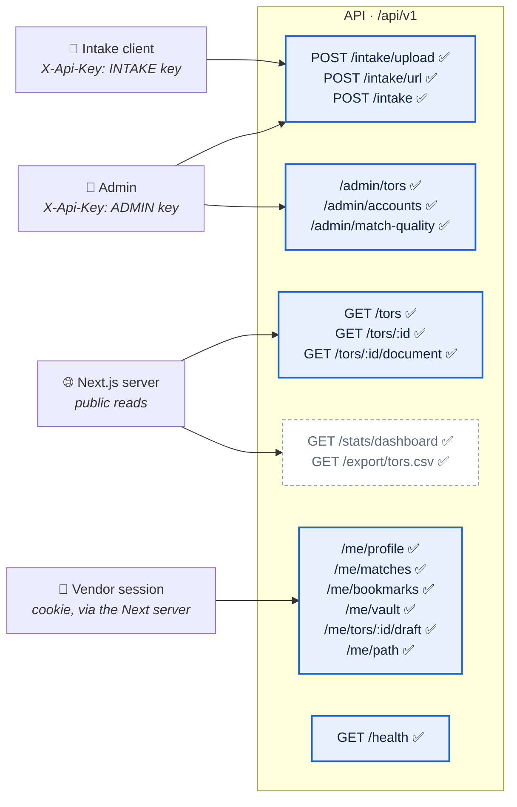
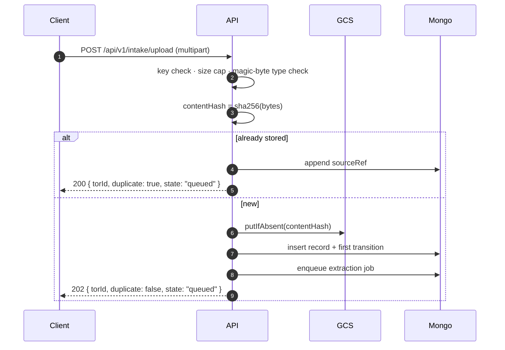

# REST API

The contract between the browser, the intake clients, and the API service.

**Legend:** ✅ built and tested · 🔨 in progress · ⬜ designed, not built (with the slice that
brings it).

Base URL comes from configuration — `NEXT_PUBLIC_API_URL` for the web app, `API_BASE_URL` for
server-side callers. No host is hard-coded anywhere (`NFR-S7`).

All paths are versioned: **`/api/v1`**. A breaking change to a response shape gets `/api/v2`, not a
silent edit — clients include a Next.js server, an admin browser, and whatever a partner agency
scripts against the intake key.

---

## 1. The surface at a glance



| Group | Who calls it | Auth | Slice |
| :--- | :--- | :--- | :--- |
| `/intake/*` | admin console, partner scripts | `X-Api-Key`, per-role | 1 ✅ |
| `/tors/*` | the public site, through the Next server | none (public data); the match-range filter needs a session | 3 ✅ |
| `/stats/*`, `/export/*` | dashboard and CSV export | none; the match-range filter needs a session | dashboard ✅ · export ✅ |
| `/me/*` | a signed-in vendor | session cookie | 4 ✅ |
| `/admin/*` | review queue, all TORs, vendor accounts, match quality | admin key, sent by the Next server after its staff gate | 2–4 ✅ |

---

## 2. Conventions

### Request id and security log

Every response carries `X-Request-Id`, generated per request (an inbound value is ignored). Logins, 401/403 refusals,
429 rate-limit hits and admin actions are written to the API log with that id; see ARCHITECTURE.md, "Logging and
security events". Response bodies are unchanged.

### Authentication

Two separate key lists, because the routes differ in blast radius (`NFR-S1`):

```http
X-Api-Key: <key>
```

Deliberately not `Authorization`: once a Cloud Run service is deployed
`--no-allow-unauthenticated` (the deployed default, §7.5), Cloud Run's own IAM
check reads `Authorization` for a Google-signed identity token before the
request reaches this app — a caller only gets the one header, so the app-level
key needed a header of its own.

| Key | Configured by | Opens |
| :--- | :--- | :--- |
| Admin | `ADMIN_API_KEYS` | `POST /intake/upload`, `POST /intake/url`, every `/admin/*` route |
| Intake | `INTAKE_API_KEYS` | `POST /intake` |

Keys are compared in **constant time**, and every configured key is checked on every request, so
neither the value nor which key matched can be recovered by timing the rejection. An empty key list
opens nothing — a missing configuration fails closed, it does not disable the check.

The browser never holds the admin key. A staff member signs in to the Next server (`requireStaff()`),
and the Next server calls `/admin/*` with the key. Individual staff accounts in place of the shared
staff code are TOR-199, not yet built; the intake key stays either way, because a partner script
has no session.

### Errors

One shape, always:

```json
{ "error": { "code": "bad_request", "message": "Request did not match the expected shape" } }
```

Validation failures add the failing paths, so a caller can fix the request without guessing:

```json
{ "error": { "code": "bad_request", "message": "…",
             "issues": [{ "path": "url", "message": "Invalid url" }] } }
```

| Status | `code` | Means |
| :--- | :--- | :--- |
| 400 | `bad_request` | Malformed request, or a schema failure |
| 401 | `unauthorized` | Missing or wrong key |
| 404 | `not_found` | No such record |
| 413 | `payload_too_large` | Document exceeds `MAX_UPLOAD_BYTES` |
| 429 | — | Rate limit; `RateLimit-*` headers say when to retry |
| 500 | `internal` | Server fault. The message is fixed text; details go to the log, never to the caller |

### Rate limiting

Every `/intake` route is limited to `INTAKE_RATE_LIMIT_PER_MINUTE` requests per minute per client,
reported in the standard `RateLimit-Limit` / `RateLimit-Remaining` / `RateLimit-Reset` headers.

### Security headers and CORS (TOR-317)

Every response carries helmet's defaults (`X-Content-Type-Options: nosniff`, `X-Frame-Options`,
`Cross-Origin-Resource-Policy: same-origin`, HSTS, …) and a CSP of
`default-src 'none'; frame-ancestors 'none'`; `X-Powered-By` is removed. The document routes keep
setting their own `nosniff`, `no-store` and `Content-Disposition`. The in-app PDF viewer is unaffected:
the browser's frame loads the web server's proxy route, which forwards only content type, disposition
and length from the API.

CORS: the browser never calls this API directly (Next calls it server-to-server), so the only allowed
origin is `APP_ORIGIN`, matched exactly. That origin gets `Access-Control-Allow-Origin` echoed with
`Access-Control-Allow-Credentials: true` and `Vary: Origin`. Any other origin gets no `Access-Control-*`
header, and its preflight is answered `204` without them, so the browser blocks the read. `*` is never sent.
Code: `apps/api/src/core/security-headers.ts`.

---

## 3. Intake ✅ (slice 1, `FR-A-1`)

Three routes, one service behind them. Whatever the route, the document is hashed, stored
immutably, deduplicated, and queued for extraction.



**202 means accepted, not processed.** Extraction happens in the worker; poll `GET /tors/:id`
(slice 3) for the outcome.

The stored object lands at `tors/<year>/<month>/<sha256>.<ext>`, with the submitted filename and
the route kept as object metadata. The identity in the key is the content hash, never the name —
that is what makes an overwrite impossible and ties one object to one record.

**200 means it was already here.** A repeat submission is not new work — the response carries the
existing `torId` and the record gains one more `sourceRef` (`FR-A-3`).

### `POST /api/v1/intake/upload` — admin key

`multipart/form-data`, exactly one file part.

```bash
curl -X POST https://api.example/api/v1/intake/upload \
  -H "X-Api-Key: $ADMIN_API_KEY" \
  -F "file=@tor.pdf"
```

```json
{ "torId": "66f0…", "duplicate": false, "state": "queued" }
```

Rejections: no file (400) · more than one file (400) · over `MAX_UPLOAD_BYTES` (413, mid-stream) ·
a content type that the magic bytes contradict (400 — the declared type is attacker-controlled, so
the bytes decide).

### `POST /api/v1/intake/url` — admin key

```json
{ "url": "https://agency.go.th/announcements/2569/tor-041.pdf" }
```

The fetch is defended, because the caller chooses the address (`NFR-S1`, spec §5.6): scheme
allowlist, **every** resolved address checked against private ranges — not just the first — the
check repeated after each redirect, plus size and timeout caps. The stored `sourceRef.url` is the
**final** URL after redirects, which is what a reader needs to verify the document.

### `POST /api/v1/intake` — intake key

The partner route. Same body as `/upload`, a different key list, and `submittedBy: "api"` in the
recorded source ref.

### `GET /health` ✅

`{ "status": "ok", "service": "tor-radar-api" }` — used by CI, the container health check, and the
web app.

---

## 4. Public reads ✅ (slice 3)

Design: [search and filter spec](superpowers/specs/2026-09-16-search-and-filter-design.md).

### `GET /api/v1/tors` ✅

Query: `q`, `agency` (repeatable), `category` (repeatable), `status`, `open=true`, `minBudget`,
`maxBudget`, `deadlineFrom`, `deadlineTo`, `minDaysLeft`, `from`, `to`, `cursor`, `pageSize`. Different parameters
combine with AND; repeated values OR together. `from`/`to` mean **`announcedAt`**, the agency's own
publication date, never ingestion time. `open` means announced with a deadline today or later in
`TIME_ZONE`, or none stated. Dates are `YYYY-MM-DD` and inclusive. `minDaysLeft=N` (integer
0…`SEARCH_MAX_DAYS_LEFT`) keeps TORs whose deadline is at least N days after today in `TIME_ZONE`
(0 = today or later); a TOR with no stated deadline never matches, and with `deadlineFrom` the later
bound wins (TOR-203).

Filter values are parsed as primitives only, so no operator object can reach a Mongo query; anything
malformed is a 400. Every confidence tier is listed. Restricted, unpublished and duplicate records are
not.

The list comes in four segments: verified TORs still taking bids with at least `SEARCH_MIN_PREP_DAYS`
(default 5) days left, then those closing sooner (today included), both closing soonest first; then
every other verified record, then unverified ones, both newest announcement first. Pagination is an
opaque cursor that resumes inside its segment: pass `nextCursor` back as `cursor`.
(`page` from an earlier draft is superseded; see rendering spec §5.1.)

```json
{ "items": [ { "id": "…", "announcedAt": "2026-03-05T00:00:00.000Z", "confidenceLevel": "high",
               "unverified": false, "open": true, "torState": "open",
               "title": { "raw": "…", "verified": true },
               "referenceNo": { "raw": "69079434637", "verified": true },
               "agency": { "raw": "…", "value": "…", "verified": true },
               "category": { "raw": "…", "value": "…", "verified": true },
               "budget": { "raw": "…", "value": 5524000, "verified": true },
               "deadline": { "raw": "", "value": null, "verified": false },
               "torStatus": { "value": "announced", "verified": true },
               "stage": { "code": "D0", "kind": "invitation", "on": "2026-10-30" },
               "verdict": { "kind": "anomaly", "side": "high", "distance": 3.1 } } ],
  "total": 10, "nextCursor": null,
  "coverage": { "lastUpdatedAt": "2026-09-16T09:52:00.000Z" } }
```

`torState` is where the TOR stands — `open`, `awaiting-invitation`, `closed`, `awarded` or `cancelled` —
decided by one rule (`lib/tor-state.ts`) that `state=` and `open=true` filter by too. A **final stage**
the source states (`stage.kind` `awarded` or `cancelled`, read by the stages worker, TOR-205) decides
first; otherwise it follows the extracted `torStatus` and the deadline. `torStatus` itself is still the
extracted value, unchanged (NFR-F7). `stage` is the project's newest published stage, `null` when none is
known (every non-e-GP record, and an e-GP record the worker has not read yet).

Each row carries its own `verdict` — `normal`, `anomaly` (with `side` and `distance`), or
`not-evaluated` with its reason — derived at read from its peer group's bounds rather than stored on
the record (dashboard spec §2.1). A page is fetched first and its distinct cohorts are read in one
further query, so the cost grows with the number of peer groups on the page, not with the number of
rows.

`coverage` is not decoration: `FR-E-6` requires every surface showing figures to state when they were
last updated. Keyword matching (`q`) reads the title and agency through an Atlas Search `lucene.thai` index when
`SEARCH_ATLAS_ENABLED` is on: it matches whole Thai words, best first, up to `SEARCH_MAX_HITS`. With the
switch off (a plain `mongod`) it falls back to a substring match. The request and response do not change.

**Rate limit (TOR-318).** `GET /tors` and `GET /tors/facets` share one allowance of
`PUBLIC_SEARCH_RATE_LIMIT_PER_MIN` (default 120) per client address per minute; past it the answer is
an empty `429` with no rate-limit headers (the same as the sign-in limiter). "Client address" is the
real client only because of the proxy scheme in the 2026-11-20 revision of the accounts-and-sessions spec
(`TRUST_PROXY` on the API, the web server forwarding one `X-Forwarded-For`).

### `GET /api/v1/tors/facets` ✅

The filter options that occur in the published corpus, most frequent first, capped at
`SEARCH_FACET_LIMIT`: `{ agencies: [{value, count}], categories: [{value, count}], budget: {min, max} | null }`.

### `GET /api/v1/tors/:id` ✅

One published record with every extracted field as an object, never a bare value:

```json
{ "budget": { "raw": "๑,๒๐๐,๐๐๐ บาท", "value": 1200000, "confidence": 0.82, "verified": false } }
```

`raw` is what the interface displays, exactly as extracted (`NFR-F7`); `value` is what statistics
compute on. The response also carries `provenance` (model, version, extraction time), `sourceUrl`,
`confidenceLevel`, `unverified` and `contentHash`, because `NFR-F6` requires AI output to be
attributable. A field the source system stated (for example the BMA e-GP project budget) carries
`"origin": "source"`, so it is never presented as AI output. A field read from another document
carries `fromDocument` — a TOR's deadline read from its project's invitation to bid names that
invitation, whose original is available at `GET /api/v1/tors/{fromDocument}/document`. A TOR collected
from BMA e-GP carries `sourceProject` — `{ "system": "bma-egp", "projectNumber": "69099251609", "url":
"https://egp2.bangkok.go.th/project-detail/…" }`, the project's own page on the source site — and `null`
otherwise. `torState` and `stage` are as in the list. `stageHistory` lists the project's published stages,
oldest first, as the source gives them (TOR-205): `[{ "code": "B0", "kind": "draft", "description":
"ร่างเอกสารประกวดราคา(e-Bidding)", "on": "2026-10-21", "recordId": "…" }, …]` — `code` and `description`
exactly as the source wrote them, `on` the Bangkok day, `recordId` our record of that stage's document
when we hold one (its original at `GET /api/v1/tors/{recordId}/document`). Empty when no stage is known.
`stagesCheckedAt` is when the stages were last read from the source (ISO time), `null` before the first read
(TOR-206: the detail page says how fresh its timeline is). When the record was extracted with `EXTRACT_BIDDING_FIELDS_ENABLED` on, `fields` also holds
`evaluationMethod`, `evaluationWeights` and `requiredDocuments` in the same `{raw, value, confidence, verified}`
shape (`value` is the structured list; see the extraction spec §13); they are absent from older records. Invitations
themselves are supporting documents: never listed, counted, or served as a record of their own. Contact data passes through the public
redaction serializer (`FR-B-5`); evidence quotes are not returned. A restricted or unpublished record
is a 404.

### `GET`, `HEAD` `/api/v1/tors/:id/document`

Streams the original — no signed link, no redirect. `HEAD` answers with the same status and headers
and never opens the object. Limited to `DOCUMENT_RATE_LIMIT_PER_MIN` (default 60) per client address per
minute, `HEAD` and `GET` together, on a bucket of its own: past it, an empty `429` (TOR-318). A restricted record answers **`404`**, the same as an unknown id: a
`403` would confirm both that the record exists and that it was taken down (`FR-B-6`).

**Query:** `?disposition=inline` or `?disposition=attachment` (default). Any other value is `400`.

**Headers, every response:**

| Header | Value |
| :--- | :--- |
| `Content-Type` | the verified type from the record |
| `X-Content-Type-Options` | `nosniff` |
| `Content-Disposition` | `inline`, or `attachment; filename*=UTF-8''<encoded name>` |
| `Cache-Control` | `private, no-store` — a takedown must never be served from a cache |
| `Accept-Ranges` | `bytes` |
| `Content-Length` | full size, or the range length |

**Ranges** (`Range` request header):

| Request | Response |
| :--- | :--- |
| none | `200`, whole object |
| `bytes=a-b`, `bytes=a-`, `bytes=-n` | `206`, `Content-Range: bytes a-b/size` |
| more than one range, or malformed | ignored — `200`, whole object (RFC 9110 permits this) |
| start beyond the end | `416`, `Content-Range: bytes */size` |

The web app never calls this route directly — it goes through a Next route handler on the app's own
origin, so the browser needs no CORS configuration (rendering spec §2.1).

---

## 5. Statistics and export

### `GET /api/v1/stats/dashboard` ✅ (slice 3)

Same filters as `GET /api/v1/tors`, minus paging.

```json
{ "totals": { "torCount": 18, "budgetSum": 172150000, "agencyCount": 3, "unverifiedBudgetCount": 1 },
  "flagged": { "count": 1 },
  "trend":   [ { "month": "2026-09", "torCount": 4, "budgetSum": 52000000 } ],
  "byAgency":[ { "agency": "สำนักงานเขตทวีวัฒนา", "torCount": 7, "budgetSum": 61000000 } ],
  "points":  [ { "id": "…", "category": "งานก่อสร้าง-ทาง", "month": "2026-09", "budget": 48000000,
                 "verdict": { "kind": "anomaly", "side": "high", "distance": 47.01 },
                 "confidence": 0.95, "verified": true, "modelVersion": "gemini-3.5-flash-001" } ],
  "bounds":  [ { "category": "งานก่อสร้าง-ทาง", "month": "2026-09", "n": 11,
                 "q1": 1675000, "q3": 2700000, "lowBound": -862500, "highBound": 4237500,
                 "eligible": true } ],
  "rule":    { "method": "IQR", "iqrMultiplier": 1.5, "zScoreLimit": 3,
               "peerMinN": 8, "windowMonths": 12, "cohortTimezone": "Asia/Bangkok" },
  "byState": [ { "state": "open", "torCount": 9, "budgetSum": 153650000 } ],
  "meta":    { "lastIntakeAt": "2026-09-16T21:07:24.665Z", "statsComputedAt": "2026-09-17T03:10:11.000Z",
               "stale": false, "corpusSize": 22 },
  "checklist": null }
```

Every figure on this response derives from the records the route already reads
for `points`, and from nothing else. The totals used to come from the rollup
cache instead, which put two sources on one screen: when the statistics worker
fell behind they disagreed in public — 18 TORs above, 19 below. `tor_rollups`
remains for a future screen that reports aggregates WITHOUT per-record points.

Each breakdown ignores the filter its own control sets and honours the rest, so
the control that set a value still offers the alternatives:

| Breakdown | Ignores | Honours |
| :--- | :--- | :--- |
| `byAgency` | `agency` | everything else |
| `byState` | `state` | everything else |
| `trend` | `month` | everything else |
| `totals`, `points`, `flagged` | — | every filter |

A chosen value that the other filters leave empty stays listed at zero rather
than vanishing. `agency=__unknown__` and `month=__unknown__` select the records
whose value could not be read.

`totals` count every published, unrestricted record with a numeric budget, **verified or not**, with
`unverifiedBudgetCount` alongside: excluding unverified extractions would understate what agencies
spend. `points` and `flagged` use the stricter eligibility rule, so the anomaly rule speaks only for
what passed the deterministic checks.

`flagged.count` is `null`, not `0`, when no cohort on screen reaches `peerMinN` — "not enough
comparable TORs" and "no anomalies found" are different statements.

`rule` travels with every response because `NFR-F5` allows the phrase "statistical anomaly" only
alongside the rule that produced it, and `FR-F-3` requires the methodology page to describe the
active rule rather than a copy of it.

`meta.lastIntakeAt` is the most recent successful intake, which is what `FR-E-6` asks for;
`meta.statsComputedAt` is the last statistics run, and `meta.stale` is true when that run is older
than `STATS_STALE_AFTER_MS` **or has never happened**. `checklist` is reserved for `FR-F-4` in
sprint 4.

### `GET /api/v1/export/tors.csv` ✅ (TOR-69)

The current search as CSV (FR-E-7). Design: [csv-export spec](superpowers/specs/2026-11-23-csv-export-design.md).

- **Query:** exactly `GET /tors`'s, parsed by the same schema, so a malformed filter is `400` and
  `minMatch` / `maxMatch` without a session is `401`. `cursor` and `pageSize` are validated and ignored:
  the file is the whole result, in the list's order.
- **Rows:** at most `EXPORT_MAX_ROWS` (default 5000), read page by page. `X-Export-Total` is the number
  of matching records and `X-Export-Truncated` is `true` when the file holds fewer.
- **Columns (18, Thai headers and Thai labels):** project number, title, agency, category (normalised and
  as written), budget in baht, deadline (ISO and as written), status (the `/search` badge's words, as of
  the export day), announcement date, confidence (สูง / กลาง / ต่ำ), the "unverified extraction" mark, the
  unverified fields by Thai name, the extraction model and time, the TOR page and the original document
  (both on `APP_ORIGIN`), and the source page (the e-GP project, or the source URL). Built from the list
  serializer: nothing a public reader cannot already see. Restricted records are absent.
- **Response:** `text/csv; charset=utf-8` with a byte-order mark, RFC 4180 quoting, `Content-Disposition:
  attachment; filename="tor-radar-YYYY-MM-DD.csv"`, `Cache-Control: no-store`, `nosniff`. A cell starting
  with `=`, `+`, `-`, `@`, tab or CR is prefixed with `'` so no spreadsheet runs it as a formula.
- **Limit:** `EXPORT_RATE_LIMIT_PER_MIN` (default 10) per client.
- **Web:** `/api/export/tors.csv` relays it without buffering and forwards the session for the match filter;
  `/search` links to it as "ดาวน์โหลด CSV" with its own query.

---

## 6. Vendor ✅ (slice 4)

**Session lifetime (TOR-319).** A session ends at the first of: `SESSION_LIFETIME_MS` after sign-in (absolute, default 7 days), or
`SESSION_IDLE_TIMEOUT_MS` without use (default 30 minutes). A rejected session is answered `401` on `/me` and every account route; an idle
one is never revived by later use. Use slides the idle window, written at most every `SESSION_TOUCH_INTERVAL_MS` (default 60 s, capped at half
the idle timeout). The web app, on a `401` for a cookie it holds, drops the cookie through `GET /api/auth/expired` and redirects to
`/login?reason=expired`, which shows "เซสชันหมดอายุ กรุณาเข้าสู่ระบบอีกครั้ง".

| Route | Purpose |
| :--- | :--- |
| `POST /register` · `/verify` · `/login` · `/logout` | Account lifecycle; consent is recorded at registration. `/login` ends the session id the request carried (`x-session-id`) and, while `SESSION_SINGLE_ACTIVE` is on (default), every other session of the account. `/logout` deletes the session row. Through the web route `/api/auth/logout` the reply also carries `Clear-Site-Data: "cache", "cookies", "storage"` and drops the cookie (TOR-319) |
| `POST /password/forgot` · `/password/reset` · `/password/change` | Password recovery and change. `forgot` also serves a Google-only account (verified address, no password yet): the reset link is how such a vendor sets a password, which `DELETE /me` needs  A new password (`POST /register`, `/password/reset`, `/password/change`) is refused with **422** `password_breached` (Thai message รหัสผ่านนี้อยู่ในรายการรหัสผ่านที่รั่วไหลหรือใช้กันทั่วไป กรุณาตั้งรหัสผ่านอื่น) when it is on the bundled common-password list or seen in Have I Been Pwned (TOR-320). Reset checks before it consumes the token, so the link stays usable |
| `GET /auth/google/start` | Sign in with Google (TOR-315). `404` unless `GOOGLE_OAUTH_ENABLED`. Rate-limited. Stores one single-use transaction (state, nonce, PKCE verifier, browser binding; kept as digests where it matters) for `OAUTH_TRANSACTION_TTL_MS`, and answers `{ url, binding }`: `url` is Google's authorization URL (`response_type=code`, scopes `openid email profile`, `code_challenge_method=S256`, `state`, `nonce`, `prompt=select_account`); `binding` is for the web handler to put in an httpOnly cookie. `no-store`. **`/auth` only, not mounted under `/api/v1`** |
| `POST /auth/google/callback` | `{ code, state, binding }`, same-origin only, rate-limited. Consumes the transaction (so a replay or a forged `state` finds nothing), checks `binding` against its digest in constant time, exchanges the code with the stored verifier, and accepts the ID token only when signature, issuer, audience, `azp`, expiry and `nonce` all match **and** Google says `email_verified`. Then: a linked `google.sub` signs in; a **verified** account with the same address is linked only when the same account authenticated both the start and callback of an explicit link from the account screen; otherwise nothing is created and the reply is `{ status: "consent_required", ticket }`. Success is `{ status: "signed_in", sessionId, expiresAt }`. Every failure, a disabled account included, is `401` with the one message `ไม่สามารถเข้าสู่ระบบด้วย Google ได้` |
| `POST /auth/google/complete` | `{ ticket, consent: true, behaviourConsent? }`, same-origin only. Consumes the ticket, records the same consent a password registration records, creates the account (verified, no password, `google.sub`) and answers `{ status: "signed_in", sessionId, expiresAt }`. An existing unverified password account for the address is removed first. `400` without `consent: true`; `401` for an unknown, used or expired ticket |
| `GET /me` · `POST /me/consent/withdraw` | The signed-in account (with `behaviourConsent`, null until given, `behaviourEnabled` and `draftEnabled`); withdrawing consent |
| `POST /me/consent/behaviour` · `POST /me/consent/behaviour/withdraw` | The separate consent to record what the vendor views, saves, dismisses and prepares (TOR-215). Withdrawing deletes every event recorded. Also given at sign-up with the optional `behaviourConsent: true` on `POST /register`, never a condition of registering |
| `POST /me/events` | `{ torId, type: view \| save \| dismiss \| prepare }`, one event, `204`. `403` unless `MATCH_BEHAVIOUR_ENABLED` is on and the vendor consented; `404` for an unknown TOR. A bookmark is recorded as `save` by the server |
| `GET /me/export` · `DELETE /me` | PDPA data export and account deletion, behaviour events and the vault included. The export lists what is kept in the vault (type, name, size, date), not the files; deleting the account deletes the files first and the records after, and answers an error with the account untouched if storage fails, so it can be retried |
| `GET` · `PUT /me/profile` | Categories, budget range, notification preferences (`FR-D-2`) |
| `PUT /me/profile/extras` | Past projects, certifications and personnel, saved on their own so the main form never overwrites them. The body carries the lists whole; `certifications` and `personnel` are each optional and left as stored when absent (`personnel: []` clears it); editing only the staff never states the company's certificates. A person is `{ role, certifications: ["engineer" \| "architect"], other: [] }` — a licence a person holds, never the company's ISO, มอก. or SME — with an `id` once saved and no name, capped by `PROFILE_PERSONNEL_MAX`; a project without an `id` is new and gets one. Saving the section for the first time is what turns `certifications` from *not stated* into a stated answer that may lower a score |
| `GET /me/matches?page=` | This vendor's open TORs, best first, each with its score and Thai reasons |
| `GET /me/matches/scores` | Every current score by TOR id, for marking a page of search results |
| `GET /me/path?target=` | The company path (TOR-224): for one work group or leaf (`400` for an unknown one), what the sampled TORs in that field ask for and whether the vendor holds it: `{ target, sample, requirements: [{ kind: certification\|registration, id, th, asked, holds }], budget, yourLargestProjectThb }`. `holds` is `null` until the vendor states that section. Counted from fields read at `T_LOW` or better, over the newest `PATH_SAMPLE_CAP` usable TORs by announcement date; the median budget uses verified, in-range budgets only; nothing is stored |
| `GET /me/vault` | The vendor's kept files and the limits: `{ documents: [{ id, kind: cv \| certificate \| past_work, certificationId?, filename, contentType, bytes, uploadedAt }], limits: { maxFileBytes, maxFiles } }` (TOR-218). Never another account's; no storage key |
| `POST /me/vault` | Multipart: `kind`, `certificationId` (certificates only, from the certification list) and one `file`. The bytes decide the type (PDF, JPG, PNG; `400` otherwise), `VAULT_MAX_FILE_BYTES` caps the size (`413`), `VAULT_MAX_FILES` the count (`409`, decided before the body is read and exact under concurrent uploads). Stored under a key of its own in the vault bucket, never under the file's name. `201` with the document; `409` too when the account is being deleted, or was while the upload was arriving (the upload keeps nothing). Same-origin only. Through the web (`POST /api/vault`) a request without a session is `401` and one over the size limit `413`, both before the body is read |
| `GET /me/vault/:id/file` | The file, always as an attachment, `nosniff`, `no-store`, ranges supported. Another account's id and a missing one both answer `404` |
| `POST /me/tors/:id/draft` | An AI draft of a cover letter for one TOR (TOR-220): `{ text, modelVersion, generatedAt }`, from the vendor's own profile, the TOR's extracted fields and the **names** of the kept files (never their contents, never the account's name or email). Nothing is stored. `404` unless `DRAFT_ENABLED` is on, and for an unknown, malformed, unpublished or restricted TOR; `409 profile_needed` until the profile names some work; `429` past `DRAFT_RATE_PER_HOUR` per account; `502 draft_failed` when the model fails or is cut off. Same-origin only. Through the web it is `POST /api/tors/:id/draft`, which has its own deadline (`DRAFT_TIMEOUT_MS` plus a few seconds) for the model call |
| `DELETE /me/vault/:id` | Deletes the file, then its record; if storage fails the record stays and the call can be repeated. `404` for one that is not theirs |
| `GET /me/bookmarks` · `GET /me/bookmarks/ids` · `PUT` · `DELETE /me/bookmarks/:torId` | Private list — never public (`FR-D-3`) |

Each route is mounted twice, under `/api/v1` and under `/auth`: the browser reaches its own account
through the Next handler that owns the cookie, which forwards under `/auth`.

**Sign in with Google through the web (TOR-315).** The browser never calls the API for this; the Next handler
`app/api/auth/[...path]` owns the redirects and the cookies:

| Web route | Does |
| :--- | :--- |
| `GET /api/auth/google/start` | Calls the API's start, sets `tor-radar-google-binding` (httpOnly, `SameSite=Lax`, `Secure` outside development, path `/api/auth/google`, 10 minutes) and redirects to Google. Any failure, including the feature being off, redirects to `/login?error=google` |
| `GET /api/auth/google/callback` | The redirect URI registered at Google (`GOOGLE_OAUTH_REDIRECT_URI`, default `APP_ORIGIN` + this path). Without the binding cookie, or with Google's `error`, it never calls the API. Success sets the normal `tor-radar-session` cookie (and drops the staff cookie, as password sign-in does) and redirects to `/dashboard`; a first sign-in sets `tor-radar-google-ticket` and redirects to `/google-consent`; any failure redirects to `/login?error=google` |
| `POST /api/auth/google/complete` | The consent page's submit: `{ consent: true, behaviourConsent? }`; the ticket comes from its cookie. Same-origin only. `{ ok: true }` and the session cookie on success |

`GET /tors` accepts `minMatch` and `maxMatch` (whole percentages, `MATCH_RANGE` in
`@tor-radar/shared`) only from a signed-in caller — without a session the request is refused with
401, never answered with unfiltered results. A TOR is kept when its rounded score (`matchPercent`,
the same rounding every badge uses) lies in the range.

Session cookie, `HttpOnly` + `Secure` + `SameSite=Lax`. A match score is personal data: it never
appears in a public response, which is why the signed-out site shows no MATCH %.

---

## 7. Admin ✅ (slices 2–4)

| Route | Purpose |
| :--- | :--- |
| `GET /admin/overview` · `GET /admin/events` | The overview counts (stored, published, failed, stuck, …) and the recent transitions |
| `GET /admin/queue` | Low-confidence records awaiting review (`FR-G-1`) |
| `GET /admin/tors?q=&status=&kind=&page=` | Every TOR. `status` is `all`, `public`, `restricted`, `unverified`, `processing`, `stuck` or `failed`. **Stuck** is queued or extracting with no change for `ADMIN_STUCK_AFTER_MS` (default: the job lock × 5) — a job that died rather than one still running |
| `GET /admin/tors/ids?q=&status=&kind=` | "Select everything matching": `{ ids, total, chunk }` — up to `ADMIN_SELECT_ALL_MAX` ids behind the current filters, and `chunk`, the size the screen must send them in |
| `POST /admin/tors/bulk` | `{ action, ids, reason? }` with `action` one of `reextract`, `reject`, `restore`; at most `ADMIN_BULK_MAX` ids; `reject` needs a reason. Each TOR goes through the single-TOR path, so each keeps its own history entry. Returns `{ done, failed: [{ id, reason }] }` — one TOR that cannot take the action does not stop the rest |
| `GET /admin/tors/:id` | One record with everything a reviewer needs |
| `GET`, `HEAD` `/admin/tors/:id/document` | Streams the original for staff — same contract as the public route (§4), but **without** the restricted check: a reviewer must be able to see what they rejected |
| `GET /admin/tors/:id/pages/:page` | The stored image of one page of the original (`image/jpeg`, `nosniff`, `no-store`) that a field's boxes are drawn on. `page` is a whole number from 1; `400` otherwise, `404` when no image was stored for it. Present only for records extracted with `OCR_ENABLED`. Each field in `GET /admin/tors/:id` may carry `anchor: { page, boxes: [[x0,y0,x1,y1],…] }`, fractions of the page |
| `PATCH /admin/tors/:id/fields` · `PATCH /admin/tors/:id/fields/:field/verification` | Correct extracted fields, or confirm one — the correction is stored, the original document is not touched |
| `POST /admin/tors/:id/approve` | Clears the unverified mark, admits the record to statistics and matching |
| `POST /admin/tors/:id/reextract` | Queues the stored original for extraction again (a paid Vertex call) |
| `POST /admin/tors/:id/reject` · `/restore` | Takedown and its reversal: restricts access and writes an audit entry (`FR-B-6`) — never deletes |
| `GET /admin/accounts` · `GET /admin/accounts/:id` | Vendor accounts; opening one is itself an audit entry |
| `PUT /admin/accounts/:id/profile` | Staff edit of a vendor profile; the vendor is shown that an admin changed it |
| `POST /admin/accounts/:id/role` · `/disable` · `/enable` | Role change; disabling revokes every session |
| `POST /admin/accounts/:id/verification-email` · `/password-reset` | Resend on the vendor's behalf |
| `POST /admin/accounts/:id/match-email` | Send the vendor their current matches now. Refused for a vendor whose email preset is off or who is not eligible; claims nothing, so the scheduled email still goes |
| `GET /admin/reports/other-terms` | What vendors typed under อื่นๆ (work and certifications), counted — the taxonomy's missing vocabulary |
| `GET /admin/accounts/:id/labels` · `PUT /admin/accounts/:id/labels/:torId` | The labelling worksheet for one vendor (what email would send, and a sample it would not), and one judgement: `relevant`, `not-relevant` or `unsure` |
| `GET /admin/match-quality` | Precision, recall and the unsure rate over every label (matching design §7.8) |

Every route is under `/api/v1`.

Every change to a TOR writes a transition to `tor_events`, and every read or change of a vendor
account writes to `admin_audit`, so who did what and when survives (`FR-E-5`, `NFR-S2`).

---

## 8. Rules that hold across the whole API

1. **Nothing is ever deleted.** A takedown restricts; a correction is additive. The stored original
   is immutable (`FR-A-2`, `NFR-S3`).
2. **Personal data is minimised in one place** — a single serializer — so no route can leak by
   forgetting (`FR-B-5`).
3. **Confidence controls marking, not visibility.** Every readable record is served; a
   low-confidence one is served marked (SRS §4.2.1).
4. **Only "statistical anomaly" and "specification-quality check"** ever appear in a response, about
   a TOR, a budget, or an agency (`NFR-F5`).
5. **Extracted values are served exactly as extracted.** `raw` is never re-worded, re-formatted, or
   silently corrected (`NFR-F7`).
6. **Every host, port, key, and limit comes from configuration.** `localhost` appears in no source
   file (`NFR-S7`).
7. **Who may call what is written down in one place.** [security/access-control-matrix.md](security/access-control-matrix.md)
   lists every route with its caller, its enforcing middleware and how a vendor is kept to its own data;
   `apps/api/src/core/access-control.test.ts` fails when a route and the matrix disagree (`NFR-S1`).


Google callback includes checkMailbox=true with the consent ticket for an external signup. The web sends the browser to the email instructions. /auth/google/complete also requires the proof from the emailed consent link for that ticket.
