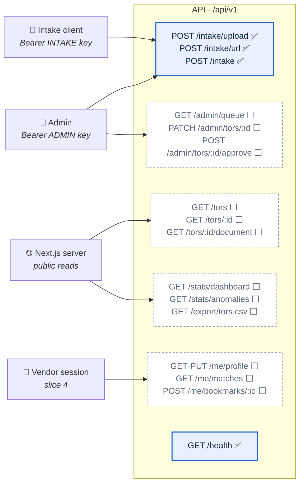
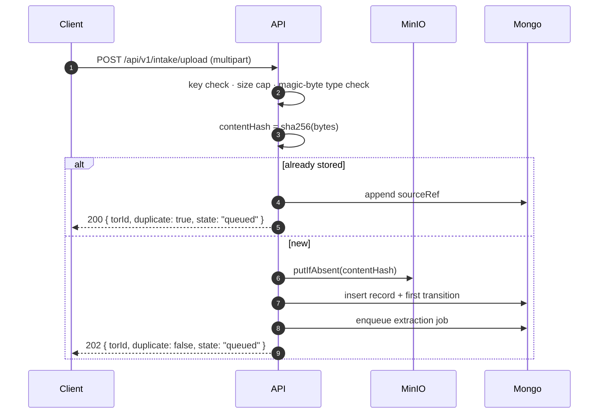

# REST API

The contract between the browser, the intake clients, and the API service.

**Legend:** ✅ built and tested · 🔨 in progress · ⬜ designed, not built (with the slice that
brings it).

Base URL comes from configuration — `NEXT_PUBLIC_API_URL` for the web app, `API_BASE_URL` for
server-side callers. No host is hard-coded anywhere (`NFR-S7`).

All paths are versioned: **`/api/v1`**. A breaking change to a response shape gets `/api/v2`, not a
silent edit — clients include a Next.js server, an admin browser, and whatever a partner agency
scripts against the intake key.

---

## 1. The surface at a glance



| Group | Who calls it | Auth | Slice |
| :--- | :--- | :--- | :--- |
| `/intake/*` | admin console, partner scripts | Bearer key, per-role | 1 ✅ |
| `/tors/*` | the public site, through the Next server | none (public data) | 3 ⬜ |
| `/stats/*`, `/export/*` | dashboard and CSV export | none | 3 ⬜ |
| `/me/*` | a signed-in vendor | session cookie | 4 ⬜ |
| `/admin/*` | review queue | staff session | 2–4 ⬜ |

---

## 2. Conventions

### Authentication

Two separate key lists, because the routes differ in blast radius (`NFR-S1`):

```http
Authorization: Bearer <key>
```

| Key | Configured by | Opens |
| :--- | :--- | :--- |
| Admin | `ADMIN_API_KEYS` | `POST /intake/upload`, `POST /intake/url` |
| Intake | `INTAKE_API_KEYS` | `POST /intake` |

Keys are compared in **constant time**, and every configured key is checked on every request, so
neither the value nor which key matched can be recovered by timing the rejection. An empty key list
opens nothing — a missing configuration fails closed, it does not disable the check.

Slice 4 replaces the admin key with a staff session; the intake key stays, because a partner script
has no session.

### Errors

One shape, always:

```json
{ "error": { "code": "bad_request", "message": "Request did not match the expected shape" } }
```

Validation failures add the failing paths, so a caller can fix the request without guessing:

```json
{ "error": { "code": "bad_request", "message": "…",
             "issues": [{ "path": "url", "message": "Invalid url" }] } }
```

| Status | `code` | Means |
| :--- | :--- | :--- |
| 400 | `bad_request` | Malformed request, or a schema failure |
| 401 | `unauthorized` | Missing or wrong key |
| 404 | `not_found` | No such record |
| 413 | `payload_too_large` | Document exceeds `MAX_UPLOAD_BYTES` |
| 429 | — | Rate limit; `RateLimit-*` headers say when to retry |
| 500 | `internal` | Server fault. The message is fixed text; details go to the log, never to the caller |

### Rate limiting

Every `/intake` route is limited to `INTAKE_RATE_LIMIT_PER_MINUTE` requests per minute per client,
reported in the standard `RateLimit-Limit` / `RateLimit-Remaining` / `RateLimit-Reset` headers.

---

## 3. Intake ✅ (slice 1, `FR-A-1`)

Three routes, one service behind them. Whatever the route, the document is hashed, stored
immutably, deduplicated, and queued for extraction.



**202 means accepted, not processed.** Extraction happens in the worker; poll `GET /tors/:id`
(slice 3) for the outcome.

The stored object lands at `tors/<year>/<month>/<sha256>.<ext>`, with the submitted filename and
the route kept as object metadata. The identity in the key is the content hash, never the name —
that is what makes an overwrite impossible and ties one object to one record.

**200 means it was already here.** A repeat submission is not new work — the response carries the
existing `torId` and the record gains one more `sourceRef` (`FR-A-3`).

### `POST /api/v1/intake/upload` — admin key

`multipart/form-data`, exactly one file part.

```bash
curl -X POST https://api.example/api/v1/intake/upload \
  -H "Authorization: Bearer $ADMIN_API_KEY" \
  -F "file=@tor.pdf"
```

```json
{ "torId": "66f0…", "duplicate": false, "state": "queued" }
```

Rejections: no file (400) · more than one file (400) · over `MAX_UPLOAD_BYTES` (413, mid-stream) ·
a content type that the magic bytes contradict (400 — the declared type is attacker-controlled, so
the bytes decide).

### `POST /api/v1/intake/url` — admin key

```json
{ "url": "https://agency.go.th/announcements/2569/tor-041.pdf" }
```

The fetch is defended, because the caller chooses the address (`NFR-S1`, spec §5.6): scheme
allowlist, **every** resolved address checked against private ranges — not just the first — the
check repeated after each redirect, plus size and timeout caps. The stored `sourceRef.url` is the
**final** URL after redirects, which is what a reader needs to verify the document.

### `POST /api/v1/intake` — intake key

The partner route. Same body as `/upload`, a different key list, and `submittedBy: "api"` in the
recorded source ref.

### `GET /health` ✅

`{ "status": "ok", "service": "tor-radar-api" }` — used by CI, the container health check, and the
web app.

---

## 4. Public reads ⬜ (slice 3)

### `GET /api/v1/tors`

Query: `q`, `agency`, `category`, `status`, `minBudget`, `maxBudget`, `from`, `to`, `page`,
`pageSize`. Filters compose; dates mean **`announcedAt`**, the agency's own publication date, never
ingestion time.

Filter values are parsed as primitives only, so no operator object can reach a Mongo query.

```json
{ "items": [ { "id": "…", "reference": "TOR-2569-0812-041", "title": {…}, "agency": {…},
               "budget": {…}, "deadline": {…}, "confidenceLevel": "high", "unverified": false } ],
  "page": 1, "pageSize": 20, "total": 487,
  "coverage": { "lastUpdated": "2026-08-12T09:42:00+07:00", "note": "ครอบคลุมเฉพาะเอกสารที่นำเข้าระบบ" } }
```

`coverage` is not decoration: `FR-E-6` requires every surface showing figures to state what they
cover and when they were last updated.

### `GET /api/v1/tors/:id`

One record with all nine fields. Every extracted field is an object, never a bare value:

```json
{ "budget": { "raw": "๑,๒๐๐,๐๐๐ บาท", "value": 1200000, "currency": "THB",
              "confidence": 0.82, "verified": false } }
```

`raw` is what the interface displays, exactly as extracted (`NFR-F7`); `value` is what statistics
compute on. The response also carries `provenance` (model, version, extraction time) and
`sourceUrl`, because `NFR-F6` requires AI output to be attributable.

### `GET /api/v1/tors/:id/document`

Redirects to a **freshly signed** MinIO URL, or streams the bytes with
`Content-Disposition: attachment` and `X-Content-Type-Options: nosniff`. Signed URLs are generated
per request and never stored — a persisted one becomes a broken link on an unpredictable date.

---

## 5. Statistics and export ⬜ (slice 3)

| Route | Returns |
| :--- | :--- |
| `GET /api/v1/stats/dashboard` | Totals, per-agency and per-category aggregates, the trend series, and the coverage block |
| `GET /api/v1/stats/anomalies` | Flagged records with their peer group, the IQR bounds, and the multiple |
| `GET /api/v1/export/tors.csv` | The current filter as CSV, with the same PII minimisation as the API |

**Open:** whether these compute live or read a precomputed rollup — see
[OPEN-QUESTIONS.md](OPEN-QUESTIONS.md) Q1/Q2. The route shape is the same either way; only its
freshness guarantee changes, and `coverage.lastUpdated` is where that becomes visible.

Anomaly responses always carry the method and its parameters (`PEER_GROUP_KEY`, `PEER_WINDOW`,
`PEER_MIN_N`, `ANOMALY_METHOD`), because `NFR-F5` allows the phrase "statistical anomaly" only
alongside the rule that produced it.

---

## 6. Vendor ⬜ (slice 4)

| Route | Purpose |
| :--- | :--- |
| `GET` · `PUT /api/v1/me/profile` | Skills, budget range, notification preferences (`FR-D-2`) |
| `GET /api/v1/me/matches` | Scored TORs for this vendor, with the reasons the email shows |
| `POST` · `DELETE /api/v1/me/bookmarks/:torId` | Private list — never public (`FR-D-3`) |
| `GET /api/v1/me/export` · `DELETE /api/v1/me` | PDPA data export and account deletion |

Session cookie, `HttpOnly` + `Secure` + `SameSite=Lax`. A match score is personal data: it never
appears in a public response, which is why the signed-out site shows no MATCH %.

---

## 7. Admin ⬜ (slices 2–4)

| Route | Purpose |
| :--- | :--- |
| `GET /api/v1/admin/queue` | Low-confidence records awaiting review (`FR-G-1`) |
| `PATCH /api/v1/admin/tors/:id` | Correct extracted fields — the correction is stored, the original document is not touched |
| `POST /api/v1/admin/tors/:id/approve` | Clears the unverified mark, admits the record to statistics and matching |
| `POST /api/v1/admin/tors/:id/restrict` | Takedown: restricts access and writes an audit entry (`FR-B-6`) — never deletes |

Every one of these writes a transition to `tor_events`, so who changed what and when survives
(`FR-E-5`).

---

## 8. Rules that hold across the whole API

1. **Nothing is ever deleted.** A takedown restricts; a correction is additive. The stored original
   is immutable (`FR-A-2`, `NFR-S3`).
2. **Personal data is minimised in one place** — a single serializer — so no route can leak by
   forgetting (`FR-B-5`).
3. **Confidence controls marking, not visibility.** Every readable record is served; a
   low-confidence one is served marked (SRS §4.2.1).
4. **Only "statistical anomaly" and "specification-quality check"** ever appear in a response, about
   a TOR, a budget, or an agency (`NFR-F5`).
5. **Extracted values are served exactly as extracted.** `raw` is never re-worded, re-formatted, or
   silently corrected (`NFR-F7`).
6. **Every host, port, key, and limit comes from configuration.** `localhost` appears in no source
   file (`NFR-S7`).
