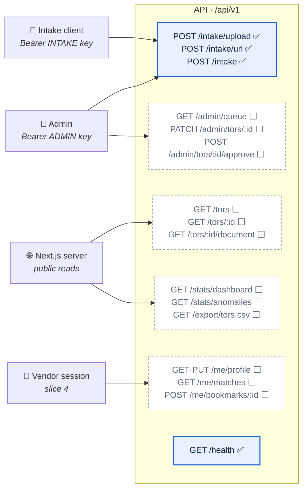
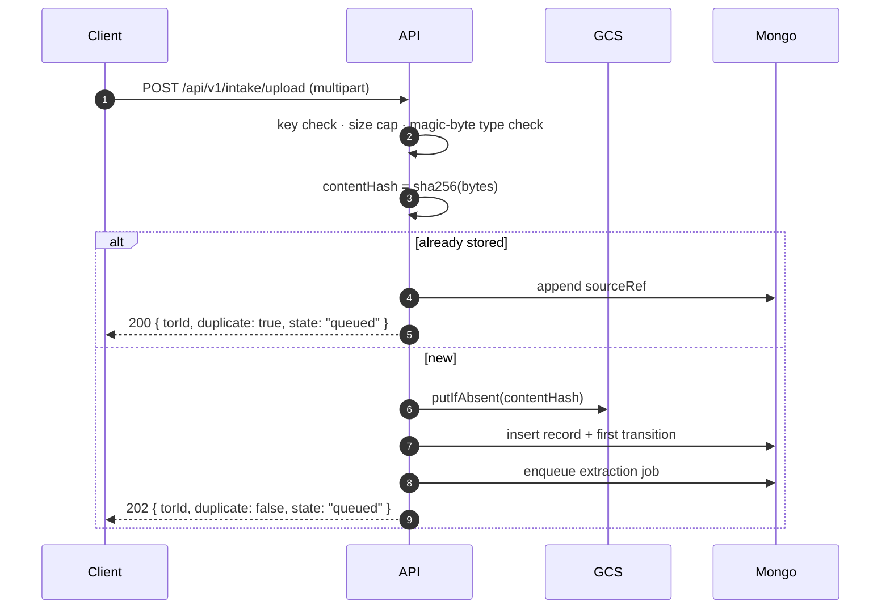

# REST API

The contract between the browser, the intake clients, and the API service.

**Legend:** ✅ built and tested · 🔨 in progress · ⬜ designed, not built (with the slice that
brings it).

Base URL comes from configuration — `NEXT_PUBLIC_API_URL` for the web app, `API_BASE_URL` for
server-side callers. No host is hard-coded anywhere (`NFR-S7`).

All paths are versioned: **`/api/v1`**. A breaking change to a response shape gets `/api/v2`, not a
silent edit — clients include a Next.js server, an admin browser, and whatever a partner agency
scripts against the intake key.

---

## 1. The surface at a glance



| Group | Who calls it | Auth | Slice |
| :--- | :--- | :--- | :--- |
| `/intake/*` | admin console, partner scripts | Bearer key, per-role | 1 ✅ |
| `/tors/*` | the public site, through the Next server | none (public data) | 3 ⬜ |
| `/stats/*`, `/export/*` | dashboard and CSV export | none | 3 ⬜ |
| `/me/*` | a signed-in vendor | session cookie | 4 ⬜ |
| `/admin/*` | review queue | staff session | 2–4 ⬜ |

---

## 2. Conventions

### Authentication

Two separate key lists, because the routes differ in blast radius (`NFR-S1`):

```http
Authorization: Bearer <key>
```

| Key | Configured by | Opens |
| :--- | :--- | :--- |
| Admin | `ADMIN_API_KEYS` | `POST /intake/upload`, `POST /intake/url` |
| Intake | `INTAKE_API_KEYS` | `POST /intake` |

Keys are compared in **constant time**, and every configured key is checked on every request, so
neither the value nor which key matched can be recovered by timing the rejection. An empty key list
opens nothing — a missing configuration fails closed, it does not disable the check.

Slice 4 replaces the admin key with a staff session; the intake key stays, because a partner script
has no session.

### Errors

One shape, always:

```json
{ "error": { "code": "bad_request", "message": "Request did not match the expected shape" } }
```

Validation failures add the failing paths, so a caller can fix the request without guessing:

```json
{ "error": { "code": "bad_request", "message": "…",
             "issues": [{ "path": "url", "message": "Invalid url" }] } }
```

| Status | `code` | Means |
| :--- | :--- | :--- |
| 400 | `bad_request` | Malformed request, or a schema failure |
| 401 | `unauthorized` | Missing or wrong key |
| 404 | `not_found` | No such record |
| 413 | `payload_too_large` | Document exceeds `MAX_UPLOAD_BYTES` |
| 429 | — | Rate limit; `RateLimit-*` headers say when to retry |
| 500 | `internal` | Server fault. The message is fixed text; details go to the log, never to the caller |

### Rate limiting

Every `/intake` route is limited to `INTAKE_RATE_LIMIT_PER_MINUTE` requests per minute per client,
reported in the standard `RateLimit-Limit` / `RateLimit-Remaining` / `RateLimit-Reset` headers.

---

## 3. Intake ✅ (slice 1, `FR-A-1`)

Three routes, one service behind them. Whatever the route, the document is hashed, stored
immutably, deduplicated, and queued for extraction.



**202 means accepted, not processed.** Extraction happens in the worker; poll `GET /tors/:id`
(slice 3) for the outcome.

The stored object lands at `tors/<year>/<month>/<sha256>.<ext>`, with the submitted filename and
the route kept as object metadata. The identity in the key is the content hash, never the name —
that is what makes an overwrite impossible and ties one object to one record.

**200 means it was already here.** A repeat submission is not new work — the response carries the
existing `torId` and the record gains one more `sourceRef` (`FR-A-3`).

### `POST /api/v1/intake/upload` — admin key

`multipart/form-data`, exactly one file part.

```bash
curl -X POST https://api.example/api/v1/intake/upload \
  -H "Authorization: Bearer $ADMIN_API_KEY" \
  -F "file=@tor.pdf"
```

```json
{ "torId": "66f0…", "duplicate": false, "state": "queued" }
```

Rejections: no file (400) · more than one file (400) · over `MAX_UPLOAD_BYTES` (413, mid-stream) ·
a content type that the magic bytes contradict (400 — the declared type is attacker-controlled, so
the bytes decide).

### `POST /api/v1/intake/url` — admin key

```json
{ "url": "https://agency.go.th/announcements/2569/tor-041.pdf" }
```

The fetch is defended, because the caller chooses the address (`NFR-S1`, spec §5.6): scheme
allowlist, **every** resolved address checked against private ranges — not just the first — the
check repeated after each redirect, plus size and timeout caps. The stored `sourceRef.url` is the
**final** URL after redirects, which is what a reader needs to verify the document.

### `POST /api/v1/intake` — intake key

The partner route. Same body as `/upload`, a different key list, and `submittedBy: "api"` in the
recorded source ref.

### `GET /health` ✅

`{ "status": "ok", "service": "tor-radar-api" }` — used by CI, the container health check, and the
web app.

---

## 4. Public reads ✅ (slice 3)

Design: [search and filter spec](superpowers/specs/2026-09-16-search-and-filter-design.md).

### `GET /api/v1/tors` ✅

Query: `q`, `agency` (repeatable), `category` (repeatable), `status`, `open=true`, `minBudget`,
`maxBudget`, `deadlineFrom`, `deadlineTo`, `from`, `to`, `cursor`, `pageSize`. Different parameters
combine with AND; repeated values OR together. `from`/`to` mean **`announcedAt`**, the agency's own
publication date, never ingestion time. `open` means announced with a deadline today or later in
`TIME_ZONE`, or none stated. Dates are `YYYY-MM-DD` and inclusive.

Filter values are parsed as primitives only, so no operator object can reach a Mongo query; anything
malformed is a 400. Every confidence tier is listed. Restricted, unpublished and duplicate records are
not.

Pagination is a cursor over `(announcedAt desc, _id desc)`: pass `nextCursor` back as `cursor`.
(`page` from an earlier draft is superseded; see rendering spec §5.1.)

```json
{ "items": [ { "id": "…", "announcedAt": "2026-03-05T00:00:00.000Z", "confidenceLevel": "high",
               "unverified": false, "open": true,
               "title": { "raw": "…", "verified": true },
               "referenceNo": { "raw": "69079434637", "verified": true },
               "agency": { "raw": "…", "value": "…", "verified": true },
               "category": { "raw": "…", "value": "…", "verified": true },
               "budget": { "raw": "…", "value": 5524000, "verified": true },
               "deadline": { "raw": "", "value": null, "verified": false },
               "torStatus": { "value": "announced", "verified": true },
               "verdict": { "kind": "anomaly", "side": "high", "distance": 3.1 } } ],
  "total": 10, "nextCursor": null,
  "coverage": { "lastUpdatedAt": "2026-09-16T09:52:00.000Z" } }
```

Each row carries its own `verdict` — `normal`, `anomaly` (with `side` and `distance`), or
`not-evaluated` with its reason — derived at read from its peer group's bounds rather than stored on
the record (dashboard spec §2.1). A page is fetched first and its distinct cohorts are read in one
further query, so the cost grows with the number of peer groups on the page, not with the number of
rows.

`coverage` is not decoration: `FR-E-6` requires every surface showing figures to state when they were
last updated. Keyword matching (`q`) is an interim substring match until Atlas Search is available
locally — see [PLAN.md](PLAN.md).

### `GET /api/v1/tors/facets` ✅

The filter options that occur in the published corpus, most frequent first, capped at
`SEARCH_FACET_LIMIT`: `{ agencies: [{value, count}], categories: [{value, count}], budget: {min, max} | null }`.

### `GET /api/v1/tors/:id` ✅

One published record with every extracted field as an object, never a bare value:

```json
{ "budget": { "raw": "๑,๒๐๐,๐๐๐ บาท", "value": 1200000, "confidence": 0.82, "verified": false } }
```

`raw` is what the interface displays, exactly as extracted (`NFR-F7`); `value` is what statistics
compute on. The response also carries `provenance` (model, version, extraction time), `sourceUrl`,
`confidenceLevel`, `unverified` and `contentHash`, because `NFR-F6` requires AI output to be
attributable. A field the source system stated (for example the BMA e-GP project budget) carries
`"origin": "source"`, so it is never presented as AI output. A field read from another document
carries `fromDocument` — a TOR's deadline read from its project's invitation to bid names that
invitation, whose original is available at `GET /api/v1/tors/{fromDocument}/document`. A TOR collected
from BMA e-GP carries `sourceProject` — `{ "system": "bma-egp", "projectNumber": "69099251609", "url":
"https://egp2.bangkok.go.th/project-detail/…" }`, the project's own page on the source site — and `null`
otherwise. Invitations
themselves are supporting documents: never listed, counted, or served as a record of their own. Contact data passes through the public
redaction serializer (`FR-B-5`); evidence quotes are not returned. A restricted or unpublished record
is a 404.

### `GET`, `HEAD` `/api/v1/tors/:id/document`

Streams the original — no signed link, no redirect. `HEAD` answers with the same status and headers
and never opens the object. A restricted record answers **`404`**, the same as an unknown id: a
`403` would confirm both that the record exists and that it was taken down (`FR-B-6`).

**Query:** `?disposition=inline` or `?disposition=attachment` (default). Any other value is `400`.

**Headers, every response:**

| Header | Value |
| :--- | :--- |
| `Content-Type` | the verified type from the record |
| `X-Content-Type-Options` | `nosniff` |
| `Content-Disposition` | `inline`, or `attachment; filename*=UTF-8''<encoded name>` |
| `Cache-Control` | `private, no-store` — a takedown must never be served from a cache |
| `Accept-Ranges` | `bytes` |
| `Content-Length` | full size, or the range length |

**Ranges** (`Range` request header):

| Request | Response |
| :--- | :--- |
| none | `200`, whole object |
| `bytes=a-b`, `bytes=a-`, `bytes=-n` | `206`, `Content-Range: bytes a-b/size` |
| more than one range, or malformed | ignored — `200`, whole object (RFC 9110 permits this) |
| start beyond the end | `416`, `Content-Range: bytes */size` |

The web app never calls this route directly — it goes through a Next route handler on the app's own
origin, so the browser needs no CORS configuration (rendering spec §2.1).

---

## 5. Statistics and export

### `GET /api/v1/stats/dashboard` ✅ (slice 3)

Same filters as `GET /api/v1/tors`, minus paging.

```json
{ "totals": { "torCount": 18, "budgetSum": 172150000, "agencyCount": 3, "unverifiedBudgetCount": 1 },
  "flagged": { "count": 1 },
  "trend":   [ { "month": "2026-09", "torCount": 4, "budgetSum": 52000000 } ],
  "byAgency":[ { "agency": "สำนักงานเขตทวีวัฒนา", "torCount": 7, "budgetSum": 61000000 } ],
  "points":  [ { "id": "…", "category": "งานก่อสร้าง-ทาง", "month": "2026-09", "budget": 48000000,
                 "verdict": { "kind": "anomaly", "side": "high", "distance": 47.01 },
                 "confidence": 0.95, "verified": true, "modelVersion": "gemini-3.5-flash-001" } ],
  "bounds":  [ { "category": "งานก่อสร้าง-ทาง", "month": "2026-09", "n": 11,
                 "q1": 1675000, "q3": 2700000, "lowBound": -862500, "highBound": 4237500,
                 "eligible": true } ],
  "rule":    { "method": "IQR", "iqrMultiplier": 1.5, "zScoreLimit": 3,
               "peerMinN": 8, "windowMonths": 12, "cohortTimezone": "Asia/Bangkok" },
  "byState": [ { "state": "open", "torCount": 9, "budgetSum": 153650000 } ],
  "meta":    { "lastIntakeAt": "2026-09-16T21:07:24.665Z", "statsComputedAt": "2026-09-17T03:10:11.000Z",
               "stale": false, "corpusSize": 22 },
  "checklist": null }
```

Every figure on this response derives from the records the route already reads
for `points`, and from nothing else. The totals used to come from the rollup
cache instead, which put two sources on one screen: when the statistics worker
fell behind they disagreed in public — 18 TORs above, 19 below. `tor_rollups`
remains for a future screen that reports aggregates WITHOUT per-record points.

Each breakdown ignores the filter its own control sets and honours the rest, so
the control that set a value still offers the alternatives:

| Breakdown | Ignores | Honours |
| :--- | :--- | :--- |
| `byAgency` | `agency` | everything else |
| `byState` | `state` | everything else |
| `trend` | `month` | everything else |
| `totals`, `points`, `flagged` | — | every filter |

A chosen value that the other filters leave empty stays listed at zero rather
than vanishing. `agency=__unknown__` and `month=__unknown__` select the records
whose value could not be read.

`totals` count every published, unrestricted record with a numeric budget, **verified or not**, with
`unverifiedBudgetCount` alongside: excluding unverified extractions would understate what agencies
spend. `points` and `flagged` use the stricter eligibility rule, so the anomaly rule speaks only for
what passed the deterministic checks.

`flagged.count` is `null`, not `0`, when no cohort on screen reaches `peerMinN` — "not enough
comparable TORs" and "no anomalies found" are different statements.

`rule` travels with every response because `NFR-F5` allows the phrase "statistical anomaly" only
alongside the rule that produced it, and `FR-F-3` requires the methodology page to describe the
active rule rather than a copy of it.

`meta.lastIntakeAt` is the most recent successful intake, which is what `FR-E-6` asks for;
`meta.statsComputedAt` is the last statistics run, and `meta.stale` is true when that run is older
than `STATS_STALE_AFTER_MS` **or has never happened**. `checklist` is reserved for `FR-F-4` in
sprint 4.

### `GET /api/v1/export/tors.csv` ⬜ (slice 5)

The current filter as CSV, with the same PII minimisation as the API.

---

## 6. Vendor ⬜ (slice 4)

| Route | Purpose |
| :--- | :--- |
| `GET` · `PUT /api/v1/me/profile` | Skills, budget range, notification preferences (`FR-D-2`) |
| `GET /api/v1/me/matches` | Scored TORs for this vendor, with the reasons the email shows |
| `POST` · `DELETE /api/v1/me/bookmarks/:torId` | Private list — never public (`FR-D-3`) |
| `GET /api/v1/me/export` · `DELETE /api/v1/me` | PDPA data export and account deletion |

Session cookie, `HttpOnly` + `Secure` + `SameSite=Lax`. A match score is personal data: it never
appears in a public response, which is why the signed-out site shows no MATCH %.

---

## 7. Admin ⬜ (slices 2–4)

| Route | Purpose |
| :--- | :--- |
| `GET /api/v1/admin/queue` | Low-confidence records awaiting review (`FR-G-1`) |
| `GET`, `HEAD` `/api/v1/admin/tors/:id/document` | Streams the original for staff — same contract as the public route (§4), but **without** the restricted check: a reviewer must be able to see what they rejected |
| `PATCH /api/v1/admin/tors/:id` | Correct extracted fields — the correction is stored, the original document is not touched |
| `POST /api/v1/admin/tors/:id/approve` | Clears the unverified mark, admits the record to statistics and matching |
| `POST /api/v1/admin/tors/:id/restrict` | Takedown: restricts access and writes an audit entry (`FR-B-6`) — never deletes |

Every one of these writes a transition to `tor_events`, so who changed what and when survives
(`FR-E-5`).

---

## 8. Rules that hold across the whole API

1. **Nothing is ever deleted.** A takedown restricts; a correction is additive. The stored original
   is immutable (`FR-A-2`, `NFR-S3`).
2. **Personal data is minimised in one place** — a single serializer — so no route can leak by
   forgetting (`FR-B-5`).
3. **Confidence controls marking, not visibility.** Every readable record is served; a
   low-confidence one is served marked (SRS §4.2.1).
4. **Only "statistical anomaly" and "specification-quality check"** ever appear in a response, about
   a TOR, a budget, or an agency (`NFR-F5`).
5. **Extracted values are served exactly as extracted.** `raw` is never re-worded, re-formatted, or
   silently corrected (`NFR-F7`).
6. **Every host, port, key, and limit comes from configuration.** `localhost` appears in no source
   file (`NFR-S7`).
