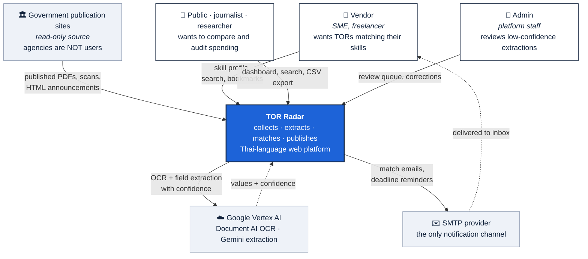
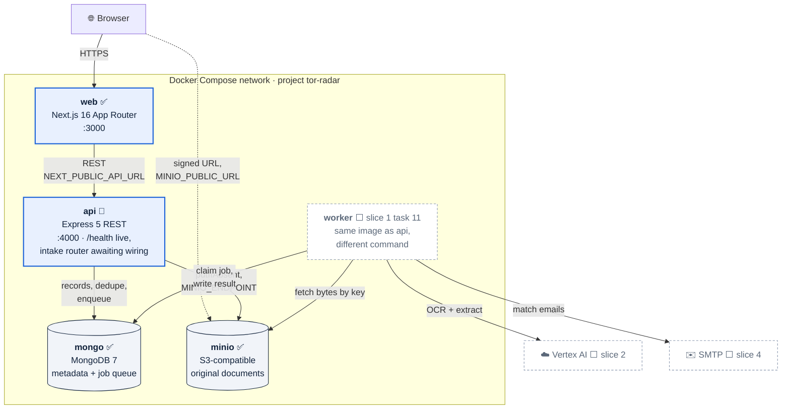
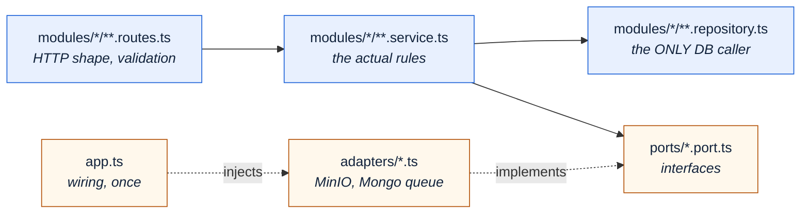
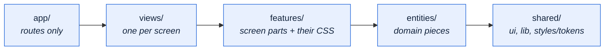
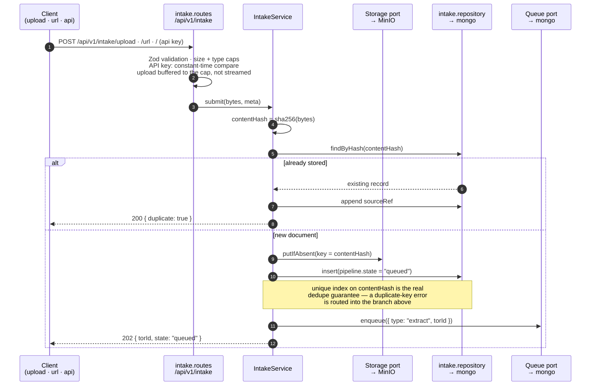
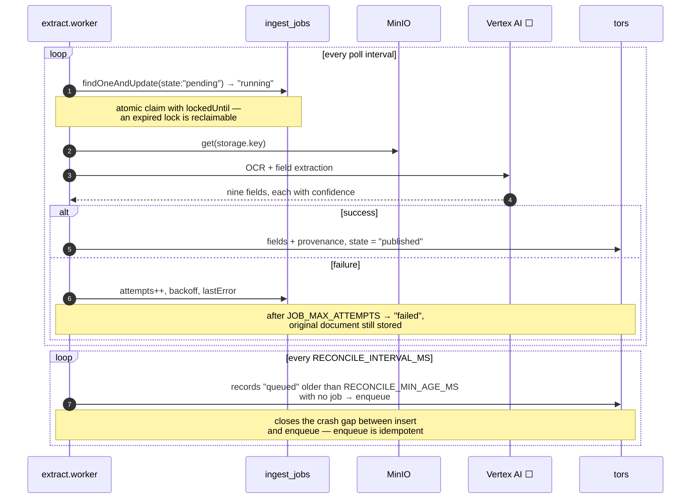
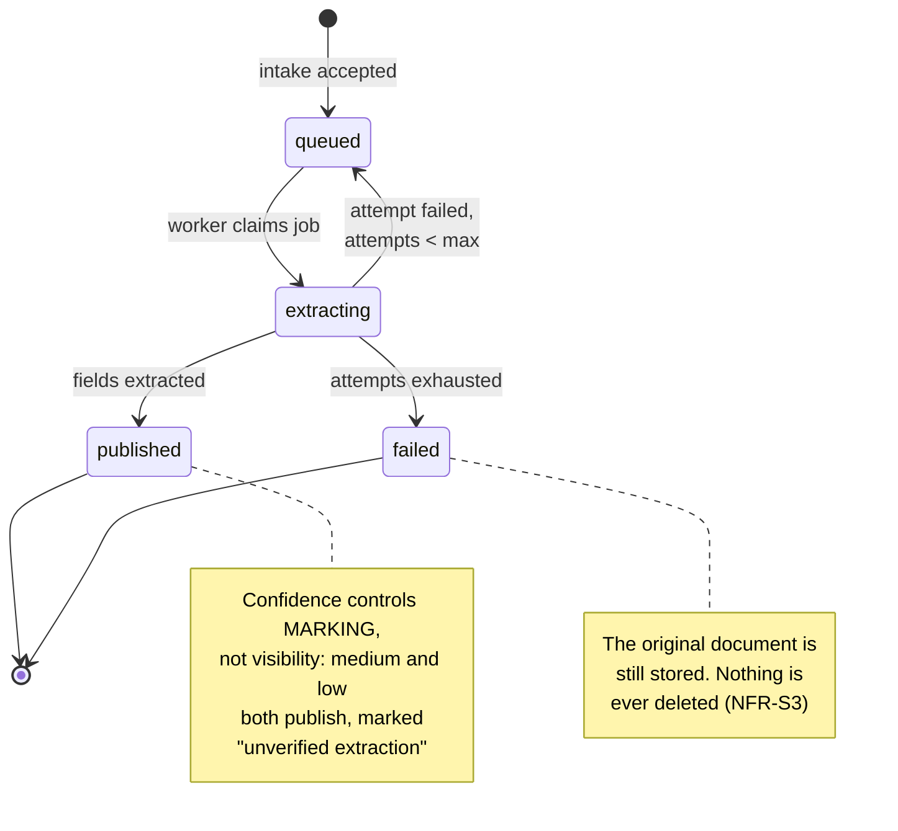
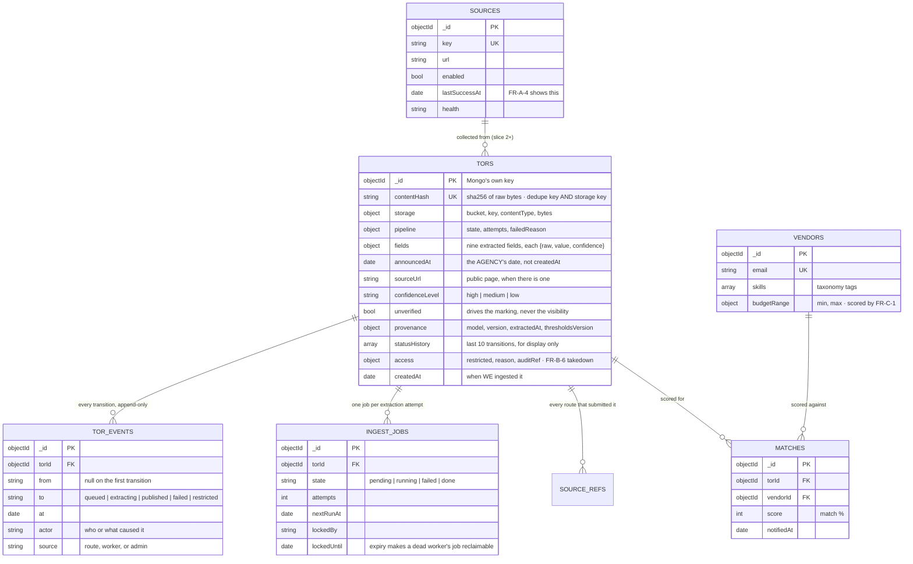
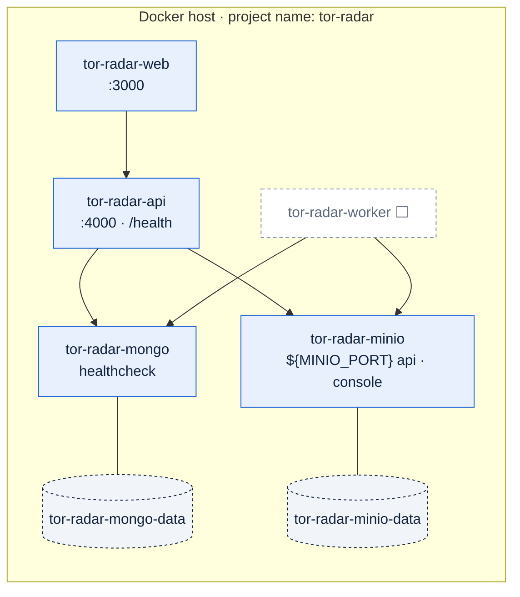

# Architecture

How TOR Radar is put together: what the pieces are, where each kind of code lives, how a document
travels through the system, and which rules must stay true.

This document answers *where* — where does this behaviour live, where does a change belong. It does
not restate *what* the system must do (that is [SRS.md](SRS.md)) or *how* one slice is built (that
is [superpowers/specs/](superpowers/specs/)). It is deliberately short and changes only a few times
a year, per the [ARCHITECTURE.md convention](https://matklad.github.io/2021/02/06/ARCHITECTURE.md.html).

**Legend used throughout:** ✅ built · 🔨 being built now · ⬜ planned, with the slice that brings it.

---

## 1. The problem, in four sentences

Thai government agencies publish procurement Terms of Reference across dozens of websites, as PDFs,
scans, and HTML pages, in no common format. A small vendor cannot practically watch all of them, and
a citizen cannot practically compare prices across them. TOR Radar collects those published
documents, extracts their fields with AI, matches them against vendor skill profiles, emails the
vendors within minutes, and publishes a public dashboard with a documented statistical-anomaly rule.
Everything it publishes is traceable to an unaltered original document.

---

## 2. System context

Who and what the system talks to. (C4 level 1 — [c4model.com](https://c4model.com).)

Two boundaries worth stating out loud, because they are easy to assume wrongly:

- **Agencies are a data source, not users.** There is no agency portal and no agency upload flow
  (SRS §1.3 S8).
- **Email is the only notification channel.** No in-app inbox, no chat webhook, no SMS.

---

## 3. Containers

The runnable pieces and how they talk. (C4 level 2.)

**Why the worker is its own service rather than a thread in the API:** restarting the API must not
kill a job in flight, and a failing extraction should be visible in its own logs. It shares the API
image and differs only by command, so this costs one Compose entry, not a second codebase.

**Why two MinIO addresses:** `MINIO_ENDPOINT` is how the API reaches MinIO *inside* the Compose
network; `MINIO_PUBLIC_URL` is what a browser can resolve. A URL signed with the internal address
reaches nothing from outside, and nothing catches it until a human clicks the link.

---

## 4. Codemap

Where each kind of code lives, and — as importantly — what each folder is not allowed to do.

### Repository root

| Path | Holds | Rule |
| :--- | :--- | :--- |
| `apps/web/` | Next.js frontend | `app/` is routing only; UI code lives in `src/` |
| `apps/api/` | Express API and the worker | Feature modules, ports, adapters |
| `packages/shared/` | Types and Zod schemas both apps import | No runtime dependencies on either app |
| `docs/` | SRS, this file, design specs, plans, benchmark evidence | — |
| `mockups/` | Design-canvas source the UI was ported from | Never built, never linted, never imported |
| `tools/` | Jira seeding, Vertex checks, extraction scoring | Operational scripts, not app code |

### `apps/api/src/`

| Path | Holds | Rule |
| :--- | :--- | :--- |
| `core/config.ts` | Every threshold, host, port, credential, model name | No literal thresholds anywhere else |
| `core/db.ts` | Collection handles and index creation | — |
| `core/errors.ts` | Typed errors and the error middleware | Zod failures become 400, never 500 |
| `lib/` | Pure helpers: `hash`, `file-type` (magic bytes), `safe-fetch` (SSRF) | No I/O beyond what the helper is for |
| `ports/` | `Storage`, `Queue` interfaces | `Storage` exposes `putIfAbsent`, never `put` |
| `adapters/` | MinIO storage, Mongo-backed queue | Imported by `app.ts` only |
| `modules/<feature>/` | One feature, files prefixed with its name | `modules/` imports `ports/`, never `adapters/` |
| `workers/` ⬜ | Extraction worker and the orphan reconciler | Same wiring rules as the API |

### `apps/web/src/`

Imports flow one direction and never upward:

| Path | Holds |
| :--- | :--- |
| `app/(public)/` · `app/(app)/` | One folder per URL; a `page.tsx` composes a view plus route-level boundaries only — `Suspense` on `/login`, `VendorOnly` on `/profile` and `/notifications` |
| `views/` | `DashboardView`, `SearchView`, `TorDetailView`, `VendorProfileView`, `LoginView`, `NotificationsView`, `AdminReviewView` |
| `features/<screen>/` | That screen's components **and** its stylesheet — `dashboard`, `search`, `tor-detail`, `profile`, `notifications`, `admin`, `auth`, `app-shell`, `landing` |
| `shared/ui/` | What genuinely crosses screens: `BudgetRange`, star/bookmark icons, section-title styles |
| `shared/lib/` | Client state: `viewer` (prototype session), `notifications` (read state) |
| `shared/styles/tokens.css` | Every colour, font stack, and rhythm value in the product |
| `data/` | Sample records the screens render until the pipeline fills them |

A feature is one folder, so deleting it is one operation. When a stylesheet needs a `-2` suffix, the
feature it belongs to has not been given its folder yet.

---

## 5. How a document travels

### 5.1 Intake 🔨

Three routes, one service. Nothing is accepted twice, and nothing is ever overwritten.

**The order is fixed:** store bytes → insert record → enqueue. A crash between steps leaves an
orphaned object in storage, never a job pointing at a record that does not exist.

### 5.2 Extraction ⬜ slice 1 task 11 · AI in slice 2

### 5.3 Pipeline state

`pipeline.state` is the system's own progress. It is **not** `fields.torStatus`, which is the
agency's status for the procurement (open, closed, awarded) and is extracted, not computed.

---

## 6. Data model

MongoDB holds metadata and extracted fields. Document bytes never go in a Mongo document — the
record stores a storage key, and whoever needs the bytes fetches them.

Three shapes are load-bearing:

1. **No array inside a record grows without limit.** `statusHistory` keeps the last ten transitions
   for the detail screen and is capped by the write itself (`$push` with `$slice`); every transition
   is also appended to `tor_events`, which is built to grow. A document is what MongoDB reads,
   rewrites and indexes as one unit, so a document that grows makes every read and every write of
   that record more expensive — while a collection that grows costs nothing per read, because an
   index finds the page you asked for. Referencing when embedded data grows without bounds is
   [MongoDB's own rule](https://www.mongodb.com/docs/manual/data-modeling/best-practices/).
2. **Every extracted field is an object, not a bare value** —
   `budget: { raw: "๑,๒๐๐,๐๐๐ บาท", amount: 1200000, confidence: 0.82 }`. `raw` is what the
   interface displays, exactly as extracted; `amount` is what the anomaly rule computes on.
   Statistics never parse display strings, and a formatting change can never alter a displayed
   budget.
3. **`announcedAt` ≠ `createdAt`.** Ingesting a batch of last year's documents today must not look
   like today's procurement activity. Records without `announcedAt` are excluded from trends rather
   than defaulted.
4. **Provenance is recorded at both levels.** Each field carries its own `confidence`; the record
   carries the model, version, extraction time, and the thresholds version that graded it. NFR-F6
   asks that every AI-produced value be attributable, and one extraction run produces every field on
   a record, so the run's identity lives once and the per-field certainty lives on the field.
5. **`contentHash` is both the dedupe key and the storage key.** One value, so a stored object and
   its record can never disagree about identity.

### Indexes

| Index | Exists for |
| :--- | :--- |
| `tors.contentHash` **unique** | Dedupe under concurrency (FR-A-3) — the guarantee, not the optimisation |
| `tors.pipeline.state + createdAt` | Queue and admin views |
| `tors.fields.category.value + announcedAt` | Peer-group selection for the anomaly rule |
| `tors.announcedAt` | Date-range selection and trends (FR-E-1, FR-E-3) |
| `tors.fields.agency.value + announcedAt + fields.torStatus.value` | The combined filters of FR-E-3 |
| `tors.access.restricted` | Keeps restricted records out of public queries |
| `tor_events.torId + at` | The audit read: one TOR's history, newest first |
| `ingest_jobs.state + nextRunAt` | The worker's claim query |

---

## 7. Invariants

Rules that must stay true. Several are stated as absences — the things this system deliberately does
not do — because those are the ones a well-meaning change quietly breaks.

| Invariant | Why | Enforced by |
| :--- | :--- | :--- |
| No in-document array grows without bound | A document is read and rewritten whole; an array with no ceiling makes every operation on that record slower forever | `$push` + `$slice`, with the full trail in `tor_events` |
| Originals are never altered or deleted | FR-A-2, NFR-S3 — a takedown restricts access and writes an audit entry, it does not touch the file | `Storage` port exposes `putIfAbsent`, never `put` |
| No filesystem path is ever shared between services | Separate containers do not share a filesystem; the pointer travels, the bytes do not | Services exchange storage keys only |
| Signed URLs are never persisted | They expire, so a stored one becomes a broken link at an unpredictable date | Generated on demand from the key |
| `localhost` appears in no source file | The literal that is correct in development is exactly what breaks the shipped system | `core/config.ts` + `${VAR:-default}` in Compose |
| Only `*.repository.ts` touches the database | One place to change when the schema moves | Code review; the module layout makes violations obvious |
| `modules/` imports `ports/`, never `adapters/` | Tests can supply fakes; the wiring lives in one file | `app.ts` is the only place adapters are named |
| Confidence controls marking, not visibility | SRS §4.2.1 — every readable record publishes; low confidence is marked and queued for review | The publish path has no confidence gate |
| Only "statistical anomaly" and "specification-quality check" | NFR-F5 — never "suspicious", "corrupt", or "irregular" about a TOR, budget, or agency | Copy review; the wording lives in the views |
| Every AI value carries confidence, model, version, and a source link | NFR-F6 | `provenance` on every record |
| Extracted values are displayed exactly as extracted | NFR-F7 — never re-worded, re-formatted, or silently corrected | `fields.*.raw` is what renders |
| PDPA-**aligned**, never "PDPA-compliant" | NFR-S2 — no certification is claimed | Copy review |
| Scope is national | SRS §1.2 — the old Bangkok-only rule is withdrawn; agency is a plain extracted field | Nothing rejects a record by agency |

---

## 8. Stack

Decided; not substituted without a design change.

| Layer | Choice | Version | Why this one |
| :--- | :--- | :--- | :--- |
| Frontend | Next.js App Router, React | 16 · 19 | Server rendering for public pages, one routing model for public and vendor screens |
| 3D / motion | Three.js | 0.185 | The landing radar scene |
| API | Express, REST | 5 | Small, well-understood surface; no GraphQL need at this size |
| Validation | Zod | 4 | One schema shared by both apps via `packages/shared` |
| Database | MongoDB (Atlas in deployment) | 7 | Extracted fields are irregular and evolve per slice; also serves as the job queue |
| Search | Atlas Search, `lucene.thai` analyzer | ⬜ slice 3 | Thai is written without spaces, so a default text index cannot tokenise it. `mongodb/mongodb-atlas-local` runs the same analyzer in Compose and CI |
| Object storage | MinIO, S3-compatible | 8 (client) | Immutable originals behind a `Storage` port, swappable for S3 |
| AI | Vertex AI — Document AI OCR, Gemini | ⬜ slice 2 | Thai OCR quality; confidence values per field |
| Notifications | SMTP email | ⬜ slice 4 | The only channel in scope |
| Runtime | Node | ≥ 22 | Native `fetch`, `process.loadEnvFile` |
| Tests | Vitest, Supertest | 4 · 7 | Same runner across workspaces |
| Infrastructure | Docker Compose, GitHub Actions CI | — | NFR-S6; lint, test, build, dependency audit on every PR |

**Why Mongo is also the queue (D5):** the alternative is a second infrastructure service for a
workload of a few thousand documents. An atomic `findOneAndUpdate` claim with a lock expiry gives
at-least-once delivery, and the reconciler in §5.2 covers the crash gap. The honest cost is that
this must be re-examined if throughput ever grows past one worker.

---

## 9. Deployment shape

- **Named volumes, not bind mounts,** for application data: records and documents survive
  `docker compose down` and go only on `down -v`.
- **`api` and `worker` wait on `service_healthy`,** not on container start, which removes the race
  where the API opens a connection before Mongo accepts one.
- **Explicit project and container names,** because Compose otherwise derives them from whatever
  directory it ran in, and the logs differ per machine.
- **MinIO host ports are parameterised** — `${MINIO_PORT:-9000}` — because 9000 is commonly taken
  by another project on the same machine. This repository's `.env` maps them to 9010/9011.
- ⬜ The Compose file still has the pre-workspace shape: no `worker` service, no health conditions,
  generic names. That is slice 1 task 15.

---

## 10. Build order

Each slice has its own design spec, plan, and build cycle. Slice 1 is first because every later
slice reads the records it writes.

| Slice | Features | Delivers | State |
| :--- | :--- | :--- | :--- |
| **1** | F1 | Config, ports and adapters, three intake routes, immutable storage, dedupe, job queue, worker, admin upload screen, design tokens | 🔨 |
| 2 | F2, F3 | Vertex AI OCR and field extraction, confidence tiering, review queue | ⬜ |
| 3 | F4, F7, F8, F11 | Search, TOR detail, dashboard, anomaly rule, quality checklist, CSV export | ⬜ |
| 4 | F5, F6, F9, F10 | Auth and vendor profiles, taxonomy, matching, email notification, PDPA and takedown | ⬜ |

Task-level progress lives in [TODO.md](TODO.md) and is not repeated here — this document describes
the shape, not the schedule.

The frontend runs ahead of the backend on purpose: the screens are built and navigable against
sample data in `apps/web/src/data/`, so the interaction could be reviewed before the pipeline that
fills it exists. Every such screen says so on the page, because FR-E-6 forbids implying the numbers
are complete.

### Values that are deliberately not yet chosen

| Value | Waits on |
| :--- | :--- |
| `T_low` / `T_high` confidence thresholds | The accuracy measurement in NFR-F3 — see [corpus/BENCHMARK.md](corpus/BENCHMARK.md) |
| `MIN_BID_WINDOW_DAYS` | Calibration; until then checklist C2 reports "not evaluated" |
| `MIN_SCOPE_CHARS`, `MIN_SCOPE_SECTIONS` | Calibration |
| IQR vs Z-score as the anomaly method | Comparison on real budget data |

They are declared in `core/config.ts` with their open status recorded. Inventing one is a defect,
not a shortcut. The full register, including the design questions that block slices, is
[OPEN-QUESTIONS.md](OPEN-QUESTIONS.md).

---

## 11. Where to look next

| Question | Document |
| :--- | :--- |
| What is still undecided? | [OPEN-QUESTIONS.md](OPEN-QUESTIONS.md) — every open question, what it blocks, what unblocks it |
| Is the data model right? | [superpowers/specs/2026-09-09-data-model-review.md](superpowers/specs/2026-09-09-data-model-review.md) — workload, decisions, what is still open |
| What must the system do? | [SRS.md](SRS.md) — every requirement, testable, with verification method |
| Why does it exist, and for whom? | [PROJECT.md](PROJECT.md) — problem, stakeholders, personas, user stories |
| How is the current slice built? | [superpowers/specs/](superpowers/specs/) — decisions, structure, seams, security |
| What is being built right now? | [TODO.md](TODO.md), and the plan in [superpowers/plans/](superpowers/plans/) |
| How good is the extraction? | [corpus/BENCHMARK.md](corpus/BENCHMARK.md) — measured accuracy, every wrong prediction |
| How do I set up Vertex AI? | [gcp-setup.md](gcp-setup.md) |
| How do I run it? | [../README.md](../README.md) |
