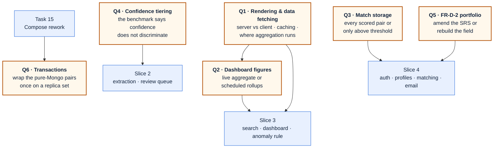

# Open questions

Every decision that is not yet made, in one place — so none of them is discovered late, inside the
slice that depends on it.

**This file holds questions, not tasks.** Work that is decided and scheduled lives in
[TODO.md](TODO.md). When a question here is answered, the answer moves into the spec that records it
and the row moves to §5 below with a link. Nothing is deleted.

_last updated: 2026-09-09_

---

## 1. What blocks what

**Q1 is the one to answer first** — it is the only question with another question downstream of it.

---

## 2. Blocking a slice

### Q1 · What renders on the server, and where is data fetched?

| | |
| :--- | :--- |
| **Blocks** | Slice 3, and Q2 |
| **Why it is open** | Never decided. Every screen currently opens with `"use client"`, which opted the app out of server rendering by accident rather than by choice |
| **What has to be decided** | Where each screen renders (server · client · static) · where data is fetched (server component · route handler · client `fetch`) · what is cached and for how long · where aggregation happens (database · API · browser) · what the API returns (records or figures) |
| **Unblocked by** | A design pass: research current Next 16 guidance, propose, argue, write it down |
| **Raised by** | Zen, 2026-09-09 — correctly, as the question that comes before Q2 |

### Q2 · Do dashboard figures come from a live aggregation or a scheduled rollup?

| | |
| :--- | :--- |
| **Blocks** | Slice 3's dashboard and the anomaly rule |
| **Why it is open** | Live aggregation over the whole corpus is instant at 500 records and unusable at 100,000. The alternative is MongoDB's computed-values pattern: a job writes one rollup document per agency × category × month, including IQR bounds, and the page states its freshness (FR-E-6 requires a last-updated time anyway) |
| **Unblocked by** | Q1 |
| **Recommendation on the table** | Precomputed rollups |

### Q4 · What replaces confidence tiering, given the benchmark?

| | |
| :--- | :--- |
| **Blocks** | Slice 2 |
| **Why it is open** | [corpus/BENCHMARK.md](corpus/BENCHMARK.md) measured model confidence at **0.965 on wrong extractions and 0.971 on correct ones**. Confidence does not separate the two, which is the assumption SRS §4.2.1 and open values O1/O2 (`T_low`, `T_high`) are built on |
| **What has to be decided** | Whether tiering uses something other than raw model confidence — field-level validation rules, cross-field consistency, agreement between two extraction passes — or whether the review queue is driven by sanity checks alone |
| **Also affected** | The teammate branch that gated on the withdrawn BMA check (FR-A4) needs a replacement gate |
| **Unblocked by** | A design pass against the measured numbers, before slice 2 builds on the assumption |

### Q3 · Which vendor–TOR pairs get stored?

| | |
| :--- | :--- |
| **Blocks** | Slice 4 |
| **Why it is open** | Storing every scored pair grows as vendors × TORs — 1,000 vendors against 100,000 TORs is 100 million documents, mostly low scores nobody reads. Storing only pairs at or above the notify threshold keeps the collection proportional to what was emailed, but "why was I not matched?" then needs recomputing |
| **Held** | Zen asked to decide this together, with real numbers, when slice 4 is designed |

### Q5 · FR-D-2 requires past projects and portfolio material; the profile screen no longer has them

| | |
| :--- | :--- |
| **Blocks** | Slice 4, and the SRS's own accuracy today |
| **Why it is open** | The field was removed because it duplicated the starred-TOR list ("I have done work like this"). The SRS still names past projects, certifications, and free-text portfolio material |
| **Two ways out** | Amend FR-D-2 to say the starred list carries track record · or rebuild the field in slice 4 against real profile storage |
| **Note** | Certifications were never built either |

---

## 3. Waiting on data, not on a decision

These are the SRS's own open values (§8, O1–O4). Inventing any of them is a defect, not a shortcut.
Each is declared in `core/config.ts` with its open status recorded.

| Value | Waits on | Behaviour until then |
| :--- | :--- | :--- |
| `T_low` / `T_high` | The accuracy measurement in NFR-F3 — and Q4, which may replace the mechanism entirely | Nothing tiers |
| `MIN_BID_WINDOW_DAYS` | Calibration against real announcement dates | Checklist C2 reports "not evaluated" |
| `MIN_SCOPE_CHARS`, `MIN_SCOPE_SECTIONS` | Calibration against real scope sections | Checklist reports partial |
| `ANOMALY_METHOD` (IQR vs Z-score) | Comparison on real budget data | IQR, documented as provisional |

---

## 4. Known gaps, already agreed — tracked as work, not as questions

Listed here only so the register is complete; each has a home in [TODO.md](TODO.md).

| Gap | Where it lands |
| :--- | :--- |
| The intake router is built and tested but never mounted in `app.ts`, so the running API serves only `/health` | Slice 1, task 12 |
| Compose still has the pre-workspace shape: no worker service, no health gates, generic container names | Slice 1, task 15 |
| Swap `mongo:7` for `mongodb-atlas-local`, so Thai search and transactions exist locally and in CI | Slice 1, task 15 |
| Q6 · Wrap the pure-Mongo write pairs in transactions once that swap makes a replica set available. Ordering stays as the primary defence — a transaction cannot span MinIO, and ordering keeps working when a caller forgets a session | Slice 1, task 15 |
| `putIfAbsent` is check-then-write, not atomic — benign while keys are content-addressed | Carried in TODO |
| Queue enqueue is idempotent only probabilistically without a unique index | Carried in TODO |
| A PDF whose `%PDF` header is not at byte 0 — behaviour to confirm against the real corpus | Carried in TODO |
| Teammate PR #3 `feat/bma-egp-source` — read it against the withdrawn Bangkok-only scope before slice 2 builds on it | Before slice 2 |

---

## 5. Settled — kept for the trail

| Question | Answer | Recorded in |
| :--- | :--- | :--- |
| How does Thai full-text search work, given Thai has no word spaces? | Atlas Search with the `lucene.thai` analyzer; `mongodb-atlas-local` gives the same analyzer in Compose and CI | [data-model review §2.1](superpowers/specs/2026-09-09-data-model-review.md) |
| How is an ever-growing status history stored? | Capped copy of the last 10 on the record for display; every transition appended to `tor_events` | [data-model review §2.4](superpowers/specs/2026-09-09-data-model-review.md) |
| How are records identified and deduplicated? | `contentHash` (SHA-256 of the raw bytes) as both dedupe key and storage key, unique-indexed | [slice 1 design §4.2](superpowers/specs/2026-09-01-tor-radar-foundation-intake-design.md) |
| Bangkok-only or national scope? | National; agency is a plain extracted field, nothing is rejected for being outside Bangkok | SRS v2.0 §1.2 |
| Is the frontend allowed to run ahead of the pipeline? | Yes, against clearly-labelled sample data — FR-E-6 forbids implying the numbers are complete | [ARCHITECTURE §10](ARCHITECTURE.md) |
