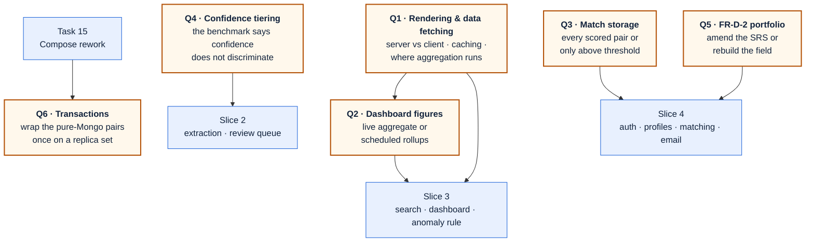

# Plan

What this project is building next, what has been decided, and what is still undecided — written for
the team to read.

**This is not the task list.** [TODO.md](TODO.md) tracks the build box by box and is where live
status lives. This document explains the direction.

_last updated: 2026-09-14_

---

## 1. Where the project is

Slice 1 (foundation and intake) and slice 2 (extraction and confidence) are built and serving. The
staff review area is complete end to end: a real queue, the stored document beside the extracted
fields, per-field confirmation, and the three decisions a reviewer can make — each behind a
confirmation, each written to an audit trail.

Slice 3 — the public surface: search, the dashboard, the anomaly rule — is the next body of work. It
was waiting on the rendering decision, which is now made.

---

## 2. Decided, not yet started

### Pointing at the document

**Decided 2026-09-11.** The review screen should mark where in the source document each value was
read, as the interface design draws it: a box on the page, labelled with the field and its
confidence.

This is more than a screen change, and the reason is worth stating plainly. **The pipeline does not
call Document AI at all.** The stack table names it for Thai OCR, but the extractor posts the
document straight to Gemini and asks for structured JSON, so no coordinates are produced. The only
provenance stored today is `evidence`, a short quote the model cites for each value. There are no
positions being discarded — there are none.

Delivering it means:

| Step | Why it is not optional |
| :--- | :--- |
| A design spec, written first | It changes the extraction pipeline and the record schema |
| An OCR pass that returns token positions | Nothing in the pipeline produces coordinates today |
| Page images to draw on, and somewhere to keep them | Originals are immutable; these are new derived artifacts |
| An `anchor` per field, and a schema-version bump | Otherwise "no anchor" and "written before anchors existed" cannot be told apart |
| Reprocessing the corpus, and re-measuring | A second model in the path changes the accuracy the thresholds came from |

**The trade-off the spec has to settle.** Documents with a real text layer could be pointed at for
free, from the PDF's own text positions — no OCR call, no new storage. But the accuracy benchmark
found the failures were numeric mis-reads on **scans**, which have no text layer. The cheap route
serves the documents that were already easy; the expensive route serves the ones that actually need
a reviewer's eyes.

---

## 3. Open questions

Decisions not yet made, in one place, so none of them is discovered late inside the slice that
depends on it. When one is answered, the answer moves into the spec that records it and the row
moves to the settled table at the end. Nothing is deleted.

### What blocks what

**Q1 and Q2 are answered** and recorded in the settled table at the end of this section. Slice 3 is unblocked.

### The questions

#### Q4 · What replaces confidence tiering, given the benchmark?

| | |
| :--- | :--- |
| **Blocks** | Slice 2 |
| **Why it is open** | [corpus/BENCHMARK.md](corpus/BENCHMARK.md) measured model confidence at **0.965 on wrong extractions and 0.971 on correct ones**. Confidence does not separate the two, which is the assumption SRS §4.2.1 and open values O1/O2 (`T_low`, `T_high`) are built on |
| **What has to be decided** | Whether tiering uses something other than raw model confidence — field-level validation rules, cross-field consistency, agreement between two extraction passes — or whether the review queue is driven by sanity checks alone |
| **Also affected** | The teammate branch that gated on the withdrawn BMA check (FR-A4) needs a replacement gate |
| **Unblocked by** | A design pass against the measured numbers, before slice 2 builds on the assumption |

#### Q3 · Which vendor–TOR pairs get stored?

| | |
| :--- | :--- |
| **Blocks** | Slice 4 |
| **Why it is open** | Storing every scored pair grows as vendors × TORs — 1,000 vendors against 100,000 TORs is 100 million documents, mostly low scores nobody reads. Storing only pairs at or above the notify threshold keeps the collection proportional to what was emailed, but "why was I not matched?" then needs recomputing |
| **Held** | Zen asked to decide this together, with real numbers, when slice 4 is designed |

#### Q5 · FR-D-2 requires past projects and portfolio material; the profile screen no longer has them

| | |
| :--- | :--- |
| **Blocks** | Slice 4, and the SRS's own accuracy today |
| **Why it is open** | The field was removed because it duplicated the starred-TOR list ("I have done work like this"). The SRS still names past projects, certifications, and free-text portfolio material |
| **Two ways out** | Amend FR-D-2 to say the starred list carries track record · or rebuild the field in slice 4 against real profile storage |
| **Note** | Certifications were never built either |

### Waiting on data, not on a decision

These are the SRS's own open values (§8, O1–O4). Inventing any of them is a defect, not a shortcut.
Each is declared in `core/config.ts` with its open status recorded.

| Value | Waits on | Behaviour until then |
| :--- | :--- | :--- |
| `T_low` / `T_high` | The accuracy measurement in NFR-F3 — and Q4, which may replace the mechanism entirely | Nothing tiers |
| `MIN_BID_WINDOW_DAYS` | Calibration against real announcement dates | Checklist C2 reports "not evaluated" |
| `MIN_SCOPE_CHARS`, `MIN_SCOPE_SECTIONS` | Calibration against real scope sections | Checklist reports partial |
| `ANOMALY_METHOD` (IQR vs Z-score) | Comparison on real budget data | IQR, documented as provisional |

### Known gaps, already agreed

Listed here only so the register is complete; each has a home in [TODO.md](TODO.md), which tracks the build itself.

| Gap | Where it lands |
| :--- | :--- |
| The intake router is built and tested but never mounted in `app.ts`, so the running API serves only `/health` | Slice 1, task 12 |
| Compose still has the pre-workspace shape: no worker service, no health gates, generic container names | Slice 1, task 15 |
| Swap `mongo:7` for `mongodb-atlas-local`, so Thai search and transactions exist locally and in CI | Slice 1, task 15 |
| Until that swap, search keywords (`q`) use an escaped, unindexed substring match instead of Atlas Search with `lucene.thai`. Correct for Thai and inside NFR-F2 at 5,000 records; its cost grows with the corpus. The repository clause becomes a `$search` stage after the swap, with no API change | TOR-40 · [search spec §5](superpowers/specs/2026-09-16-search-and-filter-design.md) |
| Q6 · Wrap the pure-Mongo write pairs in transactions once that swap makes a replica set available. Ordering stays as the primary defence — a transaction cannot span MinIO, and ordering keeps working when a caller forgets a session | Slice 1, task 15 |
| `putIfAbsent` is check-then-write, not atomic — benign while keys are content-addressed | Carried in TODO |
| Queue enqueue is idempotent only probabilistically without a unique index | Carried in TODO |
| A PDF whose `%PDF` header is not at byte 0 — behaviour to confirm against the real corpus | Carried in TODO |
| Teammate PR #3 `feat/bma-egp-source` — read it against the withdrawn Bangkok-only scope before slice 2 builds on it | Before slice 2 |

### Settled — kept for the trail

Every decision that shapes the build, with who made it and when, so a decision is never
re-litigated and nobody has to guess whether something was chosen or merely happened.

| Question | Answer | Decided | Recorded in |
| :--- | :--- | :--- | :--- |
| Where are original documents stored (Q7)? | **Google Cloud Storage**, replacing MinIO — whose community edition went source-only and whose image vanished from Docker Hub. Same Google Cloud project as Vertex AI, but a **separate** service account. `fake-gcs-server` for daily development and CI, plus a real-bucket test where credentials exist | Zen, 2026-09-14 | [object storage spec](superpowers/specs/2026-09-14-object-storage-gcs-design.md) |
| How hard is "originals are never deleted" enforced? | **Least-privilege permissions plus an unlocked retention policy.** The app's account can create and read, never delete; versioning off; no auto-delete rules. A project Owner could still delete deliberately — a **locked** policy would stop that but can never be undone and keeps the bucket billing for the whole retention period, so it waits for a real agency deployment | Zen, 2026-09-14 | object storage spec §3 |
| How do documents reach the browser? | **Streamed through the API**, which checks takedown status on every request and adds `nosniff`. Replaces signed links, which Google cannot attach `nosniff` to and which keep working after a takedown until they expire | Zen, 2026-09-14 | object storage spec §5 |
| Where do dashboard figures come from (Q2)? | **Scheduled summaries.** A background job writes one summary per agency × category × month, including the IQR bounds the anomaly rule needs; the page reads those and shows its last-updated time, which FR-E-6 requires anyway. Live aggregation over the whole corpus is instant at 500 records and unusable at 100,000 | Zen, 2026-09-14 | Slice 3 design — next |
| The admin actions spent the admin key with no caller check. Fix now or in slice 4? | **Fix now, as its own change**, not folded into a larger refactor. Server-side staff session, checked first inside every action. A shared-secret stopgap until slice 4's real accounts | Zen, 2026-09-10 | Jira TOR-129 |
| What does the review screen's document panel show? | **The real stored file**, through a signed URL. The mockup's highlight boxes and zoom controls are not ported: there are no coordinates to draw, and the browser's own viewer already zooms and pages | Zen, 2026-09-11 | [validation port plan](superpowers/plans/2026-09-11-admin-validation-port.md) |
| How much of the new mockup does the review screen take? | **Only the queue page body.** The app-shell navigation stays as built | Zen, 2026-09-11 | Jira TOR-130 |
| Where does the queue collapse control live? | **On the seam between the columns**, one control in both states, and the collapsed rail carries **no count** — the page header already states it | Zen, 2026-09-10 | commits `859d0ec`, `9c2a7a4` |
| Which actions ask for confirmation? | **Reject** (reason required), **publish** (when fields are unconfirmed), **re-extract**. Confirm-all, the field tick, sign-out and mark-all-read do not | Zen, 2026-09-11 | commit `27e7e49` |
| Which error screens does the whole app need? | **All four surfaces on every route that needs them** — loading, error, not-found, and a root-failure page — not only the admin area | Zen, 2026-09-11 | commit `8643672` |
| When are loading, empty, error and confirm states designed? | **In the mockup, alongside each screen's normal state** — not built afterwards without a design | Zen, 2026-09-14 | build skill, Gate 8 |
| How is planning written down? | **`PLAN.md` for the team to read**, with open questions as one section inside it; **`TODO.md` tracks agent work** | Zen, 2026-09-11 | this file |
| Does work stay local or go to the shared branch? | **Pushed to `origin/main`** once gates are green, so the team has it | Zen, 2026-09-14 | — |
| How does the app render, and who talks to the API? | The Next server is the only caller; screens render on the server with client leaves; a `server-only` data access layer; figures computed in the database; Cache Components, narrowly, invalidated by tag | Zen, 2026-09-10 | [rendering and data fetching](superpowers/specs/2026-09-10-rendering-data-fetching-design.md) |
| Can the review screen box where the AI read a value, as the mockup draws? | Not from what is stored: `evidence` is a text quote and the pipeline never calls Document AI, so no coordinates exist. Decided to build it properly — capture and store them per field, with page images | Zen, 2026-09-11 | Jira TOR-128 |
| Is confirming a field the same operation as correcting it? | No. Corrections are replayed to the extractor as few-shot examples, so confirming an already-correct value through that path would teach it from a non-event. Separate route, `verified` only | Zen, 2026-09-11 | Jira TOR-130 |
| How does Thai full-text search work, given Thai has no word spaces? | Atlas Search with the `lucene.thai` analyzer; `mongodb-atlas-local` gives the same analyzer in Compose and CI | [data-model review §2.1](superpowers/specs/2026-09-09-data-model-review.md) |
| How is an ever-growing status history stored? | Capped copy of the last 10 on the record for display; every transition appended to `tor_events` | [data-model review §2.4](superpowers/specs/2026-09-09-data-model-review.md) |
| How are records identified and deduplicated? | `contentHash` (SHA-256 of the raw bytes) as both dedupe key and storage key, unique-indexed | [slice 1 design §4.2](superpowers/specs/2026-09-01-tor-radar-foundation-intake-design.md) |
| Bangkok-only or national scope? | National; agency is a plain extracted field, nothing is rejected for being outside Bangkok | SRS v2.0 §1.2 |
| Is the frontend allowed to run ahead of the pipeline? | Yes, against clearly-labelled sample data — FR-E-6 forbids implying the numbers are complete | [ARCHITECTURE §10](ARCHITECTURE.md) |
