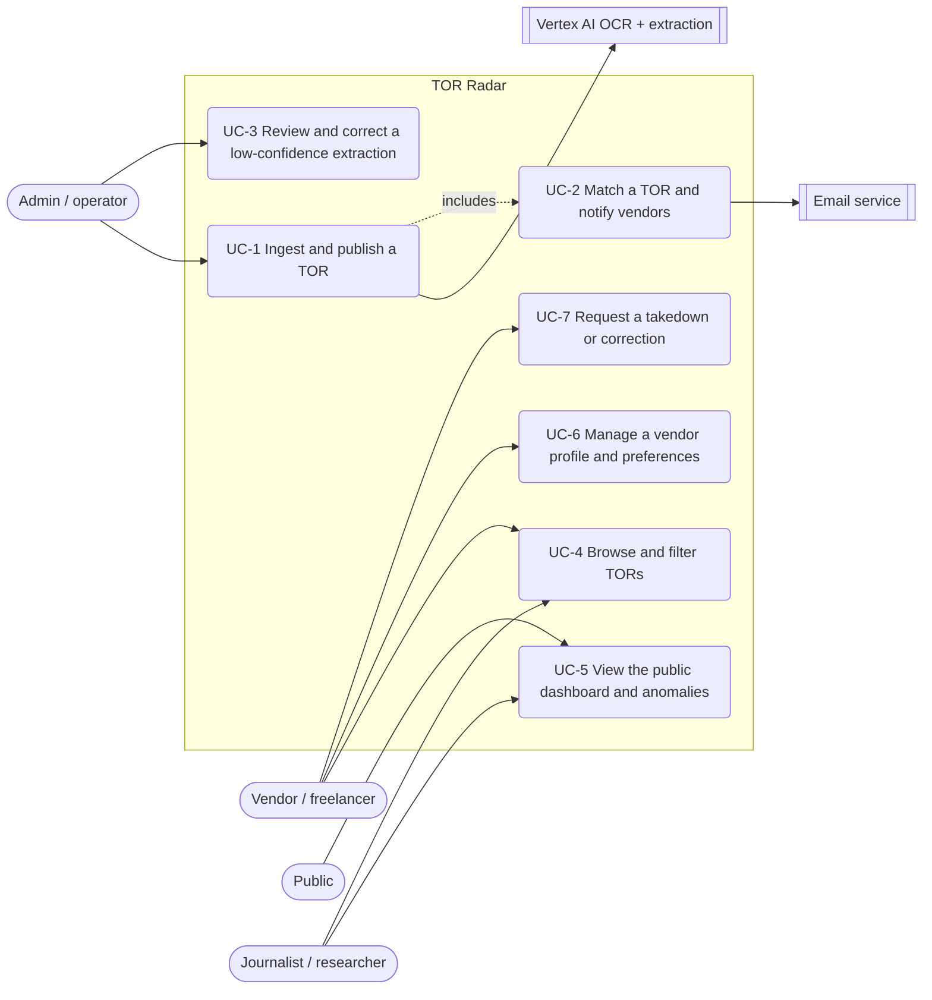

# Software Requirements Specification — TOR Radar

## 1. Introduction

### 1.1 Purpose

This document specifies the software requirements for **TOR Radar**, Phase 1: a centralized,
Thai-language web platform that ingests publicly announced procurement TORs from sources across
Thailand, extracts and normalizes them with AI, matches them to vendor skill profiles, sends email
notifications, and publishes a public transparency dashboard with pricing-anomaly visualization.
It defines what the system shall do for the delivery team and project sponsor.

### 1.2 In Scope / Out of Scope

**Product name:** TOR Radar.

**In scope:**

- Ingestion of publicly announced TORs by file upload, URL, authenticated API, and configured
  source adapters.
- PDF, JPG, and PNG input from public procurement sources across Thailand, including but not
  limited to the initial sources in Appendix D.
- Thai/English OCR, structured field extraction, per-field confidence, and qualification
  normalization into a shared skill taxonomy.
- Vendor profiles, matching, explained email notifications, and user-controlled preferences.
- A public dashboard with search, filters, per-agency statistics, historical records, pricing
  plots, and a documented statistical-anomaly rule.
- A rule-based specification-quality checklist and an admin review path for the least reliable
  extractions.

**Out of scope:**

- Agency accounts, a draft-TOR portal, or an agency-facing submission workflow; agencies are data
  sources, not platform users.
- Drafting, preparing, or submitting bids and proposals.
- Legal advice, corruption judgments, payments, contract management, or award analysis beyond a
  coarse status label.
- Native mobile applications and a non-Thai user interface in Phase 1.

**Benefit:** vendors and the public receive searchable, structured access to TORs from public
announcements without requiring cooperation, accounts, or system integration from issuing
agencies.

### 1.3 Intended Audience and Reading Suggestions

| Reader | Read first | Then |
|---|---|---|
| Developer (backend / frontend / AI) | §4 Requirements, especially §4.2.1, §4.5.1, and §4.6.1 | §3 interfaces and Appendix B end-to-end use cases |
| Tester / QA | §5 Verification | §4 requirement details and Appendix B alternative flows |
| Sponsor / product owner | §1 Introduction and §2 Product Overview | §7 risks and open issues |
| New team member | §1.2 In Scope / Out of Scope and §2.5 Operational Concept | Appendix A, then §4 |

### 1.4 User Characteristics

| Class | Characteristics | Access |
|---|---|---|
| Vendor / freelance professional | Builds a skill profile; consumes matches and search; technical literacy varies | Authenticated vendor |
| Public user | Occasional dashboard reader; no training assumed | Anonymous |
| Journalist / researcher / watchdog | Power user of filters, anomaly data, and optional CSV export | Anonymous |
| Admin / platform operator | Monitors ingestion, corrects extractions, and manages the taxonomy | Authenticated admin |
| Procurement officer | Not a platform user; published documents are system input, while public views remain available anonymously | Anonymous only |

### 1.5 Limitations

- Phase-1 pilot scale is hundreds of TORs and tens of concurrent users; no uptime guarantee or
  horizontal-scaling claim is made (NFR-9).
- No extraction-accuracy figure is promised before the Sprint-1 benchmark measures it (NFR-1).
- Corpus completeness is not claimed; dashboard figures reflect only the ingested corpus (FR-E1b).
- The system is described as **PDPA-aligned**, never “PDPA-compliant”; no legal certification is
  claimed (NFR-5).
- Outputs are never accusations; only “statistical anomaly” and “specification-quality check” are
  permitted labels (FR-E2, FR-F2a, NFR-10).

### 1.6 Assumptions and Dependencies

| # | Assumption / dependency | If it fails |
|---|---|---|
| A1 | The public TOR sources in Appendix D remain accessible in a form permitted for retrieval | Use manual URL or file ingestion for the affected source |
| A2 | The Sprint-1 benchmark shows extraction accuracy sufficient to continue | Re-plan extraction scope and confidence handling before further delivery |
| A4 | Vertex AI pricing and service availability remain within the approved pilot budget | Reduce benchmark re-runs and cap AI usage |

### 1.7 Acronyms

TOR · OCR · PDPA · PII · MVP · MoSCoW · IQR · SRS · DoD · RTM.

### 1.8 Document Conventions

- Requirement IDs use `FR-<group><n>` for functional requirements, `NFR-<n>` for nonfunctional
  requirements, and `US-<n>` for user stories.
- A suffix sub-ID such as `FR-A2a` identifies one independently verifiable part of a parent
  requirement; the parent ID means all its sub-IDs collectively.
- Requirement attributes use these values:

  | Attribute | Values |
  |---|---|
  | Priority | Must / Should / Could / Won't |
  | Source | User story, business rule, legislation, or another section of this SRS |
  | Verification | **T** test · **D** demonstration · **I** inspection · **A** analysis |
  | Sprint | Sprint in which the requirement is delivered |

- **MVP** means required for Phase 1. **Stretch** means not committed in Phase 1.
- Normative requirements use “The system shall…” and contain one testable statement.

### 1.9 References

1. ISO/IEC/IEEE 29148:2018 — Requirements engineering.
2. IEEE 830-1998 — Recommended practice for software requirements specifications.
3. Public Procurement and Supplies Management Act B.E. 2560 (Thailand).
4. Personal Data Protection Act B.E. 2562 (Thailand).

---

## 2. Product Overview

### 2.1 Product Perspective

TOR Radar is a new standalone system, not an extension of an existing agency product and not an
integration with agency internal systems. It consumes public announcement pages and documents
through the retrieval methods listed in Appendix D. Vertex AI provides OCR and extraction, while
the continued public availability of each source remains an external dependency.

### 2.2 Product Functions

1. Ingest TOR documents from every supported route into one pipeline, store raw files immutably,
   and resolve duplicates.
2. OCR and extract structured fields with per-field confidence under a two-threshold publish policy.
3. Normalize extracted qualifications into the shared skill taxonomy.
4. Score TORs against vendor profiles and email matching vendors with a stated reason.
5. Serve a public no-login dashboard with per-agency statistics, pricing plots, composable filters,
   and a permanent historical archive.
6. Produce a rule-based, explainable specification-quality checklist per TOR.
7. Provide review and correction tools for very-low-confidence records and taxonomy management.

### 2.3 Operating Environment

| Element | Choice | Note |
|---|---|---|
| Frontend | Next.js | Responsive web for desktop and mobile browsers |
| API | Node.js + Express | REST/JSON |
| Database | MongoDB Atlas | Metadata and extracted fields only |
| Object storage | MinIO (S3-compatible) | Raw documents; never embedded in MongoDB documents |
| AI | Vertex AI Document AI and Gemini | OCR, extraction, and checklist assistance |
| Email | Nodemailer (SMTP) or Resend | Email only |
| Deployment | Docker Compose; demo on one small VM or Cloud Run | Deployment target selected in Sprint 1 |

### 2.4 User Classes → Feature Access

| Feature | Anonymous | Vendor | Admin |
|---|---|---|---|
| Public dashboard, pricing plots, filters | ✔ | ✔ | ✔ |
| Shared TOR detail page | ✔ | ✔ | ✔ |
| Profile, matching, email notifications | — | ✔ | — |
| Bookmarks / personal archive (Could) | — | ✔ | — |
| CSV export (Could) | ✔ | ✔ | ✔ |
| Ingestion, review queue, taxonomy | — | — | ✔ |

### 2.5 Operational Concept

A public announcement enters the shared ingestion pipeline → the raw file is stored immutably in
MinIO → duplicates are resolved → OCR and field extraction record per-field confidence → the
confidence tier selects the publish path (clean / tagged / tagged and queued) → the record appears
on the shared detail page and dashboard → verified fields feed the anomaly rule and matching
engine → matched vendors receive an explained email.

### 2.6 User Documentation

All delivered user documentation is in Thai (NFR-7).

| Document | Audience | Content |
|---|---|---|
| Dashboard methodology page | Public, journalists | Active anomaly rule, coverage note, and limits of the “statistical anomaly” label |
| Extraction and confidence note | TOR readers | Meaning of the “unverified extraction” tag and correction route |
| Vendor onboarding help | Vendors | Profile creation, matching, scores, and notification preferences |
| Admin runbook | Operators | Ingestion routes, source adapters, review queue, taxonomy, and benchmark re-runs |
| PDPA and takedown notice | All users | Consent, export, deletion, and correction/takedown requests |
| README and Docker Compose guide | Delivery team | Local execution, tests, and environment variables |

Inline help accompanies every matching-related form field, and every error message states what the
user can do next.

---

## 3. External Interface Requirements

### 3.1 User Interfaces

All UI is in Thai (NFR-7); extracted values are displayed as-is.

| Screen | Content | Requirements |
|---|---|---|
| Public dashboard | Per-agency TOR count and budget, date range, pricing plots, filters, last-updated timestamp, and coverage note | FR-E1, FR-E2, FR-E3 |
| Shared TOR detail | Structured fields, original-document link, checklist results and reasons, status history, provenance, and unverified tag | FR-E4, FR-B3, FR-F2 |
| Search / browse | Composable filters for agency, category, budget, deadline, and status | FR-E3, US-04 |
| Vendor profile | Skill tags, certifications, past projects, budget range, consent, and notification preferences | FR-D2, FR-D3, FR-C3 |
| Admin review queue | Original document beside extracted fields, per-field confidence, edit, and approve | FR-G1, US-14 |
| Match notification email | TOR summary, matched qualifications, budget fit, days remaining, and detail-page link | FR-C2, US-03 |

### 3.2 Hardware Interfaces

None. Clients require only standard browser-capable hardware.

### 3.3 Software Interfaces

| Interface | Direction | Purpose | Requirement |
|---|---|---|---|
| Vertex AI Document AI | Outbound | Thai/English OCR of scans and photographs | FR-B1 |
| Vertex AI Gemini | Outbound | Field extraction, normalization, and checklist assistance | FR-B2, FR-B4, FR-F1 |
| MongoDB Atlas | Internal | Metadata, extracted fields, profiles, matches, and search | §4.8 |
| MinIO | Internal | Immutable raw-document storage | FR-A2 |
| SMTP / Resend | Outbound | Match-notification delivery | FR-C2 |
| OAuth provider | Outbound | Alternative vendor sign-in | FR-D1 |
| Ingestion REST endpoint | Inbound, authenticated, rate-limited | Programmatic TOR submission and source-adapter entry point | FR-A1, NFR-8 |
| Public TOR sources | Inbound | Announcement discovery and original documents | FR-A-S1, Appendix D |

### 3.4 Communications Interfaces

Every deployed environment uses HTTPS (NFR-8). The frontend and API communicate through REST/JSON;
email is delivered through SMTP or the selected email service.

---

## 4. Requirements

Each functional requirement is independently verifiable and traces to a user story, business rule,
or another requirement in this SRS.

### 4.0 System Features at a Glance

| # | Feature | Priority | Functional requirements | User stories |
|---|---|---|---|---|
| F1 | TOR ingestion and immutable storage | Must | FR-A1, FR-A2a, FR-A2b, FR-A3 | US-13 |
| F2 | Thai reading and normalization | Must | FR-B1, FR-B2, FR-B4 | US-05, US-13 |
| F3 | Confidence and review | Must | FR-B3, FR-G1, FR-G2 | US-14 |
| F4 | Search, browse, and shared detail | Must | FR-E3, FR-E4 | US-04, US-05, US-10 |
| F5 | Matching and notification | Must | FR-C1, FR-C2, FR-C3 | US-02, US-03 |
| F6 | Profiles and authentication | Must | FR-D1, FR-D2, FR-D3 | US-01 |
| F7 | Public transparency dashboard | Must | FR-E1a, FR-E1b, FR-E1c, FR-E2, FR-E5 | US-08, US-09, US-10 |
| F8 | Specification-quality checklist | Should | FR-F1, FR-F2a, FR-F2b, FR-F3 | US-06, US-11 |
| F9 | Admin review and taxonomy tooling | Must, minimal | FR-G1, FR-G2, FR-G3 | US-14, US-15 |
| F10 | PII and takedown handling | Must | FR-B5a, FR-B5b | NFR-5 |
| F11 | Bookmarks and personal archive | Could | FR-D4a, FR-D4b | US-07 |
| F12 | CSV export | Could | FR-E6 | US-12 |
| F13 | Automated source ingestion | Stretch | FR-A-S1 | US-16 |

### 4.1 FR-A — TOR Ingestion

| ID | Requirement | Priority | Source | Verify | Sprint |
|---|---|---|---|---|---|
| **FR-A1** | The system shall accept TOR input by PDF/JPG/PNG upload, submitted URL, and authenticated REST ingestion endpoint; every route shall feed the same processing pipeline. | Must | US-13 | T, D | 2 |
| **FR-A2a** | The system shall store every original document in MinIO and shall never delete or overwrite a stored object. | Must | NFR-2 | T, I | 2 |
| **FR-A2b** | The system shall store document bytes only in object storage; MongoDB shall contain metadata and a storage reference, never document bytes. | Must | NFR-2 | I, T | 2 |
| **FR-A3** | The system shall resolve duplicate submissions of the same TOR from any route to one record. | Must | US-13 | T | 2 |
| **FR-A-S1** | The system may poll configured public TOR sources through one adapter per source and shall expose the last successful fetch and health state for each enabled adapter. | Stretch | US-16, Appendix D | D | — |

### 4.2 FR-B — Extraction and Normalization

| ID | Requirement | Priority | Source | Verify | Sprint |
|---|---|---|---|---|---|
| **FR-B1** | The system shall perform Thai/English OCR on scanned and photographed documents using a Thai-capable OCR model. | Must | US-05, NFR-1 | T, A | 1–2 |
| **FR-B2** | The system shall extract title, issuing agency, budget, category, scope summary, required qualifications, submission deadline, contact, and coarse status. | Must | US-05 | T | 2 |
| **FR-B3** | The system shall record confidence per extracted field and apply §4.2.1. | Must | US-14 | T, D | 2 |
| **FR-B4** | The system shall normalize extracted qualifications into the shared vendor-profile skill taxonomy. | Must | FR-G3 | T | 2 |
| **FR-B5a** | The system shall minimize personal data in displayed extractions while keeping the original document reachable through its source link. | Must | NFR-5 | I, T | 2 |
| **FR-B5b** | The system shall provide a correction/takedown request workflow; accepted takedowns restrict access and create an audit entry without changing or deleting the original. | Must | NFR-2, NFR-5 | D, I | 4 |

#### 4.2.1 Two-Threshold Confidence Publish Policy

Every successfully extracted record is published; no record is silently withheld because of
confidence alone.

| Tier | Condition | Behaviour |
|---|---|---|
| High | All critical fields ≥ `T_high` | Publish clean; fields may feed the dashboard, anomaly rule, and matching |
| Medium | `T_low` ≤ confidence < `T_high` | Publish with “unverified extraction”; exclude below-threshold fields from anomaly statistics and matching until verified; do not queue |
| Very low / failed sanity check | Confidence < `T_low`, or a critical field is missing/implausible | Apply the unverified tag and add the record to the admin review queue |

`T_low` and `T_high` shall be derived from the Sprint-1 benchmark on 10–20 real TORs (NFR-1).

### 4.3 FR-C — Matching and Notification

| ID | Requirement | Priority | Source | Verify | Sprint |
|---|---|---|---|---|---|
| **FR-C1** | The system shall score each published TOR against vendor profiles on qualification tags, category interests, and budget range using a configurable threshold. | Must | US-02 | T | 4 |
| **FR-C2** | The system shall email matched vendors with at least the top three matched skill tags and budget-range fit within five minutes of publication in the demo environment. | Must | US-02, US-03 | T, D | 4 |
| **FR-C3** | The system shall let vendors configure immediate/daily delivery, minimum score, category filters, and budget filters. | Must | US-03 | T | 4 |

### 4.4 FR-D — Profiles and Authentication

| ID | Requirement | Priority | Source | Verify | Sprint |
|---|---|---|---|---|---|
| **FR-D1** | The system shall support email/password and OAuth registration/login with vendor, admin, and anonymous-public roles. | Must | US-01 | T | 4 |
| **FR-D2** | The system shall provide skill-profile CRUD for taxonomy tags, certifications, past projects, budget range, and free-text portfolio. | Must | US-01 | T | 4 |
| **FR-D3** | The system shall record explicit PDPA consent at signup and provide data export and account deletion. | Must | NFR-5 | T, I | 4 |
| **FR-D4a** | The system may let a vendor bookmark a TOR and view a private bookmark list. | Could | US-07 | T | 5 |
| **FR-D4b** | The system may let a vendor privately mark a bookmarked TOR as pursuing, won, or completed; marks shall never be public or presented as verified awards. | Could | US-07 | T | 5 |

### 4.5 FR-E — Public Dashboard and Visualization

| ID | Requirement | Priority | Source | Verify | Sprint |
|---|---|---|---|---|---|
| **FR-E1a** | The system shall provide a login-free dashboard showing TOR count and total budget per issuing agency over a selectable date range. | Must | US-08 | D, T | 3 |
| **FR-E1b** | The dashboard shall display the latest successful ingestion time and state that figures reflect the ingested corpus, not every procurement announcement. | Must | US-08, BR-6 | I | 3 |
| **FR-E1c** | The dashboard shall display TOR-count and total-budget trends for the active filter selection. | Must | US-10 | T, D | 3 |
| **FR-E2** | The system shall plot budgets by category and label outliers produced by §4.5.1 as “statistical anomaly”. | Must | US-09, NFR-10 | T, A | 3 |
| **FR-E3** | The system shall provide composable agency, category, date, budget, and status filters and keep closed/awarded TORs browsable as historical records. | Must | US-04, US-10 | T | 3 |
| **FR-E4** | The system shall provide one shared TOR detail page showing structured fields, original-document link, checklist result, status history, and extraction timestamp/model provenance. | Must | US-05, US-11 | D, I | 2 |
| **FR-E5** | The system shall record each status transition with timestamp, source, and actor from admin action or re-ingestion. | Must | US-07 | T | 3 |
| **FR-E6** | The system may export the active filtered result as a PII-minimized CSV containing extracted fields and source links. | Could | US-12 | T | 5 |

#### 4.5.1 Anomaly Rule

Exactly one documented method is active per deployment.

| Parameter | Default | Meaning |
|---|---|---|
| `PEER_GROUP_KEY` | category + time window | Compare budgets only inside one peer group |
| `PEER_WINDOW` | rolling 12 months | Time component of the peer group |
| `PEER_MIN_N` | 8 | Smaller groups remain unflagged |
| `ANOMALY_METHOD` | `IQR` | Flag values outside Q1 − 1.5·IQR and Q3 + 1.5·IQR; documented alternative is `ZSCORE` with absolute z-score > 3 |

Below-threshold fields are excluded from peer-group statistics so an extraction error cannot create
or shift a flag.

### 4.6 FR-F — Specification-Quality Checklist

This feature evaluates specification completeness and plausibility; it does not judge legality,
vendor-locking, or corruption.

| ID | Requirement | Priority | Source | Verify | Sprint |
|---|---|---|---|---|---|
| **FR-F1** | The system shall compute a score from the five checks in §4.6.1, with an independent pass/fail reason for each evaluated check. | Should | US-06, US-11 | T, A | 4 |
| **FR-F2a** | The system shall display the score and every reason with the label “AI-generated specification-quality check — not a legal or corruption judgment”. | Should | NFR-6, NFR-10 | I | 4 |
| **FR-F2b** | Every displayed checklist result shall link to a methodology page describing the checks and active anomaly rule. | Should | US-11 | I | 4 |
| **FR-F3** | The system shall surface failed checklist results in the dashboard anomaly view. | Should | US-11 | D | 4 |

#### 4.6.1 Five Checks

| # | Check | Passes when | Parameter |
|---|---|---|---|
| F1.1 | Budget present | A budget was extracted at or above the confidence threshold | — |
| F1.2 | Deadline plausible | A deadline exists at least `MIN_BID_WINDOW_DAYS` after announcement | Calibrate from the corpus; open issue §7.2 item 3 |
| F1.3 | Scope specific | Scope meets configured length and section-count heuristics | `MIN_SCOPE_CHARS`, `MIN_SCOPE_SECTIONS` |
| F1.4 | Qualifications stated | At least one qualification is extracted and normalized | — |
| F1.5 | Budget within peer norm | Budget is unflagged or the peer group is below `PEER_MIN_N` | Reuses §4.5.1 |

Until `MIN_BID_WINDOW_DAYS` is calibrated, F1.2 reports “not evaluated”.

### 4.7 FR-G — Admin

| ID | Requirement | Priority | Source | Verify | Sprint |
|---|---|---|---|---|---|
| **FR-G1** | The system shall provide a queue containing only very-low-confidence or failed-sanity records, show the original beside extracted fields, and allow correction/approval that clears the unverified tag. | Must | US-14 | T, D | 2 |
| **FR-G2** | The system shall store admin corrections for reuse as extractor examples. | Must | US-14 | T | 2–4 |
| **FR-G3** | The system shall seed the skill taxonomy and categories from JSON configuration; an editing UI is Stretch. | Must / Could | US-15 | I, T | 1 |

### 4.8 Data Requirements

| Entity | Key content |
|---|---|
| TOR record | Extracted fields, status history, confidence/tier, provenance, source URL, object key, duplicate link |
| Raw document | Immutable MinIO object referenced by the TOR record |
| Vendor profile | Account, skills, experience, budget range, preferences, consent, and optional private archive |
| Match record | Vendor–TOR pair, score, matched tags, budget fit, and notification timestamp |
| Taxonomy | JSON-seeded skill tags and categories |
| Correction record | Original and corrected values retained as extractor examples |
| Source state | Adapter URL, enabled state, last attempt/success, health, and latest error |

### 4.9 Other Nonfunctional Requirements

#### 4.9.1 Performance

| ID | Requirement | Verify |
|---|---|---|
| **NFR-3** | Public pages shall load in under three seconds on mobile and search/filter shall return in under two seconds against the seeded demo corpus. | T |
| **NFR-9** | Phase 1 is sized for hundreds of TORs and tens of concurrent users; it makes no uptime or horizontal-scaling claim. | A |

#### 4.9.2 Safety of Published Claims

| ID | Requirement | Verify |
|---|---|---|
| **NFR-1** | Field-level Thai OCR/extraction accuracy shall be measured on 10–20 real TORs in Sprint 1, and both confidence thresholds shall be derived from that measurement. | A |
| **NFR-6** | AI-derived content shall be labelled AI-generated; checklist results shall give exact reasons, and extracted fields shall include confidence and a source link. | I |
| **NFR-10** | User-facing text shall use only “statistical anomaly” and “specification-quality check”, never “suspicious”, “corrupt”, or another accusation. | I |

#### 4.9.3 Security

| ID | Requirement | Verify |
|---|---|---|
| **NFR-8** | Passwords shall use bcrypt/argon2; deployments shall use HTTPS; admin/API routes shall enforce roles; ingestion shall be rate-limited; CI shall audit dependencies. | T, I |
| **NFR-2** | Original documents shall remain immutable and source-linked; takedowns shall restrict access with an audit entry rather than alter or delete the original. | T, I |

#### 4.9.4 Software Quality Attributes

| Attribute | ID | Requirement | Verify |
|---|---|---|---|
| Usability / localization | **NFR-7** | The UI shall be in Thai and extracted values displayed as-is. | I |
| Maintainability / portability | **NFR-4** | The system shall run under Docker Compose; CI shall test every pull request; secrets shall remain in untracked environment files. | I, D |
| Reliability | **NFR-4a** | Failed ingestion/extraction shall retain the raw document and record a stated failure; it shall not silently drop or partially publish it. | T, D |
| Compliance | **NFR-5** | Data handling shall be PDPA-aligned through consent, minimization, export, deletion, and takedown handling without claiming certification. | I |

#### 4.9.5 Business Rules

| ID | Rule |
|---|---|
| **BR-2** | Agencies are data sources, not users; no agency accounts, draft-TOR portal, or agency-facing submission flow is provided. |
| **BR-3** | Every successfully extracted record publishes; confidence controls tagging and review, not visibility. |
| **BR-4** | Below-threshold fields never feed statistics or matching until verified. |
| **BR-5** | Raw documents remain immutable; takedown restricts access and creates an audit entry. |
| **BR-6** | The dashboard always shows last-updated time and a corpus-coverage note. |
| **BR-7** | Vendor pursuing/won/completed marks remain private and are never presented as verified awards. |
| **BR-8** | Decision thresholds come from measurement or named configuration, never inline literals. |

### 4.10 AI-Specific Requirements

| ID | Requirement | Verify |
|---|---|---|
| **AI-1** | Every AI-produced field shall carry machine-readable confidence, model/version, and timestamp. | I, T |
| **AI-2** | Below-threshold AI fields shall be excluded from anomaly statistics and matching until verified. | T |
| **AI-3** | Checklist scores shall decompose into named rule-based reasons; no opaque score is displayed. | I |
| **AI-4** | Admins shall be able to correct extracted fields, and corrections shall be retained as examples. | T |
| **AI-5** | Model or prompt changes shall trigger the accuracy benchmark before release. | A |

---

## 5. Verification

### 5.1 Methods

| Code | Method | Used for |
|---|---|---|
| **T** | Automated unit/integration test | Deduplication, filters, scoring, auth, confidence rules |
| **D** | Live demonstration | End-to-end ingestion, publication, correction, and notification |
| **I** | Code, UI, or document inspection | Labels, provenance, access control, and secrets handling |
| **A** | Dataset measurement or calculation | Accuracy, thresholds, anomaly calibration, and capacity |

### 5.2 Environments

Verification runs in Docker Compose. CI executes tests on every pull request. Performance is
measured against the deployed demo with the seeded corpus.

### 5.3 Key Verification Activities

| Activity | Sprint | Verifies |
|---|---|---|
| Accuracy benchmark on 10–20 real TORs; derive `T_low` and `T_high` | 1 | NFR-1, FR-B1, FR-B3 |
| Walking skeleton: ingest → extract → store | 2 | FR-A1–A3, FR-B1–B2 |
| Publish → tag → queue → correct → clear tag | 2 | FR-B3, FR-G1, FR-G2 |
| Anomaly calibration and hand-scored checklist comparison | 3–4 | FR-E2, FR-F1 |
| Match latency and match-reason inspection | 4 | FR-C2, US-03 |
| Full-stack performance and security pass | 5 | NFR-3, NFR-8 |
| User-facing wording inspection | 5 | NFR-5, NFR-6, NFR-10 |
| Pilot demo acceptance | 6 | All Must and Should requirements |

### 5.4 Acceptance Criteria

| Story | Acceptance criterion |
|---|---|
| US-01 | Profile CRUD works; skills come from the taxonomy; consent is required |
| US-02 | Explained email arrives within five minutes of publication in the demo |
| US-03 | Match detail lists at least three matched skill tags and budget fit |
| US-04 | All filters compose and return within two seconds on the seeded corpus |
| US-05 | Detail page shows every extracted field and the original-document link |
| US-06 / US-11 | Score and at least three concrete reasons appear with a methodology link |
| US-08 | Agency totals, date filter, last-updated time, and coverage note are visible |
| US-09 | Category budget plot marks points as “statistical anomaly” |
| US-10 | Filters compose and update totals and the period trend |
| US-12 | CSV respects active filters, includes source links, and minimizes PII |
| US-13 | Upload, URL, and API use one pipeline; API requires admin role; duplicates converge |
| US-14 | Only very-low/failed-sanity records enter the queue; approval clears the tag |
| US-15 | Taxonomy and categories are seeded from JSON; editing UI remains Stretch |
| US-16 | Each enabled source adapter reports last success and health |

---

## 6. Traceability

### 6.1 User Story ↔ Requirement ↔ Priority

| Story | Requirements | Priority | Sprint |
|---|---|---|---|
| US-01 Vendor profile | FR-D1, FR-D2, FR-D3 | Must | 4 |
| US-02 Match email | FR-C1, FR-C2 | Must | 4 |
| US-03 Match reason/preferences | FR-C2, FR-C3 | Must | 4 |
| US-04 Search/filter | FR-E3 | Must | 3 |
| US-05 Structured TOR view | FR-B2, FR-E4 | Must | 2 |
| US-06 Quality result | FR-F1, FR-F2a, FR-F2b | Should | 4 |
| US-07 Bookmarks/status/archive | FR-E5, FR-D4a, FR-D4b | Mixed | 3 / 5 |
| US-08 Public dashboard | FR-E1a, FR-E1b | Must | 3 |
| US-09 Pricing anomalies | FR-E2 | Must | 3 |
| US-10 Filters/trends | FR-E1a, FR-E1c, FR-E3 | Must | 3 |
| US-11 Quality methodology | FR-F1, FR-F2a, FR-F2b, FR-F3 | Should | 4 |
| US-12 CSV export | FR-E6 | Could | 5 |
| US-13 Ingestion | FR-A1, FR-A2a, FR-A2b, FR-A3 | Must | 2 |
| US-14 Review queue | FR-B3, FR-G1, FR-G2 | Must | 2 |
| US-15 Taxonomy management | FR-G3 | Must / Could | 1 |
| US-16 Source health | FR-A-S1 | Stretch | — |

### 6.2 Requirement ↔ Sprint

| Sprint | Window | Requirements delivered |
|---|---|---|
| 1 Inception / Elaboration | Aug 13–27 | NFR-1 benchmark and thresholds; FR-G3 seeds; NFR-4 CI/Compose skeleton |
| 2 Build core | Aug 27–Sep 10 | FR-A1–A3; FR-B1–B4; FR-B5a; FR-G1–G2; FR-E4 |
| 3 Dashboard | Sep 10–24 | FR-E1a–E1c; FR-E2; FR-E3; FR-E5 |
| 4 Matching | Sep 24–Oct 8 | FR-C1–C3; FR-D1–D3; FR-B5b; FR-F1–F3 |
| 5 Harden | Oct 8–22 | NFR-3, NFR-8, NFR-10; Could items only if core requirements pass |
| 6 Demo | Oct 22–Nov 5 | Documentation, acceptance, rehearsal, and buffer |

---

## 7. Supporting Information

### 7.1 Risks

| Risk | Severity | Mitigation | Affects |
|---|---|---|---|
| Thai OCR on scans/photos is poor | High | Benchmark real TORs; apply confidence thresholds and review | FR-B1, FR-B3, NFR-1 |
| Source pages change or block automated access | High | One adapter per source, health status, manual URL/file fallback | FR-A1, FR-A-S1 |
| Phase-1 scope exceeds delivery capacity | High | Complete Must items first; cut Could and Stretch items before core scope slips | Whole SRS |
| Quality score reads as an accusation | Medium | Explainable rules and mandatory non-legal wording | FR-F2, NFR-10 |
| PII appears inside TOR documents | Medium | Minimize extracted PII and provide takedown handling | FR-B5, NFR-2 |
| Vendor profile data creates PDPA exposure | Medium | Minimize data and provide consent, export, and deletion | FR-D3, NFR-5 |

### 7.2 Open Issues

1. Does “TORs that pass” mean a procurement status or a specification-quality result?
2. How will the checklist be validated for the demo, such as comparing ten manually scored TORs?
3. What value should `MIN_BID_WINDOW_DAYS` use after corpus calibration?
4. What values should `MIN_SCOPE_CHARS` and `MIN_SCOPE_SECTIONS` use after corpus calibration?
5. Should the active anomaly method remain IQR or switch to z-score after comparison on real data?

---

## Appendix A: Glossary

| Term | Meaning |
|---|---|
| **TOR** | Terms of Reference (ร่างขอบเขตของงาน) published for a procurement project |
| **T_low / T_high** | Confidence thresholds derived from the Sprint-1 benchmark |
| **Peer group** | Category and time-window group used for budget comparison |
| **Statistical anomaly** | Required neutral label for a budget flagged by FR-E2 |
| **Unverified extraction** | Visible tag for below-threshold data pending verification |
| **Provenance** | Extraction timestamp and model/version recorded with a TOR |
| **Coverage note** | Statement that dashboard figures reflect only the ingested corpus |
| **PDPA** | Personal Data Protection Act B.E. 2562 (Thailand) |
| **MoSCoW** | Must / Should / Could / Won't prioritization |
| **DoD** | Definition of Done: reviewed, tested, runnable, and demonstrable |

## Appendix B: Analysis Models

### B.1 Use-Case Diagram

### B.2 Fully Dressed Use Case — UC-1: Ingest and Publish a TOR

**Primary actor:** Admin (platform operator).

**Scope:** TOR Radar, Phase 1. **Level:** User goal.

**Stakeholders and interests**

- *Admin:* wants a public announcement converted into a structured record and doubtful extraction
  made visible.
- *Vendor:* needs accurate budget, deadline, and qualifications for matching.
- *Public / journalist:* needs every published figure traceable to the original document and
  unverified figures excluded from statistics.
- *Issuing agency:* needs its public document represented accurately and without accusatory labels.

**Preconditions**

- The admin is authenticated.
- The document is a publicly announced TOR in PDF, JPG, or PNG.
- The skill taxonomy is seeded.
- `T_low` and `T_high` have been derived from the benchmark.

**Success guarantee**

- The original is stored immutably and linked from exactly one TOR record.
- The record carries a confidence tier and extraction provenance.
- Verified fields may feed anomaly statistics and matching; below-threshold fields may not.

**Main success scenario**

1. The admin submits a TOR by file upload, URL, or authenticated ingestion API.
2. The system stores the original and its storage reference.
3. The system checks for an existing duplicate and finds none.
4. The system runs Thai/English OCR.
5. The system extracts the nine structured fields and their confidence values.
6. The system normalizes qualifications into the skill taxonomy.
7. All critical fields meet `T_high`; the system publishes the record without an unverified tag.
8. The system records extraction time and model/version and shows the record on the shared detail
   page and dashboard.
9. The system passes the published record to UC-2.

**Extensions**

- **3a. Duplicate detected.** Resolve to the existing record, attach the new source reference, and
  create no second record.
- **7a. Very low confidence or failed sanity check.** Publish with an unverified tag, exclude the
  affected fields from statistics and matching, and add the record to the review queue.
- **4a. OCR or extraction fails.** Keep the original, record the failure reason, notify the admin,
  and do not publish a partial extraction.

**Special requirements**

- Every ingestion route, including Appendix D source adapters, uses the same pipeline.
- The ingestion API is role-checked and rate-limited.
- No step edits or deletes the stored original.

### B.3 Fully Dressed Use Case — UC-2: Match a TOR and Notify Vendors

**Primary actor:** Vendor (beneficiary); system-triggered on publication.

**Scope:** TOR Radar, Phase 1. **Level:** User goal.

**Stakeholders and interests**

- *Vendor:* wants timely, relevant notifications with a clear match reason.
- *Admin:* wants trustworthy notifications that users will not ignore.
- *Issuing agency:* benefits indirectly when qualified vendors discover its published TOR.

**Preconditions**

- A TOR record has been published.
- At least one vendor profile has skills, category interests, and a budget range.
- The system match threshold is configured.

**Success guarantee**

- A vendor receives exactly one notification only when both the system threshold and personal
  preferences pass.
- The system records the vendor–TOR match, score, matched tags, and send time.

**Main success scenario**

1. The system takes a newly published TOR and its verified fields.
2. It scores the TOR against each vendor's qualifications, interests, and budget range.
3. It selects profiles meeting the system threshold and vendor preferences.
4. It creates an email with the TOR summary, matched tags, budget fit, remaining days, and detail
   link.
5. It sends immediate notifications within five minutes in the demo environment.
6. It records the match and send timestamp.

**Extensions**

- **1a. Critical fields are unusable.** Do not notify until an admin verifies the required fields.
- **3a. Daily digest selected.** Queue the match for that day's digest.
- **3b. No profile meets the threshold.** Keep the TOR searchable and send no email.
- **5a. Delivery fails.** Record the failure, retry, and surface a permanent failure to the admin.
- **6a. The TOR changes after notification.** Update the detail page; Phase 1 sends no retraction.

**Special requirements**

- Every email states why the TOR matched.
- No notification uses a field marked unverified.

## Appendix C: Document History

| Version | Date | Change |
|---|---|---|
| Initial | 2026-08-24 | Initial SRS |

## Appendix D: Initial TOR Sources and Retrieval Methods

Every enabled adapter discovers public announcements and sends their document URLs through the
same ingestion pipeline as manual submissions. Retrieval shall respect source access controls and
rate limits; when automated retrieval is unavailable, the operator uses URL or file ingestion.

| Source | URL | Retrieval method | Fallback |
|---|---|---|---|
| Government Procurement e-GP (national) | https://process5.gprocurement.go.th/egp-agpc01-web/announcement?keywordSearch= | Manual URL or file ingestion only. Its backing microservices are gated behind Keycloak OAuth and a Cloudflare bot challenge, so no automated adapter is planned; its BMA content is largely covered by the BMA eGP API row above | Submit the announcement URL or document manually |
| eGP procurement index | https://egp-gprocurement.com/ | Scheduled HTTP retrieval parses server-rendered project listings and follows each record's link to the official announcement; this is a secondary index, not an official government source | Use the linked official announcement directly |
| **BMA eGP (primary source)** | https://egp2.bangkok.go.th/appapi/api | The site's own public JSON API: `Projects/GetProjectFromFilter` filtered to the TOR announcement type lists announcements, `ProjectAnnouncements/GetAnnouncementDetailInProject` yields each document's id and filename, and `/api/file/<announcement id>/<filename>` returns the document itself. No authentication of any kind is required. Full reference: [docs/DATA-SOURCES.md](DATA-SOURCES.md) | Submit project URLs manually |
| Comptroller General's Department draft TOR page | https://www.cgd.go.th/cs/internet/internet/ประกาศร่าง_TOR.html | Manual URL or file ingestion because direct automated requests currently return HTTP 403 | Re-evaluate a permitted automated adapter if public access behaviour changes |
| Department of Internal Trade draft TOR page | https://www.dit.go.th/th/service/procurement/procurement-plan/tor/ | Scheduled HTTP retrieval parses the server-rendered listing and downloads linked PDF documents | Submit a listed PDF URL or file manually |
