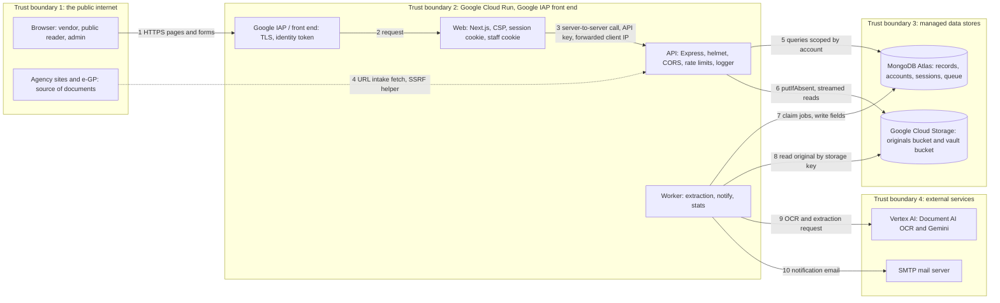

# TOR Radar — Security Project Document

Course 01219325 Software Development Security · Project Assignment 2026 · Section (b) of the
submission. Sections 1 to 6 follow the assignment's order; sections 7 and 8 add the OWASP Top 10:2025
mapping and the threat mitigation checklist (grading criteria 16 and 17).

**How to read the evidence.** This document describes the system **as it will be once the Sprint 6
security pull requests merge**. Until then, each control carries the PR that adds it. Controls already
on `main` cite a file path. Nothing here is a penetration test; the ASVS "Have now" column is a code
review backed by the tests named in section 6.

| PR | Jira | Adds |
| :-- | :-- | :-- |
| #44 | n/a | Continuous deploy to Cloud Run after CI passes on `main` (`.github/workflows/deploy.yml`) |
| #45 | TOR-317 | API security headers (helmet) and a CORS allowlist |
| #46 | TOR-316 | Structured JSON logger and security-event logging |
| #47 | TOR-318 | Real client IP, rate limits on search and downloads |
| #48 | TOR-321 | Nonce-based CSP and security headers on the web app |
| #49 | TOR-320 | Breached and common password check |
| #50 | TOR-319 | Idle timeout, login revocation, `Clear-Site-Data` on logout |
| #51 | TOR-324 | Secret and input gaps: no default keys, gitleaks, regex escaping |
| #52 | TOR-325 | Access-control matrix and cross-vendor test |
| #54 | TOR-323 | CodeQL, Semgrep, `npm audit` gate, pinned Actions, images run as `USER node` |
| #55 | TOR-315 | Sign in with Google (OIDC, PKCE), off by default until an OAuth client exists |
| #57 | TOR-322 | OWASP ZAP baseline and API scan tooling and the pre-freeze DAST report |

---

## 1. Application name and team

**Application:** TOR Radar. A Thai-language web platform that collects published Thai government
procurement Terms of Reference (TORs), extracts their fields with AI, matches them to vendor skill
profiles, notifies vendors by email, and publishes a public transparency dashboard with a documented
statistical-anomaly rule. Repository: `TORMomentum/Momentum`. Delivery team name: Momentum.

**Team members** (names and roles as recorded in the project plan workbook,
`docs/security/Momentum-OWASP-ASVS-5.0-Plan.xlsx`, tab "Project Info"; `docs/PROJECT.md` §11 records the
team process, three people, Scrum, but no names):

| Name | Role |
| :-- | :-- |
| Sudha SUTASCHUTO | Lead / PM |
| Peerapas CHINNAPATPAKDEEKUL | Backend |
| Sran JARURANGSRIPATTANAKUL | Frontend |

**Stack.** Next.js (web) · Node.js and Express (API) · MongoDB Atlas · Google Cloud Storage · Vertex AI
(Document AI OCR, Gemini extraction) · SMTP email · Docker Compose and Cloud Run behind Google IAP.

---

## 2. Functional features and their security functions

| # | Feature | What it does | Security function (evidence) |
| :-- | :-- | :-- | :-- |
| F1 | Intake | Admin upload, URL submission and a key-authenticated intake API | Key auth with constant-time compare (`modules/intake/intake.auth.ts`); SSRF helper (`lib/safe-fetch.ts`); magic-byte check (`lib/file-type.ts`); upload caps; immutable storage `putIfAbsent` (`adapters/gcs.storage.ts`) |
| F2, F3 | OCR, field extraction, confidence tiering, review queue | Gemini extraction with a fixed schema; low confidence marked and queued | AI output is labelled and not trusted: schema-bound response, "unverified extraction" marking, human review queue |
| F4 | Search and TOR detail | Thai keyword search with filters; every record links to its source | Zod primitives-only filters (no NoSQL operator reaches Mongo); regex escaping through `lib/escape-regexp.ts` (#51); search rate limit (#47); restricted TORs answer 404 |
| F5, F6 | Accounts and vendor profiles | Registration with PDPA-aligned consent, email verification, login, profile, bookmarks, vault | argon2id (`modules/accounts/password.ts`); Google sign-in with PKCE, state, nonce and id_token checks (#55, off by default); breached-password check (#49); login limits (`core/auth-rate-limit.ts`); server-side sessions with idle timeout and login revocation (#50); same-origin check on writes; every `/me` query scoped by account id |
| F7, F8 | Dashboard, anomaly rule, quality checklist | Public statistics with a published rule and wording constraints | Open design: `/methodology` page; coverage note and last-updated time on every figure |
| F9, F10 | Matching, email notification, PDPA and takedown | Skill matching, email only, consent, export and delete, takedown | One redaction serializer (`lib/redact.ts`); email dispatch off by default; takedown restricts access and never removes the original; admin audit trail |
| Admin | Review, vendor accounts, takedown | Staff area | Signed 8-hour staff cookie plus role check (`apps/web/src/shared/lib/staff-session.ts`); admin API key per route; `admin.action` log (#46) |
| Platform | Deploy and operations | Cloud Run behind Google IAP, CD from `main` (#44) | Secrets in Google Secret Manager; no default keys (#51); gitleaks in CI (#51); headers (#45, #48); CodeQL, Semgrep and `npm audit` in CI and non-root images (#54) |

Not built, so not claimed: CSV export (F11), per-adapter health reporting (F12), TOTP for admins. Google sign-in is built (#55) but stays off until an OAuth client exists.

---

## 3. Security features mapped to OWASP ASVS 5.0 requirements

Standard: OWASP ASVS 5.0.0. The team plan covers **254 of 345 requirements** (all of Level 1 that
applies to this application, and Levels 2 and 3 where the threat model asks for them). 91 are not
planned: mainly V17 WebRTC (12, not used), the OAuth authorization-server chapter parts of V10 (28, we
are only a client), and items for features that do not exist. The reasons are in the workbook, tab
"ASVS Requirements", column "Implementation / reason".

Status meanings. **Have now**: in the code, or in an open Sprint 6 PR (named in the evidence).
**Partial**: some of the requirement is met, the rest is open. **Planned**: accepted, not built.
Priority: P0 done, then P1 (Level 1 and top-risk threats), P2 (Level 2), P3 (Level 3).

The Have-now column of the workbook was re-derived from evidence on 2026-11-21: 35 requirements changed
from open to Have now because of PRs #45 to #55. Level coverage of planned requirements:
Level 1 51 of 61 planned have-now, Level 2 75 of 133, Level 3 20 of 60.

### 3.1 Summary by chapter

| Chapter | Planned | Have now | Partial | Planned only | Not planned |
| :-- | --: | --: | --: | --: | --: |
| V1 Encoding and Sanitization | 19 | 14 | 0 | 5 | 11 |
| V2 Validation and Business Logic | 12 | 5 | 0 | 7 | 1 |
| V3 Web Frontend Security | 28 | 20 | 2 | 6 | 3 |
| V4 API and Web Service | 8 | 5 | 0 | 3 | 8 |
| V5 File Handling | 10 | 5 | 0 | 5 | 3 |
| V6 Authentication | 38 | 19 | 0 | 19 | 9 |
| V7 Session Management | 19 | 12 | 1 | 6 | 0 |
| V8 Authorization | 11 | 6 | 1 | 4 | 2 |
| V9 Self-contained Tokens | 6 | 6 | 0 | 0 | 1 |
| V10 OAuth and OIDC | 8 | 7 | 1 | 0 | 28 |
| V11 Cryptography | 19 | 8 | 0 | 11 | 5 |
| V12 Secure Communication | 8 | 5 | 0 | 3 | 4 |
| V13 Configuration | 20 | 8 | 0 | 12 | 1 |
| V14 Data Protection | 12 | 6 | 0 | 6 | 1 |
| V15 Secure Coding and Architecture | 19 | 11 | 1 | 7 | 2 |
| V16 Security Logging and Error Handling | 17 | 9 | 3 | 5 | 0 |
| V17 WebRTC | 0 | 0 | 0 | 0 | 12 |
| **Total** | **254** | **146** | **9** | **99** | **91** |

### 3.2 Requirement table

One row per planned requirement (254). Not-planned requirements are omitted; see the workbook.
Evidence for "Have now" rows names the file, or `[Sprint 6, PR n, open until merged]`. For other
rows the last column says what is planned.

| Req. | L | Status | Pri. | Threat | Evidence (file or PR) / what is planned |
| :-- | :-: | :-- | :-: | :-- | :-- |
| **V1 Encoding and Sanitization** | | | | | |
| V1.1.1 | 2 | Have now | P0 | T07 | Express and Zod decode input once before validation; no later manual decoding feeds a security decision. |
| V1.1.2 | 2 | Have now | P0 | T05, T07 | React escapes at render; the Mongo driver encodes BSON at the final step. |
| V1.2.1 | 1 | Have now | P0 | T05 | React JSX auto-escaping; escapeHtml in both email templates; content-disposition.ts for headers. |
| V1.2.2 | 1 | Have now | P0 | T05 | URLs built with the URL API (tokenUrl); websiteFrom only emits http(s) links; intake URLs pass a scheme allowlist. |
| V1.2.3 | 1 | Have now | P0 | T05 | JSON produced only by res.json and framework serialisation; no hand-built JavaScript. |
| V1.2.4 | 1 | Have now | P0 | T07 | MongoDB driver with Zod primitives-only filter parsing, so no operator object reaches a query. |
| V1.2.5 | 1 | Have now | P0 | T07 | No child_process or shell call anywhere in apps/api or apps/web. |
| V1.2.9 | 2 | Have now | P0 | T07, T11 | Search and admin filters escape regex input (tors.repository.ts, admin.repository.ts). matching.repository.ts passes profile terms to $regex unescaped: fix. [Sprint 6, PR #51, open until merged] apps/api/src/lib/escape-regexp.ts used by the matching, tors, admin and admin-accounts repositories. |
| V1.2.10 | 3 | Planned | P3 | T07 | Escape cells per RFC 4180 and prefix formula characters in the CSV export, because TOR text opens in Excel |
| V1.3.2 | 1 | Have now | P0 | T07 | No eval or new Function in application code. |
| V1.3.3 | 2 | Planned | P2 | T14 | Cap input length with Zod and delimit TOR text sent to Gemini, so hidden instructions cannot distort extraction |
| V1.3.6 | 2 | Planned | P2 | T04 | Route URL intake through safe-fetch and add a government-host allowlist, to block internal and metadata addresses |
| V1.3.7 | 2 | Have now | P0 | T07 | Email templates are fixed code with escaped values; templates are never built from input. |
| V1.3.10 | 2 | Have now | P0 |  | No printf-style formatting of untrusted input; logs use JSON.stringify. |
| V1.3.11 | 2 | Have now | P0 | T07 | Addresses validated by Zod; nodemailer builds the headers. |
| V1.3.12 | 3 | Planned | P3 | T11 | Review regexes in redaction and matching and cap input length, so a long document cannot stall a worker |
| V1.4.2 | 2 | Have now | P0 |  | Zod integer and range checks; budget ceiling in config. |
| V1.5.2 | 2 | Have now | P0 |  | Only JSON.parse, with no native deserialisation. Request bodies then go through Zod; model output goes through extraction grading. |
| V1.5.3 | 3 | Planned | P3 |  | Use one URL and JSON parser across web and API, and add a test for parsing differences |
| **V2 Validation and Business Logic** | | | | | |
| V2.1.1 | 1 | Planned | P1 | T07 | Document each input's rules alongside the Zod schemas, so validation can be tested consistently |
| V2.1.2 | 2 | Planned | P2 |  | Document cross-field rules such as announcement date before bid close |
| V2.1.3 | 2 | Planned | P2 | T11 | Document per-user and global limits from core/config.ts, including AI and upload limits |
| V2.2.1 | 1 | Have now | P0 | T07 | Zod allowlists and ranges on every route body and filter. |
| V2.2.2 | 1 | Have now | P0 |  | Validation runs in the API; client checks are usability only. |
| V2.2.3 | 2 | Planned | P2 | T14 | Add date-order checks to the budget ceiling on extracted records, so bad values do not reach the dashboard |
| V2.3.1 | 1 | Have now | P0 |  | Login requires a verified email; reset and verify consume a token; tor-state.ts enforces record transitions. |
| V2.3.2 | 2 | Have now | P0 | T11 | Bulk caps (adminBulkMax, adminSelectAllMax), rate limits, and upload caps come from config. |
| V2.3.3 | 2 | Planned | P2 |  | Wrap account deletion in a transaction, so a failure cannot leave PDPA deletion half done |
| V2.3.5 | 3 | Planned | P3 | T02 | Require a second admin to approve role changes and takedowns, which are high-impact actions |
| V2.4.1 | 2 | Have now | P0 | T01, T11 | Rate limits exist on auth and intake only. Add limits on search, document streaming, and future CSV export. [Sprint 6, PR #47, open until merged] apps/api/src/core/public-rate-limit.ts on GET /tors, /tors/facets and the document route (CSV export is not built). |
| V2.4.2 | 3 | Planned | P3 |  | Reject register and reset forms submitted faster than a person could, without slowing normal reading |
| **V3 Web Frontend Security** | | | | | |
| V3.1.1 | 3 | Planned | P3 |  | Document the browser features the site requires (HTTPS, HSTS, CSP) |
| V3.2.1 | 1 | Have now | P0 | T03, T05 | stream-document.ts: attachment by default, inline only for the viewer, nosniff, verified type. |
| V3.2.2 | 1 | Have now | P0 | T05 | React renders text nodes; extracted values are never injected as HTML. |
| V3.2.3 | 3 | Have now | P0 | T05 | ES modules and TypeScript strict; nothing stored on document globals. |
| V3.3.1 | 1 | Partial | P1 | T10 | Keep Secure on https and rename session cookies with the __Host- prefix, since cookies protect vendor accounts |
| V3.3.2 | 2 | Have now | P0 | T06 | SameSite=Lax plus server-side Origin checks. |
| V3.3.3 | 2 | Planned | P1 | T10 | Rename tor-radar-session and tor_staff to __Host- names, as both are host-only |
| V3.3.4 | 2 | Have now | P0 | T10 | HttpOnly session cookie; the id is set only by the Next route and stripped from the JSON reply. |
| V3.3.5 | 3 | Have now | P0 |  | Cookies hold a 64-character id or a short signed token. |
| V3.4.1 | 1 | Have now | P0 | T10 | No HSTS header today. Add globally with max-age of at least one year. [Sprint 6, PR #48, open until merged] apps/web/src/shared/lib/security-headers.ts: HSTS max-age=63072000; includeSubDomains in production. |
| V3.4.2 | 1 | Have now | P0 | T06 | API emits no CORS headers; browsers reach it only through the same-origin Next server. |
| V3.4.3 | 2 | Have now | P0 | T05 | No CSP today. Add a nonce-based policy with object-src 'none' and base-uri 'none'. Highest-value browser control. [Sprint 6, PR #48, open until merged] apps/web/proxy.ts + shared/lib/security-headers.ts: per-request nonce CSP, object-src none, base-uri self. |
| V3.4.4 | 2 | Have now | P0 | T05 | nosniff is set on document streams only. Add to all responses. [Sprint 6, PR #45, #48, open until merged] helmet in apps/api/src/core/security-headers.ts; web headers in apps/web/src/shared/lib/security-headers.ts. |
| V3.4.5 | 2 | Have now | P0 | T09 | External links use rel=noreferrer. Add a global Referrer-Policy (matters for token links). [Sprint 6, PR #48, open until merged] Referrer-Policy strict-origin-when-cross-origin in apps/web/src/shared/lib/security-headers.ts. |
| V3.4.6 | 2 | Have now | P0 | T05 | Add frame-ancestors 'none', with 'self' only for the document viewer. [Sprint 6, PR #48, open until merged] frame-ancestors none, self only for the three original-viewer routes; the API sends frame-ancestors none (#45). |
| V3.4.7 | 3 | Planned | P3 |  | Add a CSP report endpoint after the policy is live |
| V3.4.8 | 3 | Planned | P3 |  | Add Cross-Origin-Opener-Policy: same-origin with the other headers |
| V3.5.1 | 1 | Have now | P0 | T06 | requireSameOrigin plus the Origin check in the Next auth route; admin API needs a custom key header. |
| V3.5.3 | 1 | Have now | P0 | T06 | State changes use POST, PUT, or DELETE only. |
| V3.5.4 | 2 | Have now | P0 |  | Web and API are separate Cloud Run services on different hostnames. |
| V3.5.6 | 3 | Have now | P0 |  | No JSONP anywhere. |
| V3.5.7 | 3 | Have now | P0 |  | Authorised data is rendered per request, never in static scripts. |
| V3.5.8 | 3 | Partial | P3 | T08 | Add Cross-Origin-Resource-Policy on document routes, so restricted files cannot be embedded elsewhere |
| V3.6.1 | 3 | Have now | P0 |  | Scripts are bundled and next/font self-hosts fonts; no third-party script tags. |
| V3.7.1 | 2 | Have now | P0 |  | React 19 and Next.js 16 only; no plugin technologies. |
| V3.7.2 | 2 | Have now | P0 |  | Only internal redirects (e.g. /admin/login); no open-redirect parameter. |
| V3.7.3 | 3 | Planned | P3 |  | Show a notice with a cancel option before opening an external source site |
| V3.7.5 | 3 | Planned | P3 |  | Show a warning when the browser lacks the features listed under 3.1.1 |
| **V4 API and Web Service** | | | | | |
| V4.1.1 | 1 | Have now | P0 |  | res.json sets charset utf-8; documents use the verified type. |
| V4.1.2 | 2 | Planned | P2 | T10 | Check at startup that API_BASE_URL is https, so sessions never travel in plain HTTP |
| V4.1.3 | 2 | Have now | P0 | T10 | Next builds a fresh header set for the API, and the API is IAM-restricted so browsers cannot reach it directly. |
| V4.1.4 | 3 | Have now | P0 |  | Express routes are explicit per method; anything else gets 404. |
| V4.1.5 | 3 | Planned | P3 |  | Add HMAC signatures to intake API requests, because these change the published corpus |
| V4.2.1 | 2 | Have now | P0 |  | Node's HTTP parser behind Google Front End (platform-managed). |
| V4.2.2 | 3 | Have now | P0 |  | Content-Length comes from stored metadata or is set by Node. |
| V4.2.5 | 3 | Planned | P3 |  | Cap the length of generated URLs and headers, so a long value cannot break API calls |
| **V5 File Handling** | | | | | |
| V5.1.1 | 2 | Planned | P2 | T03 | Document allowed types, size, and how a rejected file is handled |
| V5.2.1 | 1 | Have now | P0 | T03, T11 | maxUploadBytes, multipart caps, and fetch size and timeout limits. |
| V5.2.2 | 1 | Have now | P0 | T03 | file-type.ts checks magic bytes; the stored extension comes from the verified type. |
| V5.2.4 | 3 | Planned | P3 | T11 | Add a size and file-count quota per intake key, so one key cannot fill storage |
| V5.2.6 | 3 | Planned | P3 | T11 | Read image dimensions from the header and reject oversized images before OCR |
| V5.3.1 | 1 | Have now | P0 | T03 | Files live in object storage and are only streamed. |
| V5.3.2 | 1 | Have now | P0 | T03 | storage-key.ts derives keys from the content hash, never from filenames. |
| V5.4.1 | 2 | Planned | P2 | T03 | Set a sanitised filename on every document response, including inline viewing |
| V5.4.2 | 2 | Have now | P0 | T03 | RFC 6266-style encoding in content-disposition.ts, with tests. |
| V5.4.3 | 2 | Planned | P2 | T03 | Scan with ClamAV in the intake worker, because we redistribute outside documents to the public |
| **V6 Authentication** | | | | | |
| V6.1.1 | 1 | Planned | P1 | T01 | Document login rate limits and how lockout abuse is prevented |
| V6.1.2 | 2 | Planned | P2 | T01 | Document a blocked word list (TOR Radar, Momentum, agency terms) |
| V6.1.3 | 2 | Planned | P2 | T02 | Document password, staff pass, and API key paths together |
| V6.2.1 | 1 | Have now | P0 | T01 | Zod min(8) on register, reset, and change. |
| V6.2.2 | 1 | Have now | P0 |  | POST /password/change. |
| V6.2.3 | 1 | Have now | P0 |  | The route requires currentPassword and the new password. |
| V6.2.4 | 1 | Have now | P0 | T01 | No common-password check today. Add a top-3000 list at register, change, and reset. [Sprint 6, PR #49, open until merged] apps/api/src/modules/accounts/breached-password.ts + src/data/common-passwords.txt (SecLists top 10k). |
| V6.2.5 | 1 | Have now | P0 |  | No composition rules. |
| V6.2.6 | 1 | Have now | P0 |  | type=password on all password fields. |
| V6.2.7 | 1 | Have now | P0 |  | No paste blocking; standard fields work with password managers. |
| V6.2.8 | 1 | Have now | P0 |  | Passwords are hashed as received (no trim or case change). |
| V6.2.9 | 2 | Have now | P0 |  | Maximum length is 1024. |
| V6.2.10 | 2 | Have now | P0 |  | No forced rotation. |
| V6.2.11 | 2 | Planned | P2 | T01 | Reject passwords containing the 6.1.2 word list |
| V6.2.12 | 2 | Have now | P0 | T01 | Add a breached-password check (k-anonymity range API or a bundled list). [Sprint 6, PR #49, open until merged] apps/api/src/adapters/hibp.breached-passwords.ts (k-anonymity range query, fails open on outage). |
| V6.3.1 | 1 | Have now | P0 | T01 | Limits per IP and per email exist. The IP limit is unreliable behind the proxy (see 15.3.4) and counters are per instance. [Sprint 6, PR #47, open until merged] apps/web/src/shared/api/client-ip.ts forwards the client IP; TRUST_PROXY in core/config.ts; limits in core/auth-rate-limit.ts. |
| V6.3.2 | 1 | Have now | P0 | T02 | No seeded accounts; a staff pass with no configured secret fails closed. Compose default API keys are tracked under 13.2.3. |
| V6.3.3 | 2 | Planned | P1 | T02 | Add TOTP for admin accounts, the top risk in our Threat Model |
| V6.3.4 | 2 | Planned | P1 | T02 | Replace static admin keys and the shared staff pass with individual admin accounts |
| V6.3.5 | 3 | Planned | P3 |  | Email vendors after a sign-in that follows repeated failures or a long inactive period |
| V6.3.6 | 3 | Have now | P0 |  | Email is used only for verification and recovery, never as a login factor. |
| V6.3.7 | 3 | Planned | P3 | T01 | Email vendors after a password change or reset, using the existing mail templates |
| V6.3.8 | 3 | Planned | P3 | T01 | Make /password/forgot take the same time for known and unknown addresses |
| V6.4.1 | 1 | Have now | P0 |  | Verify and reset tokens: 256-bit random, expiring, single-use; never a long-term password. |
| V6.4.2 | 1 | Have now | P0 |  | No hints or secret questions. |
| V6.4.3 | 2 | Planned | P2 | T01 | Keep single-use one-hour resets and require TOTP after reset once MFA ships |
| V6.4.4 | 2 | Planned | P2 | T02 | Recover a lost admin TOTP with a recovery code or through another admin, with identity confirmed |
| V6.4.6 | 3 | Have now | P0 |  | Admin can only trigger a reset email (sendPasswordReset); never sets a password. |
| V6.5.1 | 2 | Planned | P2 | T02 | Reject a TOTP code that was already used |
| V6.5.2 | 2 | Planned | P2 |  | Store TOTP recovery codes hashed with Argon2id, so a database leak cannot reveal them |
| V6.5.3 | 2 | Planned | P2 | T02 | Generate TOTP seeds with node:crypto |
| V6.5.4 | 2 | Planned | P2 |  | Generate recovery codes with at least 112 bits of randomness |
| V6.5.5 | 2 | Planned | P2 | T02 | Use a 30-second TOTP step |
| V6.5.6 | 3 | Planned | P3 | T02 | Let admins revoke and re-enroll TOTP after a lost device |
| V6.5.8 | 3 | Planned | P3 | T02 | Validate TOTP against the server clock only |
| V6.8.1 | 2 | Have now | P0 |  | Google sign-in is a placeholder button today; the account schema has a google.sub field. [Sprint 6, PR #55, open until merged] accounts are linked by google.sub (partial unique index); a different sub on the account is refused; issuer checked by verifyIdToken, apps/api/src/adapters/google.oidc.ts and modules/accounts/google-signin.service.ts. |
| V6.8.2 | 2 | Have now | P0 |  | Google sign-in is not built yet. [Sprint 6, PR #55, open until merged] verifyIdToken checks the signature against Google keys; unsigned or badly signed tokens are rejected (google.oidc.test.ts), apps/api/src/adapters/google.oidc.ts and modules/accounts/google-signin.service.ts. |
| V6.8.4 | 2 | Planned | P2 |  | Treat Google sign-in as single-factor unless Google's claims show stronger authentication |
| **V7 Session Management** | | | | | |
| V7.1.1 | 2 | Have now | P0 | T10 | Document the seven-day account and eight-hour staff limits, the planned idle timeout, and the rationale. [Sprint 6, PR #50, open until merged] idle 30 min, absolute lifetime documented in the 2026-11-20 revision of specs/2026-10-06-accounts-and-sessions-design.md. |
| V7.1.2 | 2 | Have now | P0 | T10 | Document the concurrent session policy. [Sprint 6, PR #50, open until merged] SESSION_SINGLE_ACTIVE (default true) documented in the same spec revision. |
| V7.1.3 | 2 | Planned | P2 |  | Document how session lifetime relates to the Google sign-in |
| V7.2.1 | 1 | Have now | P0 | T10 | API resolves every session from the database (session-context.ts). |
| V7.2.2 | 1 | Planned | P1 | T02 | Replace static admin API keys with admin sessions that can expire and be tied to a person |
| V7.2.3 | 1 | Have now | P0 | T10 | randomBytes(32): 256 bits. |
| V7.2.4 | 1 | Have now | P0 | T10 | Each login creates a new token, but the previous session is not terminated: revoke it on re-login. [Sprint 6, PR #50, open until merged] apps/api/src/modules/accounts/sessions.ts + accounts.routes.ts: login deletes the carried session id and the other sessions of the account. |
| V7.3.1 | 2 | Have now | P0 | T10 | lastSeenAt exists but is never updated or enforced: wire touch() and enforce an idle timeout. [Sprint 6, PR #50, open until merged] SESSION_IDLE_TIMEOUT_MS in core/config.ts; resolve and touch reject idle sessions in sessions.ts. |
| V7.3.2 | 2 | Have now | P0 | T10 | Seven-day expiry in the database query; eight hours for staff. |
| V7.4.1 | 1 | Partial | P1 | T10 | Delete the session row at logout and make staff sessions revocable on the server |
| V7.4.2 | 1 | Have now | P0 | T10 | Disable revokes all sessions; resolve() rejects disabled and deleted accounts. |
| V7.4.3 | 2 | Have now | P0 | T10 | Reset revokes all sessions; change revokes all others automatically. |
| V7.4.4 | 2 | Have now | P0 |  | Sign-out in the app shell (AccountControls). |
| V7.4.5 | 2 | Planned | P2 | T02 | Add terminate-without-disable and terminate-all for admins |
| V7.5.1 | 2 | Have now | P0 |  | No email-change route; password change needs the current password. |
| V7.5.2 | 2 | Planned | P2 | T10 | Add a session list and revoke to the account page, using stored session metadata |
| V7.5.3 | 3 | Planned | P3 | T02 | Re-check the password for admin role changes, as account deletion already does |
| V7.6.1 | 2 | Planned | P2 |  | Apply the same session limits to Google sign-ins and require re-authentication at expiry |
| V7.6.2 | 2 | Have now | P0 |  | Sessions start only from an explicit login. |
| **V8 Authorization** | | | | | |
| V8.1.1 | 1 | Have now | P0 | T08 | SRS defines actors and access. Write one authorisation matrix. [Sprint 6, PR #52, open until merged] docs/security/access-control-matrix.md, compared with the routers by apps/api/src/core/access-control.test.ts. |
| V8.1.2 | 2 | Partial | P2 | T08 | Document which fields each audience can read and write, including redaction |
| V8.1.3 | 3 | Planned | P3 |  | Document the context used for admin access: IP address, device, and time |
| V8.1.4 | 3 | Planned | P3 |  | Document when a change in context triggers re-authentication for admins |
| V8.2.1 | 1 | Have now | P0 | T02, T08 | requireKey on admin and intake; requireStaff in Next; req.auth checks on /me routes. |
| V8.2.2 | 1 | Have now | P0 | T08 | Vendor data is queried by the session's accountId; restricted TORs answer 404. |
| V8.2.3 | 2 | Have now | P0 | T08, T09 | One redaction serializer (redact.ts) and explicit response shapes. |
| V8.2.4 | 3 | Planned | P3 |  | Require re-authentication when an admin session changes IP address or device |
| V8.3.1 | 1 | Have now | P0 | T08 | All enforcement is in the API and Next server. |
| V8.3.2 | 3 | Have now | P0 | T08 | The account row is read on every request, so role changes apply at once. |
| V8.3.3 | 3 | Planned | P3 | T02 | Pass the acting admin's identity to the API instead of a shared service key |
| **V9 Self-contained Tokens** | | | | | |
| V9.1.1 | 1 | Have now | P0 | T02 | Staff token HMAC verified with timingSafeEqual before use. |
| V9.1.2 | 1 | Have now | P0 | T02 | Fixed HMAC-SHA256; the token carries no algorithm field. |
| V9.1.3 | 1 | Have now | P0 | T02 | Key comes only from STAFF_ACCESS_SECRET. |
| V9.2.1 | 1 | Have now | P0 | T02 | Expiry is checked on every request. |
| V9.2.2 | 2 | Have now | P0 |  | Version-tagged staff token; account tokens are bound to a purpose. |
| V9.2.3 | 2 | Have now | P0 |  | Cloud Run identity token is audience-bound to the API URL; staff token is used only by web. |
| **V10 OAuth and OIDC** | | | | | |
| V10.1.1 | 2 | Have now | P0 |  | Google sign-in is not built yet. The Next server already holds the session token. [Sprint 6, PR #55, open until merged] code, id_token and PKCE verifier are handled only by the API; the Next handler passes code, state and a binding cookie, never a token to browser JavaScript. |
| V10.1.2 | 2 | Have now | P0 |  | Google sign-in is not built yet. [Sprint 6, PR #55, open until merged] single-use server-side transaction keyed by SHA-256 of state, plus an httpOnly SameSite=Lax binding cookie compared in constant time (google-signin.service.ts). |
| V10.2.1 | 2 | Have now | P0 |  | Google sign-in is not built yet. [Sprint 6, PR #55, open until merged] PKCE S256 and single-use state with a binding cookie (google.oidc.ts, google-signin.service.ts). |
| V10.2.3 | 3 | Partial | P3 |  | Request only the openid and email scopes from Google |
| V10.5.1 | 2 | Have now | P0 |  | Google sign-in is not built yet. [Sprint 6, PR #55, open until merged] nonce in the id_token compared in constant time with the stored nonce (google-signin.service.ts). |
| V10.5.2 | 2 | Have now | P0 |  | Google sign-in is not built yet. [Sprint 6, PR #55, open until merged] user identified by sub; email_verified must be true (google-signin.service.ts). |
| V10.5.3 | 2 | Have now | P0 |  | Google sign-in is not built yet. [Sprint 6, PR #55, open until merged] issuer checked by google-auth-library verifyIdToken; endpoints are fixed in code, no metadata discovery. |
| V10.5.4 | 2 | Have now | P0 |  | Google sign-in is not built yet. [Sprint 6, PR #55, open until merged] aud equals GOOGLE_OAUTH_CLIENT_ID and azp is checked (google.oidc.ts). |
| **V11 Cryptography** | | | | | |
| V11.1.1 | 2 | Planned | P2 | T13 | Write a key policy for session, staff, API, and service-account keys |
| V11.1.2 | 2 | Planned | P2 | T13 | List every algorithm and key in use (Argon2id, SHA-256, HMAC-SHA256, TLS) |
| V11.1.3 | 3 | Planned | P3 |  | Add a CodeQL or Semgrep rule in CI that finds cryptography use |
| V11.1.4 | 3 | Planned | P3 |  | Add a post-quantum migration section to the cryptographic inventory |
| V11.2.1 | 2 | Have now | P0 |  | node:crypto and @node-rs/argon2; no custom cryptography. |
| V11.2.2 | 2 | Planned | P2 |  | Keep Argon2 parameters in config and staff tokens versioned, and make other hash choices configurable |
| V11.2.3 | 2 | Planned | P2 |  | Use at least 128-bit strength, and require a staff secret of 32 or more characters |
| V11.2.4 | 3 | Have now | P0 | T02 | timingSafeEqual on key and staff token comparisons. |
| V11.2.5 | 3 | Have now | P0 |  | Verification failures fail closed. |
| V11.3.1 | 1 | Planned | P1 |  | Use AES-GCM for field encryption; never ECB or weak padding |
| V11.3.2 | 1 | Planned | P1 |  | Use only AES-256-GCM from node:crypto for field encryption |
| V11.3.3 | 2 | Planned | P2 |  | Use authenticated encryption, so tampered fields are rejected |
| V11.3.4 | 3 | Planned | P3 |  | Generate a fresh random nonce for every field encryption |
| V11.4.1 | 1 | Have now | P0 |  | SHA-256 for security uses. MD5 appears only as the GCS integrity field and SHA-1 only as a non-security shuffle. |
| V11.4.2 | 2 | Have now | P0 | T01 | Argon2id, 19 MiB, 2 iterations, 1 lane (OWASP-recommended), from config. |
| V11.4.3 | 2 | Have now | P0 | T16 | SHA-256 content hashes and HMACs. |
| V11.5.1 | 2 | Have now | P0 | T10 | randomBytes(32) for sessions and tokens. |
| V11.5.2 | 3 | Have now | P0 |  | Operating-system CSPRNG via node:crypto. |
| V11.7.2 | 3 | Planned | P3 |  | Minimise data during processing and encrypt vendor personal fields with AES-GCM |
| **V12 Secure Communication** | | | | | |
| V12.1.1 | 1 | Planned | P1 | T10 | Scan the deployed site and record that only TLS 1.2 or newer is enabled |
| V12.1.2 | 2 | Planned | P2 |  | Confirm cipher suites in the same TLS scan |
| V12.2.1 | 1 | Have now | P0 | T10 | Cloud Run endpoints are HTTPS. |
| V12.2.2 | 1 | Have now | P0 |  | Google-managed public certificates. |
| V12.3.1 | 2 | Planned | P2 | T13 | Add a production check that Mongo and SMTP connections require TLS |
| V12.3.2 | 2 | Have now | P0 |  | Node's default certificate validation; validation is never disabled. |
| V12.3.3 | 2 | Have now | P0 |  | In production, web calls API over Cloud Run HTTPS. Compose is local-only. |
| V12.3.4 | 2 | Have now | P0 |  | Google-managed certificates on internal calls. |
| **V13 Configuration** | | | | | |
| V13.1.1 | 2 | Planned | P2 | T04 | List all inbound and outbound connections, including URL intake |
| V13.1.2 | 3 | Planned | P3 |  | Document connection limits for Mongo, GCS, and SMTP and what happens at the limit |
| V13.1.3 | 3 | Planned | P3 |  | Document timeouts, retries, and back-off for each external service |
| V13.1.4 | 3 | Planned | P3 | T13 | List critical secrets and a rotation schedule |
| V13.2.1 | 2 | Planned | P2 | T13 | Move from static Mongo and intake credentials where possible; keep identity tokens for web to API |
| V13.2.2 | 2 | Planned | P2 | T13 | Review Mongo and Vertex roles, so each service has only what it needs |
| V13.2.3 | 2 | Have now | P0 | T13 | Production keys come from Secret Manager, but docker-compose.yml falls back to change-me API keys when none are set. [Sprint 6, PR #51, open until merged] docker-compose.yml: INTAKE_API_KEYS and ADMIN_API_KEYS are required, no change-me defaults. |
| V13.2.4 | 2 | Planned | P2 | T04 | Add a host allowlist for URL intake, the only outbound address users can set |
| V13.2.5 | 2 | Planned | P2 | T04 | Route Cloud Run egress through a VPC connector with a firewall allowlist |
| V13.2.6 | 3 | Planned | P3 |  | Apply the documented connection limits and retry settings in config |
| V13.3.1 | 2 | Planned | P2 | T13 | Keep secrets in Google Secret Manager and out of git, and rotate the outstanding service key |
| V13.3.2 | 2 | Planned | P2 | T13 | Give each service only its own secrets, and remove SESSION_SECRET from the worker |
| V13.3.4 | 3 | Planned | P3 |  | Configure Secret Manager expiry and rotation reminders on the 13.1.4 schedule |
| V13.4.1 | 1 | Have now | P0 |  | .git is excluded in .dockerignore. |
| V13.4.2 | 2 | Have now | P0 |  | NODE_ENV=production in deployment; stack traces never leave the process. |
| V13.4.3 | 2 | Have now | P0 |  | No directory serving. |
| V13.4.4 | 2 | Have now | P0 |  | No TRACE route. |
| V13.4.5 | 2 | Have now | P0 |  | No exposed API docs; the API is IAM-restricted, /health returns status only. |
| V13.4.6 | 3 | Have now | P0 |  | Disable X-Powered-By in Express and poweredByHeader in Next. [Sprint 6, PR #45, #48, open until merged] helmet removes X-Powered-By on the API; poweredByHeader false in apps/web/next.config.ts. |
| V13.4.7 | 3 | Have now | P0 |  | Next standalone serves only build output and public assets. |
| **V14 Data Protection** | | | | | |
| V14.1.1 | 2 | Planned | P2 | T09 | Classify personal data for PDPA in a table |
| V14.1.2 | 2 | Planned | P2 | T09 | Define protection rules per data class |
| V14.2.1 | 1 | Planned | P1 | T09 | Move verify and reset tokens from the query string to the URL fragment, so they stay out of logs |
| V14.2.2 | 2 | Have now | P0 | T09 | API client uses no-store; documents are private, no-store. |
| V14.2.3 | 2 | Have now | P0 | T09 | No analytics or trackers. |
| V14.2.4 | 2 | Planned | P2 | T09 | Implement the per-class rules from 14.1.2 |
| V14.2.5 | 3 | Have now | P0 |  | No CDN or shared cache layer. |
| V14.2.6 | 3 | Have now | P0 | T09 | Redaction serializer and explicit projections; match scores only to the owner. |
| V14.2.7 | 3 | Planned | P3 | T09 | Add a retention schedule for personal data, alongside the existing session and token TTLs |
| V14.3.1 | 1 | Have now | P0 | T09 | HttpOnly cookies are cleared at logout. Add Clear-Site-Data and clear local notification state. [Sprint 6, PR #50, open until merged] apps/web/app/api/auth/[...path]/route.ts sends Clear-Site-Data on logout. |
| V14.3.2 | 2 | Planned | P2 | T09 | Set no-store on every authenticated response, including profiles and match scores |
| V14.3.3 | 2 | Have now | P0 | T09 | localStorage holds only notification read state. |
| **V15 Secure Coding and Architecture** | | | | | |
| V15.1.1 | 1 | Planned | P1 | T12 | Define fix times by severity for vulnerable packages |
| V15.1.2 | 2 | Planned | P2 | T12 | Generate an SBOM in CI with npm sbom |
| V15.1.3 | 2 | Planned | P2 | T11 | Document slow or paid operations (OCR, Gemini) and their limits |
| V15.1.4 | 3 | Planned | P3 | T12 | List risky packages for extra review |
| V15.1.5 | 3 | Planned | P3 |  | List dangerous features: URL intake, document parsing, LLM calls |
| V15.2.1 | 1 | Have now | P0 | T12 | No npm audit in CI, though NFR-S1 requires one. Add it, failing on high severity. [Sprint 6, PR #54, open until merged] npm audit --audit-level=high in ci.yml; baseline vulnerabilities fixed by lockfile updates; one moderate (uuid via @google-cloud/storage) accepted (docs/security/sast-report.md). |
| V15.2.2 | 2 | Partial | P2 | T11 | Add per-user limits on costly reads to the existing queue, timeouts, and caps |
| V15.2.3 | 2 | Planned | P2 |  | Use a production-only install in the API image |
| V15.2.4 | 3 | Planned | P3 | T12 | Reserve the @tor-radar npm scope, so nobody can publish a package under our names |
| V15.2.5 | 3 | Have now | P0 | T03, T04 | Services are containerised and the API is IAM-restricted. Containers run as root: add a non-root USER. [Sprint 6, PR #54, open until merged] USER node in apps/api/Dockerfile and apps/web/Dockerfile (verified as uid 1000 on Compose). |
| V15.3.1 | 1 | Have now | P0 | T09 | Explicit response shapes and the redaction serializer. |
| V15.3.2 | 2 | Have now | P0 | T04 | safe-fetch handles redirects manually with re-checks and a cap. |
| V15.3.3 | 2 | Have now | P0 | T07 | Zod strips unknown fields; repositories set named fields. |
| V15.3.4 | 2 | Have now | P0 | T01 | app.ts sets no trust proxy and Next does not forward the client IP, so per-IP limits see the proxy. Forward a trusted client IP. [Sprint 6, PR #47, open until merged] apps/web/src/shared/api/client-ip.ts (one X-Forwarded-For to the API) + TRUST_PROXY in apps/api/src/app.ts. |
| V15.3.5 | 2 | Have now | P0 | T07 | TypeScript strict and Zod type enforcement. |
| V15.3.6 | 2 | Have now | P0 | T07 | Zod rebuilds objects from known keys; no deep-merge of input. |
| V15.3.7 | 2 | Have now | P0 | T07 | Zod primitives reject repeated-parameter arrays; body and query are separate. |
| V15.4.2 | 3 | Have now | P0 | T16 | Atomic operations: findOneAndDelete tokens, unique contentHash, putIfAbsent. |
| V15.4.3 | 3 | Have now | P0 |  | Queue leases expire (lockMs) and attempts are capped. |
| **V16 Security Logging and Error Handling** | | | | | |
| V16.1.1 | 2 | Planned | P2 | T15 | Write an inventory of what is logged, where, and for how long |
| V16.2.1 | 2 | Partial | P2 | T15 | Record who, when, and what, with the real admin as actor instead of "admin" |
| V16.2.2 | 2 | Have now | P0 | T15 | ISO timestamps in UTC; platform-synchronised clocks. |
| V16.2.3 | 2 | Planned | P2 | T15 | Confirm log outputs match the 16.1.1 inventory |
| V16.2.4 | 2 | Have now | P0 | T15 | Most logs are JSON; convert the remaining plain console.error call. [Sprint 6, PR #46, open until merged] apps/api/src/core/logger.ts: JSON lines; every console call in the API and workers replaced. |
| V16.2.5 | 2 | Have now | P0 | T09 | No credentials are logged in the paths reviewed. Add an explicit rule and a redacting logger. [Sprint 6, PR #46, open until merged] core/logger.ts sanitizer masks password, token, secret, cookie, session and body-like keys. |
| V16.3.1 | 2 | Have now | P0 | T01, T15 | Login success and failure are not logged today. Add both. [Sprint 6, PR #46, open until merged] core/security-log.ts + accounts.routes.ts: auth.login.success, auth.login.failure (reason), auth.logout. |
| V16.3.2 | 2 | Have now | P0 | T08, T15 | Log 401 and 403 decisions. [Sprint 6, PR #46, open until merged] core/security-log.ts: auth.denied on every 401 and 403 response. |
| V16.3.3 | 2 | Partial | P2 | T15 | Log rate-limit hits, origin rejections, and validation failures |
| V16.3.4 | 2 | Partial | P2 | T15 | Log security-control failures alongside unhandled errors |
| V16.4.1 | 2 | Have now | P0 | T15 | JSON.stringify encodes line breaks; applies once 16.2.4 is complete. [Sprint 6, PR #46, open until merged] the logger writes one JSON.stringify line per event, so outside text cannot forge a line. |
| V16.4.2 | 2 | Planned | P2 | T15 | Restrict database rights on admin_audit and Cloud Logging access |
| V16.4.3 | 2 | Planned | P2 | T15 | Ship logs to Cloud Logging and add alerts |
| V16.5.1 | 2 | Have now | P0 |  | errorMiddleware returns a generic message; stack traces stay in-process. |
| V16.5.2 | 2 | Have now | P0 |  | ApiUnavailable handling, 503s, and a disabled-extraction mode. |
| V16.5.3 | 2 | Have now | P0 |  | Staff checks and origin checks fail closed. |
| V16.5.4 | 3 | Planned | P3 |  | Keep the last error middleware and add a process-level handler for uncaught exceptions |

---

## 4. Threat model

Technique: data flow diagram with trust boundaries, then STRIDE per element. Threats are scored
likelihood (1 to 5) times impact (1 to 5) by the team, and mitigation work is ordered by that score
(P1 before P2 before P3). The full sheet is the "Threat Model" tab of the workbook.

### 4.1 Data flow diagram

Data flows: (1) browser to web, all user input; (2) IAP to web; (3) web to API with an admin or intake
key and one `X-Forwarded-For`; (4) the API fetches a user-supplied URL; (5) database reads and writes;
(6) document bytes; (7) job queue in MongoDB; (8) the worker fetches bytes by storage key, never by a
shared path; (9) document text and images leave to Vertex AI; (10) email leaves to SMTP.

### 4.2 Trust boundaries

| # | Boundary | Why it matters |
| :-- | :-- | :-- |
| TB1 | Internet to Google front end | Everything from the browser and from agency documents is untrusted |
| TB2 | Front end to web, web to API, API to worker | The browser never holds an API key or a storage credential; the web server is the only caller of the API |
| TB3 | Application to MongoDB Atlas and GCS | Only `*.repository.ts` imports the database; only the API touches storage |
| TB4 | Application to Vertex AI and SMTP | Data leaves the system; AI output is treated as untrusted; mail logs redact the recipient |

### 4.3 STRIDE per element

| Element | S Spoofing | T Tampering | R Repudiation | I Information disclosure | D Denial of service | E Elevation of privilege |
| :-- | :-- | :-- | :-- | :-- | :-- | :-- |
| Browser (vendor, admin) | T01 credential stuffing; T10 stolen session | T06 forged cross-site request | T15 admin actions unattributed | T09 tokens in URLs | n/a | T02 stolen staff pass |
| Google IAP and front end | IAP identity token required for web (#44 keeps IAP asserted) | TLS in transit | Cloud Run request logs | TLS | Google front end absorbs volume | n/a |
| Web (Next.js) | T10 cookie theft | T05 script injection; T06 | T15 | T09 headers and referrer leakage | T11 | T02 staff gate |
| API (Express) | T01 | T07 injection; T03 file upload | T15 | T08 cross-vendor read; T04 SSRF | T11 costly operations | T02 shared admin key |
| Worker | n/a | T14 hidden instructions in a TOR | T15 | T09 data sent to Vertex AI | T11 OCR cost | T03 parsing hostile files |
| MongoDB Atlas | T13 leaked connection string | T16 altered audit trail | T15 | T09 personal data at rest | T11 | T13 over-broad database role |
| GCS buckets | T13 leaked service key | T16 altered original (blocked by `putIfAbsent`) | T15 | T08 restricted document served | T11 | T13 |
| Vertex AI, SMTP | T13 | T14 | n/a | T09 | T11 quota | n/a |

### 4.4 Threats, priority and mitigation

Sorted by risk. "Built" means present on `main` or in a Sprint 6 PR named in the evidence column of
section 8. Status was set on 2026-11-21.

| ID | Pri. | Risk (L x I) | STRIDE | Threat | Mitigation designed | Status |
| :-- | :-: | :-: | :-- | :-- | :-- | :-- |
| T02 | P1 | 15 (3x5) | E | Staff pass or admin API key stolen | Constant-time key compare, signed 8-hour staff cookie, staff check on every admin page and action; planned individual admin accounts with TOTP | Partial. Shared secrets remain |
| T01 | P1 | 12 (4x3) | S | Credential stuffing, brute force on login | argon2id, per-IP and per-email limits, real client IP (#47), breached password check (#49), login logging (#46), uniform error | Mostly done |
| T11 | P1 | 12 (3x4) | D | Abuse of costly operations | Upload caps, queue, timeouts, search and document limits (#47), escaped vendor regex (#51) | Mostly done |
| T09 | P1 | 12 (3x4) | I | Personal data exposed | One redaction serializer, no trackers, export and delete, `Clear-Site-Data` (#50), Referrer-Policy (#48); planned tokens out of URLs, classification, retention | Partial |
| T12 | P1 | 12 (3x4) | T | Vulnerable or malicious npm package | Lockfile and `npm ci`; `npm audit --audit-level=high` gate, CodeQL, Semgrep and SHA-pinned Actions (#54); gitleaks (#51); planned SBOM | Mostly done. One moderate advisory accepted |
| T15 | P2 | 9 (3x3) | R | Admin actions unattributable, attacks unseen | Admin audit trail, JSON logger, `auth.*`, `auth.denied`, `ratelimit.hit`, `admin.action` events (#46) | Partial. Actor is "admin", no alerts |
| T14 | P2 | 9 (3x3) | T | Hidden instructions in a TOR steer Gemini | Fixed response schema, confidence tiering, source link; planned "text is data only" prompt rule | Open |
| T05 | P2 | 8 (2x4) | T | Script injected through TOR text or vendor input | React escaping, no raw HTML, nonce CSP (#48), deny-all CSP on API (#45), nosniff | Done (CSP style-src-attr remains) |
| T10 | P2 | 8 (2x4) | S | Session stolen or left active | 256-bit ids, HttpOnly, SameSite, server-side revocation, HSTS (#48), idle timeout and login revocation (#50) | Mostly done. `__Host-` prefix open |
| T03 | P2 | 8 (2x4) | T | Malicious file uploaded and served | Magic bytes, hash keys, nosniff, attachment by default; images run as `USER node` (#54); planned antivirus | Partial |
| T04 | P2 | 8 (2x4) | I | URL intake reaches internal addresses | `lib/safe-fetch.ts`: scheme allowlist, range checks, redirect re-check, caps; planned host allowlist | Partial |
| T13 | P2 | 8 (2x4) | I | Keys or secrets leaked or over-broad | Secret Manager, no default keys and gitleaks over full history, no finding (#51); planned key policy | Mostly done |
| T08 | P2 | 8 (2x4) | I | Vendor reads another's data | Account-scoped queries, 404 for restricted, access matrix and test (#52), 401 and 403 logged (#46) | Done for vendor data |
| T07 | P3 | 6 (2x3) | T | Injection through filters, terms, CSV | Zod primitives-only filters, escaped regex helper (#51); planned CSV escaping | Mostly done |
| T06 | P0 | 6 (2x3) | T | Forged cross-site state change | SameSite cookies, `core/require-same-origin.ts`, admin calls need a key | Done |
| T16 | P3 | 4 (1x4) | T | Stored original or audit altered | `putIfAbsent`, SHA-256 hashes, append-only history; planned restricted database rights on audit data | Partial |

---

## 5. Security design principles followed

Principles follow Lecture 7 (CISSP chapter 8 and the US-CERT list). The full write-up, with code
paths and the honest gap list, is
[security-design-principles.md](security-design-principles.md), updated on 2026-11-21 for the Sprint 6
PRs. Summary:

| # | Principle | Followed | Evidence |
| :-- | :-- | :-- | :-- |
| 1 | Least privilege | Yes | Separate intake and admin keys (`core/config.ts`); new accounts are vendors; `/me` routes take the account from the session |
| 2 | Defense in depth | Yes | Five layers on upload; login layered; headers and CSP on both web (#48) and API (#45) |
| 3 | Fail securely | Yes | Central error handler, no stack traces; staff gate fails closed; config fails fast; `putIfAbsent` refuses overwrite; uniform login error |
| 4 | Secure defaults | Yes | Email dispatch off; attachments by default; no default keys (#51); `TRUST_PROXY` default false, `true` refused (#47); single active session on (#50) |
| 5 | Separation of privilege | Yes | Staff cookie and admin role |
| 6 | Separation of duties | Partly | Intake, extraction and admin decisions are separate; admins still share one secret (T02) |
| 7 | Economy of mechanism | Yes | One helper per control: `safe-fetch`, `redact`, `escape-regexp` (#51), `logger` (#46), `security-headers` (#45, #48) |
| 8 | Complete mediation | Yes | No signed URLs; sessions checked on every request; idle sessions rejected (#50); access matrix proves coverage (#52) |
| 9 | Open design | Yes | Public anomaly method; security rests on keys, not secrecy of code |
| 10 | Least common mechanism | Yes | Separate buckets and services; per-login sessions |
| 11 | Zero trust | Yes | Files by magic bytes, URLs resolved, filters as primitives, AI output verified, TOR text escaped, breached passwords refused (#49) |
| 12 | Privacy by design | Yes | PDPA-aligned consent, minimisation, export and delete, redacting logger (#46) |
| 13 | Never assume secrets are safe | Yes | Hashed passwords and tokens, constant-time compares, secrets out of git and history scanned (#51) |
| 14 | Psychological acceptability | Yes | Thai UI, uniform login error, a Thai message for a breached password and an expired session |
| 15 | Securing the weakest link | Yes, in progress | Threat ranking drives order; weakest link (shared admin secret, T02) is still open |

---

## 6. Security test process

Security checks run in several layers. Each report file lives on the branch of the PR named beside it and
reaches `main` when that PR merges (rows marked "pending" below are not yet merged).

| Layer | Tool and scope | When | Evidence |
| :-- | :-- | :-- | :-- |
| Unit and integration tests | Vitest: `security-headers.test.ts` (api #45, web #48), `logger.test.ts` and `security-log.test.ts` (#46), `client-ip.test.ts` and 429 tests in `tors.routes.test.ts` (#47), `hibp.breached-passwords.test.ts` and register/reset cases in `accounts.routes.test.ts` (#49), `sessions.test.ts` and `auth.routes.test.ts` (#50), `escape-regexp.test.ts` and a matching case (#51); on `main`: `safe-fetch.test.ts`, `file-type.test.ts`, `intake.routes.test.ts`, `redact.test.ts`, `gcs.storage.test.ts`, `accounts.routes.test.ts`. Every test is listed in [docs/test-report.md](../test-report.md); cases in [docs/TESTING.md](../TESTING.md) | Every pull request (CI) | `npm test` in CI; TESTING.md rows UT-F1-1 to UT-F1-5, UT-S1-1 |
| Access control test | `apps/api/src/core/access-control.test.ts` (#52): compares the routers with the matrix, proves 401 and 403 for each caller class, and that vendor B never receives vendor A's data (77 tests, real Mongo and GCS emulator; mutation-checked) | Every pull request | `docs/security/access-control-matrix.md` (pending (PR open), #52) |
| SAST | CodeQL `security-and-quality` (`codeql.yml`, also Mondays 02:17 UTC), Semgrep 1.186.0 with `p/default`, `p/nodejs`, `p/typescript`, `p/secrets` (`semgrep.yml`, `--error`), `npm audit --audit-level=high` in `ci.yml` | Every pull request and push to `main` | `docs/security/sast-report.md` (#54): CodeQL 0 alerts; Semgrep baseline 26 findings, 17 fixed (Actions pinned, one shell-injection fix, `USER node`) and 9 triaged as false positives with inline reasons, 0 remaining; npm baseline 12 production vulnerabilities (2 critical, 4 high, 5 moderate, 1 low) fixed by lockfile updates, `uuid` moderate accepted. |
| Secret scan | gitleaks v8.30.1 over the full history of every ref, run in CI with a pinned binary; `.gitleaks.toml` allowlists four false positives | Every pull request | `docs/security/secret-scan.md` (#51): 530 commits, 4 findings, all false positives, no rotation needed |
| DAST | OWASP ZAP 2.17.0 (`tools/zap/run.sh`, `zap.yml`): baseline spider and passive rules on the web, passive API scan over an OpenAPI file, and a signed-in scan by cookie injection; active scan not run | Weekly or on demand in CI; before release by hand | `docs/security/dast-report.md` (#57). `main` at `c676387`: 0 High, 2 Medium (no CSP, no anti-clickjacking), 9 Low, 5 Info. With #45 to #51 merged locally: 0 High, 0 Medium, 5 Low, 5 Info (signed in: 0, 0, 6, 7). Both Mediums are fixed by #48. Accepted risks: no Cross-Origin-Resource-Policy on public static assets, and no COOP/COEP on the web app. Still open and low: `nosniff` and Permissions-Policy missing on `/_next/static` files. **The final scan on the merged `main` (TOR-358) is still to be run by a person after code freeze** |
| Header capture | `curl -I` on `/`, `/search` and the viewer route against the production web image; headless Chromium reports zero CSP violations on six pages | Per change to headers | `docs/security/evidence/web-headers.txt` and `.png` (#48). A DevTools screenshot is still to be taken by a person |
| Live verification | Each Sprint 6 PR was exercised against a running Compose stack: bad and good logins in the log (#46); 125 searches give 120 x 200 and 5 x 429 (#47); `password123` refused with 422 (#49); a second login ends the first session, idle 25 s gives 401 (#50); startup refuses missing keys (#51); vendor B gets 404 for vendor A's vault item (#52) | Per PR | Each PR description |
| Manual checks | Cookie flags and `Clear-Site-Data` in DevTools; viewer iframe works and a foreign page cannot frame it; staff login and admin actions; TLS scan of the deployed site; review of the Cloud Run IAP binding after each deploy (#44 re-asserts it) | Before the demo | TESTING.md section 3 |
| Pipeline | CI order: lint, Mermaid check, docs-drift check, build, test; continuous deploy after CI passes on `main`, deploying exactly the tested commit, with a readiness smoke check (#44) | Every merge | `.github/workflows/ci.yml`, `deploy.yml` |

Open items. Antivirus scanning of uploads, the prompt-injection rule for Gemini, and individual admin
accounts have no automated test because they are not built. Google sign-in is covered by tests with a
stub verifier and a locally signed token (`google.oidc.test.ts`, `google-signin.routes.test.ts`, #55); a
live run against a real OAuth client has not been done.

---

## 7. OWASP Top 10:2025 mapping

The 2025 list (checked against top10.owasp.org/2025 on 2026-11-21) differs from 2021: supply chain
failures and mishandling of exceptional conditions are new categories, and SSRF is folded into broken
access control.

| OWASP Top 10:2025 | Our controls (file or PR) | Related ASVS chapters | Threats | Status |
| :-- | :-- | :-- | :-- | :-- |
| A01 Broken Access Control | Account-scoped queries; `requireKey`; `requireSameOrigin`; staff gate; 404 for restricted; matrix and cross-vendor test (#52); SSRF helper `lib/safe-fetch.ts` (open: host allowlist) | V8, V4, V1.3.6 | T08, T02, T04, T06 | Mostly done |
| A02 Security Misconfiguration | helmet and CORS allowlist (#45); nonce CSP, HSTS, frame-ancestors, no `X-Powered-By` (#48); no default keys, compose requires them (#51); `TRUST_PROXY` rejects `true` (#47) | V3, V13 | T05, T10, T13 | Mostly done |
| A03 Software Supply Chain Failures | Lockfile and `npm ci`; `npm audit` gate at high, CodeQL, Semgrep, Actions pinned by SHA (#54); gitleaks (#51); CD builds the CI-tested commit (#44); planned SBOM | V15 | T12 | Mostly done |
| A04 Cryptographic Failures | argon2id; SHA-256 tokens and content hashes; HMAC-SHA256 staff cookie; HTTPS and HSTS; planned key policy and TLS scan | V11, V12, V6 | T10, T13 | Partial |
| A05 Injection | Zod primitives-only filters; MongoDB driver; `lib/escape-regexp.ts` (#51); React escaping and `escapeHtml` in mail; no shell calls | V1, V2 | T07, T05 | Mostly done (CSV escaping when export ships) |
| A06 Insecure Design | Threat model with priorities; principles document; immutable originals; confidence marks and review queue; wording rules | V15, V2 | all | Done |
| A07 Authentication Failures | argon2id; login limits and real client IP (#47); breached passwords (#49); idle timeout, login revocation (#50); email verification; Google OIDC with PKCE, nonce and id_token checks, off by default (#55); admin TOTP planned | V6, V7, V10 | T01, T02, T10 | Mostly done |
| A08 Software or Data Integrity Failures | `putIfAbsent` originals; SHA-256 hashes; append-only history; magic-byte check; CD pins the tested SHA (#44) | V5, V15, V11 | T16, T03, T14 | Partial |
| A09 Security Logging and Alerting Failures | JSON logger with a redacting sanitizer, `X-Request-Id`, `auth.*`, `auth.denied`, `ratelimit.hit`, `admin.action` (#46); Cloud Logging alerts are a console step, not done | V16 | T15, T01 | Partial |
| A10 Mishandling of Exceptional Conditions | Central error handler: generic 500, no stack trace (`core/errors.ts`); config fails fast; storage fails closed; HIBP fails open only by design and logs it (#49); open: no process-level uncaught handler | V16.5, V2.3 | T11, T15 | Partial |

---

## 8. Threat mitigation checklist

Done means present on `main` or in a named open PR. The reviewer can confirm each one by the file or
test cited.

**T02 Admin credential theft (P1)**
- [x] Constant-time key comparison (`modules/intake/intake.auth.ts`)
- [x] Signed 8-hour staff cookie, role check, `requireStaff()` at the start of each action
- [x] Every admin write logged with actor and route (#46)
- [ ] Individual admin accounts with TOTP (not built; access-matrix findings F2 and F3, #52)

**T01 Credential stuffing (P1)**
- [x] argon2id and a dummy hash for unknown emails (`modules/accounts/password.ts`)
- [x] Per-IP and per-email login limits (`core/auth-rate-limit.ts`)
- [x] Real client IP reaches the API (#47: `apps/web/src/shared/api/client-ip.ts`, `TRUST_PROXY`)
- [x] Breached and common password refused (#49)
- [x] Every login success and failure logged (#46)
- [ ] Context-word blocklist; equal timing on forgot-password

**T11 Abuse of costly operations (P1)**
- [x] Upload caps, queue, timeouts (main)
- [x] Search and document rate limits (#47: `core/public-rate-limit.ts`)
- [x] Vendor regex terms escaped (#51)
- [ ] Limits on `/stats` and `GET /tors/:id`

**T09 Personal data exposure (P1)**
- [x] One redaction serializer; no trackers; export and delete
- [x] `Clear-Site-Data` at logout (#50); Referrer-Policy (#48); redacting logger (#46)
- [ ] Verify and reset tokens out of URLs; data classification; retention schedule

**T12 Vulnerable dependency (P1)**
- [x] Lockfile and `npm ci`; gitleaks in CI (#51)
- [x] `npm audit` gate at high, CodeQL, Semgrep, SHA-pinned Actions (#54)
- [ ] SBOM in CI; one moderate advisory (`uuid` via the storage client) accepted until that client's next major

**T15 Repudiation and unseen attacks (P2)**
- [x] Structured logs, request ids, `auth.denied`, `ratelimit.hit`, `admin.action` (#46)
- [ ] Real admin identity as actor; Cloud Logging alerts

**T14 Prompt injection through a TOR (P2)**
- [x] Fixed response schema, confidence tiering, source link
- [ ] "Text is data only" prompt rule; flag values not found in the source

**T05 Script injection (P2)**
- [x] React escaping; no `dangerouslySetInnerHTML`; nonce CSP (#48); deny-all CSP on API (#45)
- [ ] Move inline `style={{}}` to CSS so `style-src-attr 'unsafe-inline'` can go

**T10 Session theft (P2)**
- [x] 256-bit ids, HttpOnly, SameSite, server-side revocation, HSTS (#48), idle timeout, login revocation (#50)
- [x] Google sign-in binds the callback to the starting browser (single-use state, binding cookie, PKCE S256, nonce) (#55)
- [ ] `__Host-` cookie prefix

**T03 Malicious upload (P2)**
- [x] Magic bytes, hash keys, nosniff, attachment by default
- [x] Non-root containers, `USER node` (#54)
- [ ] Antivirus scan

**T04 SSRF (P2)**
- [x] Scheme allowlist, resolved-address checks, redirect re-check, caps (`lib/safe-fetch.ts`)
- [ ] Government-host allowlist

**T13 Secrets (P2)**
- [x] Secret Manager; no default keys (#51); full-history gitleaks scan clean (#51)
- [ ] Written key policy and rotation schedule

**T08 Cross-vendor access (P2)**
- [x] Account-scoped queries, 404 for restricted, matrix and test (#52), denied access logged (#46)
- [ ] Finding F1: gate or remove `/sources/bma-egp/*`

**T07 Injection (P3)**
- [x] Zod primitives-only filters; escaped regex helper (#51)
- [ ] CSV formula escaping (export not built)

**T06 CSRF (P0)**
- [x] SameSite cookies; `core/require-same-origin.ts`; admin API needs a key, not a cookie

**T16 Evidence tampering (P3)**
- [x] `putIfAbsent`, SHA-256 hashes, append-only history
- [ ] Restrict database write rights on audit collections

---

## 9. Evidence and files

- Workbook: [Momentum-OWASP-ASVS-5.0-Plan.xlsx](Momentum-OWASP-ASVS-5.0-Plan.xlsx), tabs "ASVS Requirements" and "Threat Model" (new column O, status).
- Principles: [security-design-principles.md](security-design-principles.md).
- Reports, each on its PR branch until the PR merges: `docs/security/sast-report.md` (#54),
  `docs/security/dast-report.md` (#57), `docs/security/access-control-matrix.md` (#52),
  `docs/security/secret-scan.md` (#51), `docs/security/evidence/web-headers.txt` (#48).
- Still to do by a person: the final ZAP scan on the merged `main` (TOR-358); a real Google sign-in once an
  OAuth client exists (`docs/gcp-setup.md` 7.3b).
- Assignment brief: `01219325 Project Assignment 2026.pdf` (course material, not committed).
