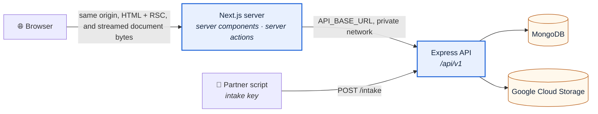

# Rendering and data fetching

**Date:** 2026-09-10
**Decides:** [PLAN.md](../../PLAN.md) Q1 — and unblocks Q2
**Applies to:** every screen in `apps/web`, and the contract between the web app and the API
**Cross-checked:** yes — §16 records what the review changed

Every screen in `apps/web` currently opens with `"use client"`. That was never decided; it
accumulated. Next.js renders Server Components by default, so the directive is an opt-out, and
opting out has a price: a larger JavaScript bundle, hydration work on every visit, and — for any
screen that fetches after mount — a round trip the server could have made first. Twenty-two files
took that trade without anyone making it.

The correction is not "avoid client components". It is that the directive belongs on the smallest
interactive component rather than on a screen.

This document decides the model, in the dependency order the six decisions have: each constrains
the next, and the first constrains all of them.

---

## 1. The six decisions

| # | Decision | Answer |
| :--- | :--- | :--- |
| 1 | Who talks to the API | The Next server. No browser-originated call reaches the API |
| 2 | Where each screen renders | Server, with client leaves for interaction only |
| 3 | Where data is fetched | Server components, through a `server-only` data access layer |
| 4 | What the API returns | Figures for the dashboard, records for lists and detail |
| 5 | Where aggregation happens | The database, in an aggregation pipeline |
| 6 | What is cached, for how long | Cache Components — narrowly, and invalidated by tag |

---

## 2. Decision 1 — the Next server talks to the API

Every **browser-originated** call to the API originates on the Next server. Partner scripts holding
an intake key still call `/intake` directly; that surface is unchanged and is not part of this
decision.



Next.js documents three data-fetching approaches and recommends picking one rather than mixing them.
A project with a separate REST service is the **External HTTP APIs** case: server components call
the existing endpoints with `fetch` under a Zero Trust model. For new code within that, the
recommended shape is a **Data Access Layer** — server-only, performing authorisation, returning
minimal data transfer objects.

What follows from the decision:

| Consequence | Effect |
| :--- | :--- |
| `NEXT_PUBLIC_API_URL` is removed | `.env.example` and `docker-compose.yml` both set it; nothing consumes it. `API_BASE_URL` becomes the only endpoint |
| No CORS configuration exists | The API is never called cross-origin |
| No API **key** reaches a browser | `server-only` makes importing the data access layer into the client graph a build error. It does **not** prevent a component from serialising a secret into props — minimal data transfer objects remain mandatory, and are the actual defence |
| A vendor session (slice 4) is one path, not two | An `httpOnly` cookie, which the Next server reads and exchanges for an API credential. The browser still carries a session token; it simply cannot read it from JavaScript, and it is never the API's own key |
| Mutations are server actions | Each one re-verifies its caller. A page-level check does not extend to an action declared on that page: the action is a separate entry point, reachable by direct `POST`. See §9 |
| `process.env` is read in the data access layer only | Which retires the `?? "http://localhost:4000"` fallback in `admin-api.ts`, the one `localhost` left in source (`NFR-S7`). The exception is `next.config.ts`, which reads environment state to build cache profiles at configuration time, before any request exists |

### 2.1 Original document bytes

**Reversed by the storage decision** ([object storage spec](2026-09-14-object-storage-gcs-design.md)
§5, 2026-09-14): the browser no longer fetches storage directly. `nosniff` cannot be attached to a
signed link, and a signed link keeps working after a takedown until it expires — both are §5.6
security-baseline requirements this design cannot meet. Two Next route handlers proxy the API's
document stream instead, so a taken-down record answers `404` on the very next request and every
byte carries `nosniff` and `no-store`. The extra hop through Next is the accepted cost, at this
corpus's sizes, of routes the browser can trust.

---

## 3. Decision 2 — where each screen renders

| Screen | Renders | Data source | What stays a client component |
| :--- | :--- | :--- | :--- |
| Landing `/` | Static shell | None | Radar backdrop, scroll motion |
| Dashboard | Server, cached figures | `GET /stats/dashboard` | Filter control, which writes to the URL |
| Search | Server, uncached, streamed | `GET /tors` | Query field and budget range, which write to the URL |
| TOR detail | Server, cached per id | `GET /tors/:id` | Bookmark toggle, calling a server action |
| Notifications | Server, per viewer | `GET /me/notifications` (slice 4) | Mark-read controls, calling a server action |
| Vendor profile | Server shell | `GET /me/profile` (slice 4) | The edit form |
| Login | Server page | — | The form |
| Admin overview · review · log | Server, uncached | Admin data access layer | The field editor |

### 3.1 Filter state lives in the URL — but not on every keystroke

A filtered list holds its filters in `searchParams`, which is what makes the screen
server-rendered, linkable, correct under the back button, and prefetchable.

Naïvely, that means one server navigation per keypress — which in Thai, where a word is composed of
stacked characters without spaces, is worse than in Latin script. The discipline:

1. The input holds a local draft value.
2. The URL is updated on an explicit submit, or debounced, inside `startTransition`.
3. The previous result list stays on screen while the next one is pending, rather than blanking.
4. Query parameters are canonicalised in one helper — order, casing, Unicode form (§11), and
   omission of empty values — so that two spellings of one search are one URL.

### 3.2 The client leaf rule

`"use client"` marks a boundary, not a file: a marked file's static imports join the client module
graph. Server components passed as `children` or props are exempt — they render on the server and
arrive as rendered output. An interactive shell may therefore wrap server-rendered content,
provided that content is passed in rather than imported.

---

## 4. Decision 3 — the data access layer

```
apps/web/src/shared/api/
  api-client.ts      server-only. Base URL from configuration, credentials, transport
                     policy (§4.1), one error shape. The only reader of process.env
  tors.api.ts        GET /tors · GET /tors/:id · the document URL
  stats.api.ts       GET /stats/dashboard · GET /stats/anomalies
  me.api.ts          vendor profile, bookmarks, notifications (slice 4)
  admin.api.ts       today's shared/lib/admin-api.ts, moved — and changed: its
                     localhost fallback is removed and configuration is validated
                     at startup instead
```

Rules the layout enforces:

1. Only `*.api.ts` calls the API, exactly as only `*.repository.ts` reaches the database.
2. Every module imports `server-only`, so a client import fails the build rather than review.
3. Each function returns the fields a screen renders, not the record the API sent. This is the
   real defence against leaking a field to the browser; `server-only` is not.
4. Reads that do not use `fetch` are wrapped in `React.cache` — request-scoped memoisation keyed by
   argument identity, cleared between requests, and no substitute for a data cache. Identical
   `fetch` calls in one render are memoised already.

### 4.1 Transport policy

Stated once, in `api-client.ts`, because a policy that lives at call sites is not a policy:

| Concern | Rule |
| :--- | :--- |
| Timeout | A deadline on every call, from configuration. A slow API must not hold a Next render open indefinitely |
| Cancellation | An `AbortSignal` tied to the request, so an abandoned render stops work downstream |
| Retries | At most one retry, jittered, and only for idempotent `GET`s on a network error or 502/503/504. **Never** for a mutation without an idempotency key |
| 429 | `Retry-After` is honoured, not ignored and retried |
| Response size | A ceiling, so a malformed or hostile response cannot exhaust the web server |
| Correlation | A request id generated at the Next server, sent to the API, and logged on both sides (§12) |

`AbortSignal` participates in `fetch` deduplication, so the layer must not assume that two
deadline-decorated calls coalesce.

---

## 5. Decisions 4 and 5 — figures, computed in the database

`GET /stats/dashboard` returns **computed figures**, with `lastUpdatedAt` and the coverage note that
`FR-E-6` requires. Lists and detail return records. The browser performs no arithmetic over a
corpus, and receives no threshold to apply for itself: a flag is decided on the server beside the
configuration that defines it, so two surfaces cannot drift when the value changes.

Aggregation runs in MongoDB, in an aggregation pipeline. Not in Node over a fetched collection, and
not in the browser.

### 5.1 Bounds, which are part of the contract

- **The dashboard payload is bounded**: a stated date window, a top-N per dimension, and drill-down
  as a second request. A full agency × category × month grid is not returned to every viewer.
- **Lists are cursor-paginated**, ordered by `(announcedAt, _id)` — `announcedAt` because it is the
  agency's own publication date, `_id` as the tie-breaker that makes the order total. Deep `skip`
  over a national corpus degrades; a cursor does not.
- **`pageSize` has a ceiling**, and the query string has a length ceiling (§11).
- Whether a total count is exact, approximate, or omitted is decided with Q2, against real volume.

**Q2 does not change this contract.** Whether the figures come from a live pipeline or a scheduled
rollup, the route, the response shape, and the caching policy are identical — the difference is
behind the API. That is why Q1 had to be settled first.

---

## 6. Decision 6 — Cache Components, used narrowly

`cacheComponents: true` in `apps/web/next.config.ts`. It is the caching model of Next.js 16: it
replaces the previously experimental `experimental.dynamicIO` and `experimental.useCache`
configuration flags, and it makes Partial Prerendering the normal rendering behaviour — a static
shell ships immediately while uncached work streams behind explicit `<Suspense>` boundaries.

The directive it enables is `use cache`. The name collision between the retired **flag**
`experimental.useCache` and the surviving **directive** `use cache` is confusing and is the reason
it is spelled out here.

### 6.1 What is cached, and what is deliberately not

| Surface | Policy | Why |
| :--- | :--- | :--- |
| Landing | Prerendered | No data |
| Dashboard figures | `use cache`, tagged `stats` | One expensive aggregate, read by everyone — the highest-reuse surface in the product |
| TOR detail | `use cache`, tagged `tor:<id>` | A stable public document, read repeatedly |
| **Search results** | **Not cached.** Behind `<Suspense>`, fetched per request | The cache key would be `q × agency × category × budget × dates × sort × page`. Reuse approaches zero, key diversity is unbounded, and Thai spelling variants multiply it. Caching it turns an in-memory LRU into an accidental, evictable search database. Revisited only if measurement shows genuinely repeated queries |
| Vendor screens, admin | Never cached | Per-viewer and privileged |

### 6.2 Invalidation is by tag, with time as the safety net

Time-only expiry is **not acceptable** for this product. An accepted takedown restricts access
(`FR-B-6`); a correction changes a published field (`FR-G-2`); an approval clears the unverified
mark. Serving a cached copy after any of those means continuing to publish something a person
decided to withdraw or fix. Waiting for a lifetime to lapse is not a defensible answer to that.

| Trigger | Mechanism |
| :--- | :--- |
| Anything the Next server mutates — approval, correction, takedown, rejection | The server action calls `revalidateTag` on `tor:<id>` and `stats` immediately, in the same request. No endpoint, no shared secret |
| Anything the **worker** writes — a newly extracted record | Time-based expiry. The worker runs inside the API and cannot reach the Next cache. §17 carries the option of an authenticated revalidation route if this proves insufficient |

### 6.3 Lifetimes are derived, then configured

A `cacheLife` profile names three values — `stale`, `revalidate`, `expire` — and all three are set,
because `stale` is what serves a reader while a refresh happens behind them, and is the defence
against a stampede at expiry.

They are derived from the pipeline's own cadence rather than chosen by feel: **a figure cannot
change faster than the pipeline can produce one.** Extraction is bounded by `EXTRACT_TIMEOUT_MS`
(120 s) and the reconciler sweeps at `RECONCILE_INTERVAL_MS` (60 s), so a dashboard `revalidate`
below roughly one extraction cycle buys nothing and costs an aggregation.

| Value | Initial | Derivation |
| :--- | :--- | :--- |
| `stale` | 60 s | The reconciler's interval — the shortest period in which the system re-examines its own state |
| `revalidate` | 120 s | One extraction cycle |
| `expire` | 3600 s | An hour-old figure that failed to refresh is still worth showing beside its `lastUpdatedAt`; older is not |

Declared as named profiles in `next.config.ts`, sourced from environment variables with these
values as documented defaults, and marked provisional until the real ingestion cadence is measured.
No duration is written into a component (`NFR-S7`).

### 6.4 Self-hosting, honestly

A `use cache` entry lives in an in-memory, per-process store: it does not survive a restart and is
not shared between instances. Compose runs one `web` container, so this is currently sufficient, and
that is a statement about today's deployment, not an argument that one instance is the right shape.
The extension point for durability is a configured cache handler; adopting it is deferred, and the
moment a second instance exists, cache entries, tag invalidation, and Server Action encryption keys
all need coordination.

### 6.5 What adoption actually costs

Not one flag. The three admin pages export `dynamic = "force-dynamic"`, which the new model
replaces with explicit runtime access behind `<Suspense>`; `searchParams` and dynamic segments need
deliberate boundary placement; and code written around `use cache` and `cacheLife` does not revert
by flipping the flag back. This is a tree-wide semantic migration on a tree that is small today,
which is the argument for doing it now rather than after slice 3 builds five more screens.

---

## 7. Personalisation is isolated, so public pages stay cacheable

A public page carrying one viewer-specific element cannot be cached as a whole. The public shell
caches; the personal part — the account control and the notification count — renders **on the
server**, behind its own narrow `<Suspense>` boundary, reading the session cookie there.

It is deliberately not a client-side fetch. That path is HTML, then JavaScript, then hydration, then
a second request before the viewer's own state appears — the worst sequence on a slow connection,
and it would discard the server-session design chosen in §2. Only the interactions stay on the
client: opening the menu, marking a notification read.

Both context providers currently wrap the document body. Providers render as deep in the tree as
possible, wrapping only what consumes them. Note what this is and is not: a client provider taking
`children` does not make those children client components, because they arrive as props rather than
through the provider's imports. The flash on first paint comes from reading browser storage after
mount, which is the prototype session's doing (§9) and disappears with it.

---

## 8. The state contract

Every data-bearing screen states all of these, in Thai, before it is considered done. This is
`Gate 8` of the build discipline, which the previous draft of this document omitted.

| State | Rule |
| :--- | :--- |
| Loading | A meaningful skeleton in the `<Suspense>` fallback, not a spinner over a blank page |
| Empty — no data yet | Distinct copy from "no match". "Nothing to review" is not "no result for this search" |
| Empty — filtered out | Names the filter that emptied it, and offers to clear it |
| Not found | `not-found.tsx`. **Caveat:** when `notFound()` is reached after streaming has begun, the response is already `200`; the not-found UI renders but the status is not 404. Detail routes therefore resolve existence before streaming |
| Forbidden | Redirect to sign-in for a missing session; a plain refusal for a valid session without the right access |
| API unreachable | The public pages serve the last cached figures with their `lastUpdatedAt` visible and a Thai note that the data is not live. Search fails closed with a stated reason. Mutations refuse rather than appearing to succeed |
| Timeout | Treated as unreachable, with the same copy. A deadline is not an exception to explain to a reader |
| Unexpected error | `error.tsx`: Thai copy, a reference id, no stack trace. Already built at the root; extended per area |

---

## 9. Sessions, cookies, and action authorisation

**Server actions are public endpoints.** An exported, referenced action is reachable by a direct
`POST` to the Next server. Next compares `Origin` against `Host` as a CSRF mitigation, and action
ids are non-deterministic — neither is authorisation.

Therefore every action, without exception:

1. Verifies its caller **first**, before any credential is spent or any API call is made.
2. Validates its arguments against a schema. Arguments arrive from the browser.
3. Checks ownership, not merely authentication — that this viewer may act on *this* record.
4. Returns only what the UI needs.

A page-level check does not satisfy any of these. Both exist, because they defend different entry
points.

**The defect this rule was written against:** the four admin actions in `admin.actions.ts` spend the
server-held admin key with no caller verification, and the only gate is a client component reading
prototype browser storage, whose own comment concedes it is not access control. This is fixed
separately from the migration, as its own change, and is not a claim this document may make about
the admin area until it is.

Session ownership, to be settled when slice 4 designs authentication and recorded there, not
invented here: which service issues and verifies the session, cookie name and attributes, rotation
and expiry, revocation, how the Next server translates an API `Set-Cookie` into a browser cookie,
and the rule that **named cookies are forwarded, never the whole `Cookie` header**.

---

## 10. Metadata and indexing

A public transparency platform that no one can find has failed at its purpose.

- `generateMetadata` on TOR detail — the record's own title and agency, in Thai.
- A canonical URL per filter permutation, so faceted variants do not compete with each other.
- `robots` excludes deep filter permutations and search result pages; it does not exclude detail
  pages.
- A sitemap that is generated rather than enumerated, because the corpus is expected to grow past
  the point where a single static list is reasonable.
- Bots are served a complete document rather than a stream, so anything the shell depends on must
  also be available at request time.

---

## 11. Thai, beyond "the UI is Thai"

| Concern | Rule |
| :--- | :--- |
| Query normalisation | Query text is normalised to **NFC** in one helper before it becomes a URL, a cache key, or a search term. Two Unicode spellings of one Thai word must not be two cache entries |
| Query length | A ceiling, checked before the request — Thai is multi-byte and a filter set encodes larger than it reads |
| Dates | The API carries Gregorian ISO values; the display may show Buddhist era. The conversion lives in one formatter, never in a component |
| Sorting | Thai collation is decided in the database, not by JavaScript's default string order |
| Extracted values | Displayed exactly as extracted — never re-worded, re-formatted, or silently corrected (`NFR-F7`) |
| Copy | Loading, empty, and error copy is Thai, written with the screens, not appended afterwards |

---

## 12. Observability

A correlation id is generated at the Next server, forwarded to the API, and logged by both. Beyond
that: structured request logs with status and latency, cache hit and miss counts, timeout counters,
and search latency. Secrets and personal data are redacted at the log boundary, through the same
serializer that redacts them for display (`FR-D-3`).

---

## 13. Testing

Next.js recommends end-to-end coverage over unit tests for async server components, because the
tooling for rendering them in isolation is incomplete. The strategy follows that:

| Level | Covers |
| :--- | :--- |
| Unit | Parameter parsing, query canonicalisation, Unicode normalisation, data transfer object mapping, cache key derivation |
| Contract | The data access layer against the API's own schemas, so a response shape change fails a test rather than a screen |
| Action | Authorisation and input validation on every server action, including the negative case that **the API is not called** when authorisation fails |
| End-to-end | Against the running Compose stack, in a production build with Cache Components enabled: streaming, back and forward URL state, the first HTML without JavaScript, 404 behaviour, an API outage, a slow API, and tag invalidation actually invalidating |

---

## 14. What changes, and what does not

Changed:

1. `cacheComponents: true`, the `cacheLife` profiles beside it, and the removal of the
   `dynamic = "force-dynamic"` exports it replaces.
2. `src/shared/api/` created; `shared/lib/admin-api.ts` moves into it and loses its `localhost`
   fallback.
3. The seven screen-level `"use client"` directives removed; each screen becomes a server component
   passing data to client leaves.
4. Filter state moves into `searchParams`, with the discipline in §3.1.
5. Providers move down the tree; session chrome server-renders behind `<Suspense>`.
6. `NEXT_PUBLIC_API_URL` deleted from `.env.example` and `docker-compose.yml`.
7. Loading, empty, not-found and unreachable states written per screen (§8).

Unchanged:

- No slice 3 API route is built here. Screens keep rendering the labelled sample records in
  `src/data/`, which become a server-side import, so the migration is verifiable today.
- The admin area's **fetch boundary** stays as it is. Its **authorisation** is fixed separately
  (§9), before this migration begins.
- The visual result is unchanged. This is a rendering-model change, not a redesign.

---

## 15. Contradictions this closes

| Contradiction | Resolution |
| :--- | :--- |
| `API.md` routes public reads through the Next server and, in the same document, names `NEXT_PUBLIC_API_URL` as the web app's base URL. A `NEXT_PUBLIC_` variable is browser-reachable by definition | The Next server is the only caller. The variable is removed and `API.md` corrected |
| `CLAUDE.md` states `localhost` appears in no source file; `admin-api.ts` carries `?? "http://localhost:4000"` | Removed; configuration validated at startup instead of defaulted at the call site |
| Every screen is a client component, while the admin area fetches on the server behind `server-only` | The admin fetch pattern becomes the rule |
| An earlier draft of this document said the Next server generates the document signed URL; `API.md` says the API does | The API does. §2.1 |

---

## 16. What the cross-check changed

Reviewed by models from three companies before anything was built on it. Four legs errored; of those
that answered, three carry knowledge predating Next.js 16 and produced corrections that current
documentation contradicts — that `fetch` is not memoised, that Partial Prerendering needs a separate
experimental flag, that `React.cache` cannot wrap an async function, that server actions are not
reachable by direct `POST`. Those were checked against the docs and rejected.

Accepted, and changed in this document:

| Finding | Section |
| :--- | :--- |
| Caching arbitrary search queries is a high-cardinality attack on an in-memory cache | §6.1 — search is no longer cached |
| Time-only invalidation is indefensible for takedowns and corrections | §6.2 — tag invalidation, time demoted |
| Client-fetching session chrome is the worst path on a slow network and discards the server-session design | §7 — server-rendered behind Suspense |
| The API, not the web app, must own the MinIO signed URL | §2.1 |
| Deep pagination degrades at national volume | §5.1 — cursor with an `(announcedAt, _id)` tie-breaker |
| One URL update per keystroke is a server navigation per Thai character | §3.1 |
| `"use client"` does not remove server-rendered HTML or SEO — the costs are bundle, hydration, and post-mount fetching | Opening section |
| `server-only` is not a guarantee that no secret reaches the browser | §2 |
| Adoption is a tree-wide migration, and "one flag back" is not a rollback | §6.5 |
| A streamed `notFound()` returns HTTP 200 | §8 |
| Missing entirely: state contract, transport policy, session mechanics, metadata, Thai specifics, observability, testing | §§4.1, 8–13 |

Found in the repository during the review, and **not** a documentation matter: the admin server
actions have no caller verification (§9).

---

## 17. Risks and what stays open

| Item | Position |
| :--- | :--- |
| Cache Components rejects part of the existing tree | The migration is incremental, screen by screen, against a running app. Reverting is code, not a flag — accepted knowingly |
| Worker-written records go stale until expiry | Accepted for ingestion freshness, where the page states its own `lastUpdatedAt`. An authenticated revalidation route is the escape hatch if a reader notices |
| Cache lifetimes are derived from the pipeline's cadence, not measured under load | Marked provisional in configuration; revisited with Q2 |
| One `web` instance | A deployment fact, not an architecture. Durable cache handling and encryption-key coordination are prerequisites for a second |
| Q2 — live aggregation or scheduled rollups | Unchanged by this document, and next |

---

## 18. Sources

Next.js 16.3.x documentation, retrieved 2026-09-10:

- [Server and Client Components](https://nextjs.org/docs/app/getting-started/server-and-client-components) — the default, the boundary, provider placement, `server-only`
- [Fetching data](https://nextjs.org/docs/app/getting-started/fetching-data) — `fetch` is not cached by default but is memoised per render; `React.cache`
- [Caching](https://nextjs.org/docs/app/getting-started/caching) — Cache Components, `use cache`, `cacheLife`, Partial Prerendering, where cached content is stored
- [How to think about data security](https://nextjs.org/docs/app/guides/data-security) — the three approaches, the Data Access Layer, server action authorisation
- [Next.js 16](https://nextjs.org/blog/next-16) — `cacheComponents` replacing `dynamicIO` and `useCache`
