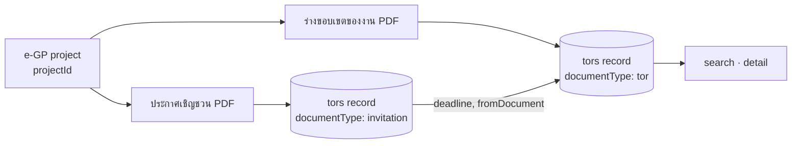

# e-GP project linking: source dates, and the deadline from the invitation

**Date:** 2026-09-16
**Amends:** [SRS](../../SRS.md) §1.5 (TOR definition) and FR-B-2 (submission deadline)
**Builds on:** [search and filter](2026-09-16-search-and-filter-design.md) · `sources/bma-egp/enrich.ts`
**Evidence:** 19 real TORs imported from egp2.bangkok.go.th and extracted with Vertex AI on 2026-09-16

---

## 1. What real data showed

| Finding | Evidence |
|---|---|
| A ร่างขอบเขตของงาน (TOR) document does not state the submission deadline | 0 of 19 extracted TORs had one. The model's evidence says so each time ("ไม่พบข้อมูลวันสิ้นสุดการยื่นซองในเอกสาร…") |
| It rarely states its own announcement date either | `announcedAt` was null on 19 of 19 |
| The deadline is stated in the project's ประกาศเชิญชวน | Tested on e-GP 69099251609: "วันที่ ๑๗ กันยายน ๒๕๖๙ ระหว่างเวลา ๐๙.๐๐ น. ถึง ๑๒.๐๐ น.", read at confidence 0.95 in 14 s |
| Every document of a project shares one `projectId` | `GetAnnouncementDetailInProject` returns TOR, ราคากลาง and เชิญชวน entries with the same `projectId`, and each has its own PDF and `projectAnnouncementPublishDate` |
| The source API has no deadline field | The search response carries no dates. Announcement entries carry only a publish date |

So FR-B-2 ("extract nine fields from each TOR", deadline among them) cannot be met from TOR documents alone.

## 2. Decisions

| # | Decision | Answer |
|---|---|---|
| 1 | What a record is | Still **one TOR document**. Search, detail, matching and the dashboard stay TOR-centred (SRS §1.5) |
| 2 | Where the deadline comes from | The **ประกาศเชิญชวน of the same project**, read by the same extraction, used **only as a supporting document** |
| 3 | How the documents are linked | `sourceProject: { system: "bma-egp", projectId, projectNumber }` on both records |
| 4 | How the supporting document is stored | As its own record (`documentType: "invitation"`), so it gets content-hash dedupe, immutable storage, extraction, retries and an audit trail for free. **It is never listed publicly** |
| 5 | How a linked value is marked | The TOR's `fields.deadline` carries `fromDocument: <invitation record id>`. The detail page names the invitation and links to its original (NFR-F6) |
| 6 | Announcement date | e-GP's `projectAnnouncementPublishDate` for that document, as a Bangkok calendar date, marked `announcedAtOrigin: "source"`. Extraction never overwrites it |
| 7 | Which order they arrive in | Either. An invitation extracted after its TOR pushes the deadline onto the TOR; a TOR extracted after its invitation pulls it |
| 8 | An implausible deadline | **Not linked.** A deadline grading flags `deadline-before-announcement` stays on the invitation, in the review queue, and the TOR shows the deadline as not stated. Measured: 4 of 9 real invitations were scans where ๙ was read as ๕, turning 2569 into 2565 |

## 3. Record shape

Added, all optional, schema version 2:

```ts
documentType?: "tor" | "invitation"          // absent means "tor"
sourceProject?: { system: "bma-egp"; projectId: string; projectNumber?: string }
announcedAtOrigin?: "source"
// on ExtractedField
fromDocument?: string                         // the record this value was read from
```

Public reads add `documentType ≠ "invitation"` to their always-applied filter.

## 4. Flow



## 5. Out of scope, and still open

- **The submission time.** The deadline value stays a `YYYY-MM-DD` date, and `raw` keeps the full wording with the time window. Comparing "still open" against the window's end time is a follow-up.
- **Projects with an invitation but no TOR** (about 65% of live tenders, DATA-SOURCES.md). Covering them changes decision 1 and needs a separate team decision.
- **The scheduled collector** (F12, FR-A-4). `tools/import_egp_tors.mts` remains a one-off import.
- **Other document types** (ราคากลาง, award, cancellation) are not collected.
- **A reviewer's correction of an invitation's deadline** is not yet pushed to its TOR; the TOR picks
  it up only when it is next extracted. The admin edit path should link it.
- **Very large scans.** A 10.7 MB, many-page scan timed out in a single Gemini call even at 5 minutes.
  Splitting by page, or Document AI OCR first, is the likely answer.
