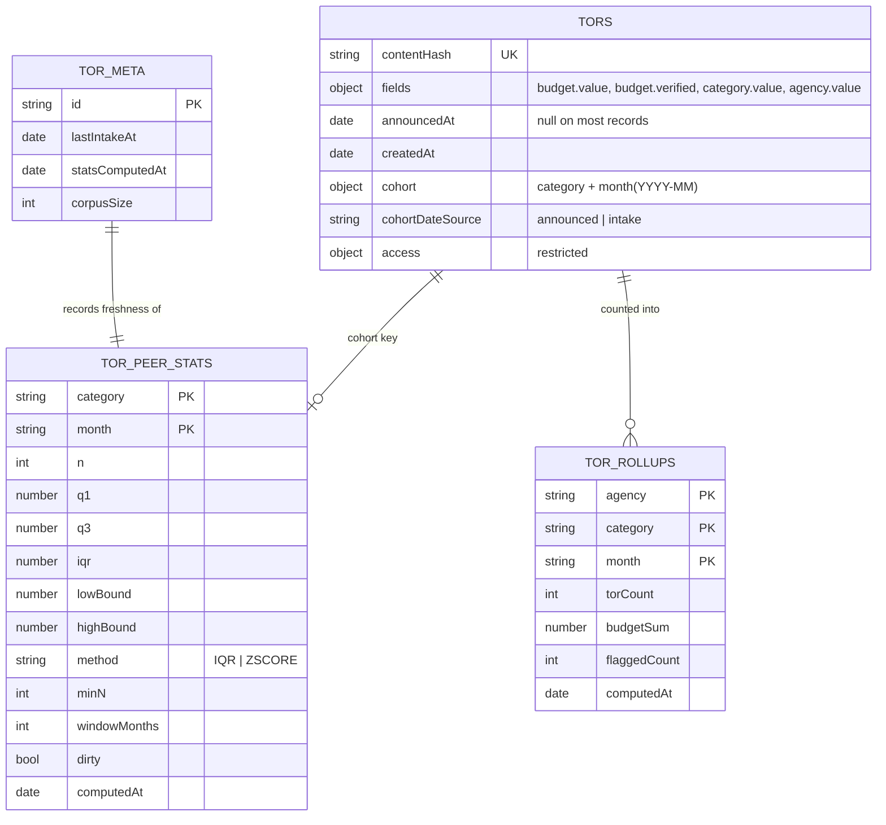

# Dashboard figures and the statistical-anomaly rule — design

_Sprint 3 (Dashboard, 2026-09-10 → 24). Covers Jira TOR-61, TOR-62, TOR-63, TOR-65, TOR-66, TOR-122,
under stories TOR-56 (US-08 public dashboard) and TOR-64 (US-10 filters)._

## 1. What this covers, and what it does not

| In scope | Out of scope |
| :--- | :--- |
| The anomaly rule as one documented function (TOR-61) | The search API and Thai full-text search (TOR-41/42/43 — Sran) |
| Excluding unverified budgets from the statistics (TOR-63) | The dashboard's Thai UI shell and coverage banner (TOR-58/59 — Sran) |
| The budget plot with flagged points (TOR-62) | The aggregation API's own route (TOR-57 — Sran); this spec defines the collections it reads |
| Composable filter state (TOR-65) | The specification-quality checklist (F8) — Sprint 4 |
| Totals and the trend line (TOR-66) | CSV export (F11) — Sprint 5 |
| The edge-case tests (TOR-122) | Matching and notification (Slice 4) |

Requirements realised: **FR-E-1** (per-agency count and budget over a selectable range, with the
trend), **FR-E-2** (budget plot, figures labelled "statistical anomaly" by the §4.5.1 rule),
**FR-E-3** (filters that compose), **FR-E-6** (last-updated time and the coverage note), **NFR-F4**
(dashboard within three seconds), **NFR-F5** (wording), **NFR-F6** (AI values labelled and explained).

## 2. Decisions, and the evidence behind them

### 2.1 A record's flag is derived at read, never stored on the record

Three designs were weighed: (A) the recompute job stamps `anomaly` on every record in a peer group;
(B) the job stores only the group's bounds and a record's flag is derived when it is read; (C) no
precomputation at all.

**Decided: B, with dirty-cohort recomputation** (§5).

- C was already rejected on 2026-09-14: live aggregation over the whole corpus is instant at 500
  records and unusable at 100,000.
- A fails on correctness under change. A budget changes when an admin corrects it or a document is
  re-extracted, and a group's bounds change whenever any TOR joins the group. A stamped flag then
  contradicts the bounds printed beside it on the same screen, which is exactly what NFR-F5 and
  FR-F-3 promise will never happen. It also rewrites every record in a cohort on every run — write
  amplification and replication load that buys nothing, because no screen filters or paginates by
  "anomalous only".
- B's cost is one small lookup: the bounds live in one document per peer group, so a category plot
  reads one bounds document however many points it draws, and a page of search results reads the
  distinct cohorts of that page with a single `$in`.
- B's own weakness — bounds going stale between scheduled runs — is closed by recomputing a cohort
  when it is marked dirty, rather than only on a timer.

Cross-checks: MongoDB's own guidance treats a precomputed view as application-refreshed, with
staleness the accepted cost and refresh scoped to the affected keys, and does not endorse copying a
derived value onto source records. The Open Contracting Partnership's red-flag library, Cardinal,
computes flags as the output of a batch run over the dataset rather than as fields maintained on
records. A different-company review (Codex, 2026-09-16) chose B for this workload unprompted,
identified the two holes fixed in §4.2 and §6.3, and proposed the dirty-cohort refinement adopted
here.

### 2.2 Eligibility is the existing `verified` flag, not model confidence

`docs/corpus/BENCHMARK.md` measured mean model confidence at **0.965 on wrong predictions and 0.971
on correct ones**, so a confidence threshold separates nothing. The benchmark's own conclusion —
deterministic per-field rules first, model confidence second — is already implemented in
`extraction.grading.ts`, which sets `fields.<name>.verified` from structural rules plus whether the
document had a real text layer, and which an admin tick can also set.

Therefore: **a budget enters the statistics, and can be flagged, only when `fields.budget.verified`
is true.** One rule, one place, used by both the recompute job and the read helper. This closes
PLAN.md's Q4 for the purposes of this slice; the wider tiering question stays open for slice 2's
own review.

### 2.3 A cohort needs a date that always exists

The peer group is category × time window, but `announcedAt` is null on 9 of 10 benchmark documents.
A cohort keyed on `announcedAt` alone would drop most of the corpus out of every group.

**Decided:** each record carries `cohort: { category, month }`, where `month` is derived from
`announcedAt` when it exists and from `createdAt` otherwise, with `cohortDateSource` recording which
was used. The methodology page states this plainly. Silently treating an intake date as an
announcement date would be a misrepresentation, and FR-E-6 already commits the dashboard to saying
what its figures cover.

### 2.4 The peer window is twelve calendar months, ending at the cohort month

"Rolling 12 months" is ambiguous for a historical record: relative to now, an old record's peers
would change every day, and its bounds could never be cached. The window is therefore anchored to
the record's own cohort month — a cohort is `(category, month)`, and its statistics are computed
over every eligible record whose cohort month falls in the twelve months ending at that month. A
record's group is then stable, and a bounds document can be keyed by exactly the cohort key the
record carries.

## 3. Data model

### 3.1 Collections

| Collection | Key | Fields | Purpose |
| :--- | :--- | :--- | :--- |
| `tors` (existing) | `_id` | **adds** `cohort: { category: string; month: string }`, `cohortDateSource: "announced" \| "intake"` | The join key from a record to its peer group |
| `tor_peer_stats` (new) | unique `{ category, month }` | `n`, `q1`, `q3`, `iqr`, `lowBound`, `highBound`, `method`, `minN`, `windowMonths`, `computedAt`, `dirty`, `dirtyAt` | The bounds. The only thing a flag is derived from |
| `tor_rollups` (new) | unique `{ agency, category, month }` | `torCount`, `budgetSum`, `flaggedCount`, `computedAt` | Totals, the trend line, and the stat strip |
| `tor_meta` (new) | `_id: "dashboard"` | `lastIntakeAt`, `statsComputedAt`, `corpusSize` | FR-E-6's last-updated time and coverage note, read once per page |

`month` is `YYYY-MM` throughout — sortable as a string, and the trend line is a sort on it.

### 3.2 Indexes

| Collection | Index | Why |
| :--- | :--- | :--- |
| `tors` | `{ "cohort.category": 1, "cohort.month": 1, "fields.budget.value": 1 }`, partial on `{ "fields.budget.verified": true }` | The statistics path. The partial filter is how §2.2's rule is enforced by the database rather than by remembering to write it |
| `tors` | `{ "cohort.category": 1, "cohort.month": 1 }` | Plot and per-cohort reads |
| `tor_peer_stats` | `{ category: 1, month: 1 }` unique | One bounds document per group; the unique index is what makes the recompute idempotent |
| `tor_peer_stats` | `{ dirty: 1, dirtyAt: 1 }`, partial on `{ dirty: true }` | The job's work queue |
| `tor_rollups` | `{ agency: 1, category: 1, month: 1 }` unique · `{ month: 1 }` | Stat strip, trend |

Existing indexes are unchanged. `{ "fields.category.value": 1, announcedAt: -1 }` stays: it serves
the record list, while the new pair serves the statistics.

### 3.3 The shape



## 4. The anomaly rule

### 4.1 One function, and it is the documentation

`apps/api/src/modules/stats/anomaly.rule.ts` exports the whole rule. The methodology page renders
from the same constants, so the page cannot drift from the behaviour.

```ts
export type AnomalyVerdict =
  | { kind: "not-evaluated"; reason: "unverified-budget" | "no-budget" | "insufficient-peers"; n: number }
  | { kind: "normal"; distance: 0 }
  | { kind: "anomaly"; side: "high" | "low"; distance: number };
```

`distance` is how far outside the bound the value sits, in multiples of the IQR — the "3.1×IQR" the
screen shows. For ZSCORE it is the absolute z-score.

Inputs: the record's budget value and `verified` flag, and its cohort's `tor_peer_stats` document.
Nothing else. No database access inside the function, so it is exhaustively testable.

Order of checks, which is also the order of the reasons a screen can show:

1. No budget value → `not-evaluated: no-budget`.
2. `fields.budget.verified !== true` → `not-evaluated: unverified-budget` (§2.2, TOR-63).
3. No bounds document, or `n < minN` → `not-evaluated: insufficient-peers`.
4. IQR: outside `q1 − 1.5·IQR` or `q3 + 1.5·IQR` → `anomaly`, otherwise `normal`.
   ZSCORE (documented alternative, off by default): `|z| > 3`.

### 4.2 Statistics are computed over eligible records only

The cohort statistics are computed over records that are: not `access.restricted`, have a budget
value, and have `fields.budget.verified === true`. The partial index in §3.2 matches that filter
exactly, so an unverified budget can neither create a flag nor move one — which is what §4.5.1 of
the SRS requires and what TOR-63 asks for.

Quartiles use the same definition the methodology page states: linear interpolation on the sorted
eligible values (type 7, the common default). It is stated because "which quartile definition" moves
flags at small `n`, and an unstated choice is not a documented rule.

## 5. Keeping the bounds fresh

### 5.1 A cohort is marked dirty by the events that can change it

| Event | Cohorts marked dirty |
| :--- | :--- |
| A record is published with a budget | its own cohort, and the eleven following months whose windows contain it |
| An admin corrects a budget, or ticks/unticks `verified` | same |
| A re-extraction changes budget, category or the cohort date | the old cohort and the new one, each with their following eleven months |
| A record is restricted (takedown) or unrestricted | its own cohort, and the following eleven |

Marking is an `updateMany` setting `dirty: true, dirtyAt: now` on at most twelve small documents,
inside the same service call that made the change. A missing bounds document is upserted dirty, so a
brand-new cohort is computed on the next sweep rather than silently absent.

### 5.2 The worker recomputes dirty cohorts, and sweeps

The existing worker gains a second handler. It claims dirty cohorts oldest-first, recomputes each
from the eligible records in its window, writes the bounds with `computedAt` and clears `dirty`. A
full sweep also runs on the configured interval, so a missed mark cannot freeze the dashboard
forever — a belt-and-braces pass, not the primary mechanism.

Rollups are recomputed in the same pass for the months touched, because `flaggedCount` depends on
the bounds that were just written.

### 5.3 Staleness is shown, not hidden

`tor_meta.statsComputedAt` is rendered as the dashboard's last-updated time (FR-E-6). When it is
older than the configured staleness limit, the dashboard says the figures are being recalculated
rather than presenting them as current. A dead job then looks like a dead job instead of quietly
frozen numbers.

## 6. Reading

### 6.1 The plot (TOR-62)

One category, one window. Reads the cohort's bounds document, then the eligible records for that
cohort, and maps each through §4.1. Points carry `{ id, budget, verdict }`; the flagged ones get the
badge and the distance. The bounds themselves are drawn as the normal band, so the reader can see
what "outside" means — the number and the rule in one picture.

### 6.2 Search rows

A page of results is fetched first, then one query fetches the bounds for the distinct cohorts on
that page (`$in` over at most the page size), then each row is mapped through §4.1. No `$lookup` per
row, and no expression comparison across the collection.

### 6.3 Counts under filters (TOR-66, the stat strip)

`torCount`, `budgetSum` and `flaggedCount` come from `tor_rollups`, summed over the cells the active
filters select. They are never computed by scanning `tors` on page load: an unindexable expression
comparison over the whole collection is exactly what NFR-F4's three-second budget cannot absorb at
100,000 records. The trend line is the same rollup cells grouped by `month`.

This is the one place where a figure can lag the underlying records, bounded by §5.2's interval and
disclosed by §5.3.

### 6.4 Filters that compose (TOR-65)

Filter state lives in the URL query string — agency, category, month range, budget range, status.
The server component reads it, so a filtered dashboard is shareable, survives a reload, and renders
on the server as the rendering spec requires. Client components own only the controls' interaction
state. Unknown or malformed values are ignored rather than rejected, and every value is parsed by a
Zod schema of primitives, so no operator object can reach a Mongo query (§5.6 of the slice-1 spec).

## 7. Screens and their states

Designed alongside the normal state, per build-skill Gate 8 — not retrofitted.

| Surface | Empty | Not evaluated | Stale | Error |
| :--- | :--- | :--- | :--- | :--- |
| Plot | "no TORs in this category yet" | `n < minN` → "not enough comparable TORs to compare" with `n` shown | banner with the last-updated time | the panel fails alone; the rest of the dashboard renders |
| Stat strip | zeroes with the coverage note | flagged count omitted, not zeroed, when no cohort qualifies | same banner | figures replaced by a retry, never by stale numbers presented as current |
| Search row badge | — | no badge, and the row says why on the detail page | — | badge omitted; the row still renders |

Wording is fixed by NFR-F5: only "ความผิดปกติทางสถิติ" and "การตรวจสอบคุณภาพข้อกำหนด". Every flagged
figure links to the methodology page (FR-F-3).

## 8. Configuration

No literals (NFR-S7). All of these live in `core/config.ts` with their open status recorded:

| Key | Default | Status |
| :--- | :--- | :--- |
| `PEER_GROUP_WINDOW_MONTHS` | 12 | From SRS §4.5.1 |
| `PEER_MIN_N` | 8 | From SRS §4.5.1 |
| `ANOMALY_METHOD` | `IQR` | **Open (O4)** — provisional until compared with ZSCORE on real budgets |
| `ANOMALY_IQR_MULTIPLIER` | 1.5 | From SRS §4.5.1 |
| `ANOMALY_ZSCORE_LIMIT` | 3 | Documented alternative |
| `STATS_SWEEP_INTERVAL_MS` | 300000 | Belt-and-braces sweep |
| `STATS_STALE_AFTER_MS` | 3600000 | When §5.3's banner appears |

## 9. Testing

| Level | What |
| :--- | :--- |
| Unit (TOR-122) | The rule: `n` below `minN`, `n` exactly `minN`, unverified budget excluded, null budget, both tails, a value exactly on a bound, identical values (IQR 0), and the quartile definition against hand-computed values |
| Unit | Cohort derivation: `announcedAt` present, absent, and a month boundary |
| Integration | The recompute job: dirty marking on correction, on verification change, on takedown; a new cohort upserted dirty; idempotence — running twice changes nothing |
| Integration | Read paths: plot, search-row badges, rollup sums under filters |
| Live | Seeded dataset large enough to put at least one cohort over `PEER_MIN_N`; a known outlier is flagged, the distance matches hand arithmetic, unticking `verified` on the review screen removes it from the statistics |

## 10. Open questions

| Question | Blocks | Needs |
| :--- | :--- | :--- |
| Real corpus collection was decided ("as many as the source has") but no Vertex AI credentials exist on this machine, so newly collected documents cannot be extracted | Real figures on the dashboard, and the O4 comparison | Credentials, or a run on a machine that has them. `tools/collect_tor.py` also hard-codes `/usr/bin/curl`, which does not exist here |
| `ANOMALY_METHOD` — IQR or ZSCORE (O4) | Nothing in this slice; the rule supports both | The comparison on real budgets, once the corpus is extracted |
| Whether the dashboard's agency filter should use the extracted agency string or a normalised agency identifier | Rollup cardinality | Real data: how many spellings one agency has in the corpus |
