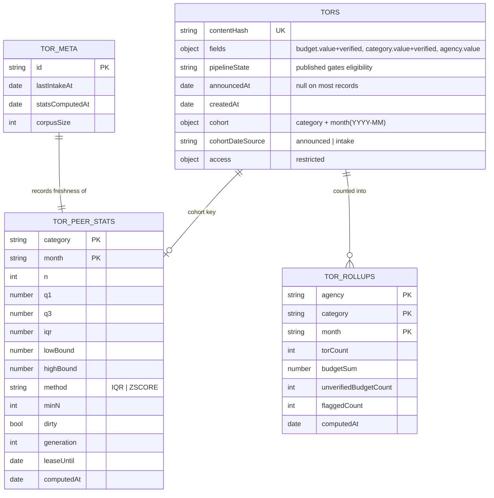

# Dashboard figures and the statistical-anomaly rule — design

_Revision 2 (2026-09-17). Sprint 3 (Dashboard, 2026-09-10 → 24). Covers Jira TOR-61, TOR-62, TOR-63,
TOR-65, TOR-66, TOR-122, under stories TOR-56 (US-08 public dashboard) and TOR-64 (US-10 filters)._

_Revision 1 was reviewed against the code by a different-company model and failed on twenty points.
The corrections are carried below, each at the section that was wrong; §12 lists them, because a
design that hides its own repairs teaches nobody._

## 1. What this covers, and what it does not

| In scope | Out of scope |
| :--- | :--- |
| The anomaly rule as one documented function (TOR-61) | Thai full-text search (TOR-43 — Sran); this spec defines only the filters that compose |
| Excluding ineligible budgets from the statistics (TOR-63) | The dashboard's Thai UI shell and coverage banner (TOR-58/59 — Sran) |
| The budget plot with flagged points (TOR-62) | The specification-quality checklist (F8, FR-F-4) — Sprint 4, TOR-48/67/68 |
| Composable filter state (TOR-65) | CSV export (F11) — Sprint 5 |
| Totals and the trend line (TOR-66) | Matching and notification — Slice 4 |
| The edge-case tests (TOR-122) | |

Requirements realised: **FR-E-1**, **FR-E-2**, **FR-E-3**, **FR-E-6**, **NFR-F4**, **NFR-F5**,
**NFR-F6** (through §7.4, not by claim), **NFR-S7**.

**FR-F-4 is deferred, not realised.** It requires failed checklist checks to appear beside flagged
budgets, and the checklist itself is Sprint 4 work. The dashboard payload reserves the field so the
screen does not have to be rebuilt; nothing here claims the requirement is met.

**Two API routes this slice needs overlap teammate cards.** `GET /api/v1/stats/dashboard` is
TOR-57's subject and `GET /api/v1/tors` is TOR-41's. The contracts are specified in §8 and built
here because TOR-62/65/66 cannot be demonstrated without them. The cards stay assigned; the overlap
is flagged rather than silently absorbed.

## 2. Decisions, and the evidence behind them

### 2.1 A record's flag is derived at read, never stored on the record

Three designs were weighed: (A) the recompute job stamps `anomaly` on every record in a peer group;
(B) the job stores only the group's bounds and a record's flag is derived when it is read; (C) no
precomputation.

**Decided: B, with dirty-cohort recomputation** (§6).

- C was rejected on 2026-09-14: live aggregation over the whole corpus is instant at 500 records and
  unusable at 100,000.
- A fails on correctness under change. A budget changes when an admin corrects it or a document is
  re-extracted, and bounds change whenever any TOR joins a group. A stamped flag then contradicts the
  bounds printed beside it on the same screen. It also rewrites every record in a cohort on every
  run — write amplification and replication load buying nothing, because no screen filters or
  paginates by "anomalous only".
- B costs one small lookup: bounds live in one document per peer group, so a plot reads one bounds
  document however many points it draws, and a page of results reads the distinct cohorts on that
  page with a single `$in`.
- B's weakness — bounds stale between scheduled runs — is closed by recomputing a cohort when it is
  marked dirty, not only on a timer.

Cross-checks: MongoDB treats a precomputed view as application-refreshed with refresh scoped to
affected keys, and does not endorse copying a derived value onto source records. The Open Contracting
Partnership's red-flag library, Cardinal, computes flags as the output of a batch run rather than as
fields maintained on records. An independent review (Codex, 2026-09-16) chose B for this workload and
contributed the dirty-cohort refinement.

### 2.2 Eligibility is deterministic, and it is more than the budget's `verified` flag

`docs/corpus/BENCHMARK.md` measured mean model confidence at **0.965 on wrong predictions and 0.971
on correct ones**, so a confidence threshold separates nothing. Its conclusion — deterministic rules
first, confidence second — is implemented in `extraction.grading.ts`, which sets
`fields.<name>.verified`.

A record is **eligible for peer statistics** when all of:

| Condition | Why |
| :--- | :--- |
| `pipeline.state === "published"` | `reextract()` moves a record to `queued` while its old fields remain in place ([admin.service.ts:155](../../../apps/api/src/modules/admin/admin.service.ts#L155)). Without this, a record being re-extracted keeps voting with data already judged suspect |
| `access.restricted !== true` | A takedown removes a record from public figures, not only from view (FR-B-6) |
| `fields.budget.value` is a finite number, `> 0`, within the configured plausibility bounds | See §2.5: an admin edit can currently write any string |
| `fields.budget.verified === true` | The deterministic gate (§4.5.1 of the SRS) |
| `fields.category.value` is a non-empty string **and** `fields.category.verified === true` | The category IS the peer group. An unverified category puts a verified budget in the wrong group, which moves flags for every other record in it |

The same predicate is used by the recompute job and by the read helper — one definition, exported
once, so the two can never disagree.

### 2.3 Totals are not peer statistics, and the difference is stated on the page

SRS §4.2.1 excludes below-threshold fields from **anomaly statistics and matching**. It does not
exclude them from what the dashboard reports as spending. Excluding them would understate agency
totals and mislead in the other direction.

| Figure | Predicate | Shown as |
| :--- | :--- | :--- |
| Agency totals, trend, TOR count (FR-E-1) | published · not restricted · has a numeric budget — **verified or not** | plain, with the coverage note; the count of unverified extractions included is shown beside it |
| Peer statistics and flags (FR-E-2) | the full §2.2 predicate | flagged points carry the rule and the distance |

So a reader sees all collected spending, and sees that the anomaly rule speaks only for the part of
it that passed the deterministic checks.

### 2.4 A cohort needs a date that always exists, in a stated timezone

`announcedAt` is null on nine of ten benchmark documents. A cohort keyed on it alone would drop most
of the corpus out of every group.

Each record carries `cohort: { category, month }`. `month` is `YYYY-MM`, derived **in Asia/Bangkok**
from `announcedAt` when it is a valid date, and from `createdAt` otherwise, with `cohortDateSource`
recording which was used. Deriving in UTC would move a late-evening Bangkok announcement into the
previous month; the corpus is Thai and the reader is Thai, so the calendar is Thai.

The methodology page states this. Silently treating an intake date as an announcement date would be
a misrepresentation, and FR-E-6 already commits the dashboard to saying what its figures cover.

### 2.5 A corrected budget must be a number

`FieldEdit.value` is typed `string` and written straight through
([admin.repository.ts:53](../../../apps/api/src/modules/admin/admin.repository.ts#L53)), so an admin
correcting a budget stores text. Mixed types break `$sum`, sorting, and every quantile: BSON orders
numbers before strings, so a string budget silently vanishes from comparisons instead of failing
loudly.

**Decided:** the admin edit path parses a budget edit into a finite number (Thai digits normalised,
separators stripped) and rejects what does not parse or falls outside the plausibility bounds, with a
Thai message. Other fields keep their string values. This is a small change to an existing module,
made here because the statistics cannot be correct without it.

### 2.6 The agency key is the extracted string, trimmed

Rollups key on the agency exactly as extracted, trimmed of surrounding whitespace. A canonical agency
identifier would be better and is what `tools/bma-agencies.json` exists for, but choosing a mapping
without seeing how many spellings the real corpus contains would be inventing a value. Recorded as an
open question (§11) with the consequence stated: two spellings of one agency appear as two rows.

### 2.7 The peer window is twelve calendar months ending at the cohort month

Relative to "now", an old record's peers would change daily and its bounds could never be cached. The
window is anchored to the record's own cohort month: cohort `(category, month)` is computed over
every eligible record whose cohort month lies in the twelve months ending at `month`. A record's
group is then stable, and the bounds document is keyed by exactly the cohort key the record carries.

## 3. Data model

### 3.1 Collections

| Collection | Key | Fields | Purpose |
| :--- | :--- | :--- | :--- |
| `tors` (existing) | `_id` | **adds** `cohort: { category: string; month: string }`, `cohortDateSource: "announced" \| "intake"` | The join key from a record to its peer group |
| `tor_peer_stats` (new) | unique `{ category, month }` | `n`, `q1`, `q3`, `iqr`, `lowBound`, `highBound`, **`mean`, `stdDev`**, `method`, `minN`, `windowMonths`, `computedAt`, `dirty`, `dirtyAt`, `generation`, `leaseOwner`, `leaseUntil` | The bounds, and the job's work queue |
| `tor_rollups` (new) | unique `{ agency, category, month }` | `torCount`, `budgetSum`, `unverifiedBudgetCount`, `flaggedCount`, `computedAt` | Totals, trend, stat strip |
| `tor_meta` (new) | `_id: "dashboard"` | `lastIntakeAt`, `statsComputedAt`, `corpusSize` | FR-E-6's last-updated time, and statistics freshness |

`month` is `YYYY-MM` — sortable as a string, so the trend line is a sort.

`lastIntakeAt` is written by the intake service on every successful submission, in the same call that
inserts or appends the source reference. **FR-E-6 asks for the time of the most recent successful
intake**, which is that field — not `statsComputedAt`, which answers a different question and is
shown separately (§6.4).

### 3.2 Indexes

| Collection | Index | Serves |
| :--- | :--- | :--- |
| `tors` | `{ "cohort.category": 1, "cohort.month": 1, "fields.budget.value": 1 }`, partial on `{ "pipeline.state": "published", "fields.budget.verified": true, "fields.category.verified": true }` | The peer-statistics scan. The partial filter is how §2.2 is enforced by the database, not by remembering to write it |
| `tors` | `{ "fields.agency.value": 1, "cohort.month": 1 }` | Agency totals when no category filter is active |
| `tors` | `{ "cohort.category": 1, "cohort.month": 1 }` | Plot membership |
| `tor_peer_stats` | `{ category: 1, month: 1 }` unique | One bounds document per group; makes recompute idempotent |
| `tor_peer_stats` | `{ dirty: 1, dirtyAt: 1 }`, partial on `{ dirty: true }` | The job's claim query |
| `tor_rollups` | `{ agency: 1, month: 1 }` · `{ category: 1, month: 1 }` · `{ month: 1 }` | The three filter shapes §7.3 actually issues. A single `{agency, category, month}` compound cannot serve "agency across months with no category", because category sits between the two fields used |
| `tor_rollups` | `{ agency: 1, category: 1, month: 1 }` unique | Identity, and idempotent upsert |

Existing indexes are unchanged.

### 3.3 The shape



### 3.4 Backfill

Existing records have no `cohort`, so none of them would be selected by the new indexes and the first
dashboard would be empty. A one-shot, idempotent migration derives `cohort` and `cohortDateSource`
for every record that has none, then upserts every resulting cohort as `dirty`. It is safe to re-run:
it matches only records missing the field.

Rollout order, because a partial index that references a field nothing has yet is useless: backfill
first, then create the indexes, then enable the read paths.

## 4. The anomaly rule

### 4.1 One function, and it is the documentation

`apps/api/src/modules/stats/anomaly.rule.ts` holds the whole rule. The methodology page renders from
the same constants, so page and behaviour cannot drift.

```ts
export type NotEvaluatedReason =
  | "no-budget"
  | "unverified-budget"
  | "unverified-category"
  | "not-published"
  | "restricted"          // a takedown, which is not the same as unpublished
  | "insufficient-peers"
  | "stats-unavailable"  // the cohort lacks what the active method needs
  | "no-spread";

export type AnomalyVerdict =
  | { kind: "not-evaluated"; reason: NotEvaluatedReason; n: number }
  | { kind: "normal" }
  | { kind: "anomaly"; side: "high" | "low"; distance: number | null };
```

Inputs: the record's eligibility inputs and its cohort's `tor_peer_stats` document. No database
access inside the function, so it is exhaustively testable.

Order of checks — also the order of reasons a screen can show:

1. No budget value → `no-budget`.
2. Not published → `not-published`.
3. Restricted → `restricted`. Distinct from unpublished on purpose: a staff reader
   looking at a taken-down record must be told it was taken down, not that it never
   published. The two states have different causes and different remedies.
4. Budget not verified → `unverified-budget` (TOR-63).
5. Category missing or unverified → `unverified-category`.
6. No bounds document, or `n < minN` → `insufficient-peers`.
7. **Zero spread** (IQR `0`, or standard deviation `0` under ZSCORE): every eligible peer holds the
   same value. A value equal to it is `normal`; a different value is an `anomaly` with
   `distance: null`, because "how many IQRs out" has no finite answer when the IQR is zero. The
   screen prints the side without a multiple. This case is reachable with real data — eight identical
   tendered budgets is a plausible procurement pattern — so it is specified, not left to a crash.
8. IQR: outside `q1 − k·IQR` or `q3 + k·IQR` → `anomaly`, `distance` = how far outside, in IQRs.
   ZSCORE (documented alternative, off by default): `|z| > limit`, `distance` = `|z|`.

### 4.2 Quartiles are defined, because the definition moves flags

Linear interpolation on the sorted eligible values (type 7 — the common default, and what
NumPy/pandas use). Stated because at `n = 8` the choice between definitions changes which values sit
outside the fence, and an unstated choice is not a documented rule (FR-F-3 promises the page
describes the rule).

## 5. Keeping the bounds fresh

### 5.1 Every event that can change a cohort marks it dirty

| Event | Cohorts marked dirty |
| :--- | :--- |
| A record is published with a budget | its cohort, plus the eleven following months whose windows contain it |
| An admin corrects a budget | same |
| An admin ticks or unticks `verified` on budget **or category** | same |
| An admin corrects the **category** | the old cohort **and** the new one, each with their eleven following months |
| Re-extraction is requested (`published → queued`) | the record's current cohort window — its contribution leaves the statistics at that moment, not when the new extraction lands |
| Re-extraction completes | the old cohort window and the new one, from the preimage and the new values |
| A record is restricted or unrestricted | its cohort window |

A cohort window is at most twelve `(category, month)` keys.

### 5.2 Marking is a bulk upsert, not an updateMany

An `updateMany` with `upsert: true` over a filter spanning twelve distinct keys creates at most one
document, and that document's shape comes from the filter — wrong for eleven of the twelve. Marking
is therefore a `bulkWrite` of twelve `updateOne(..., { upsert: true })` operations, one exact
`{category, month}` key each, setting `dirty: true`, `dirtyAt: now`, and `$inc: { generation: 1 }`.

Because the extraction write path must know the **old** cohort, `writeExtraction` returns the
preimage (`findOneAndUpdate` with `returnDocument: "before"`), and the caller marks both windows.

### 5.3 The job claims with a lease, and clears only what it computed

Two workers must not recompute one cohort, and a mark written while a computation is in flight must
not be erased by it.

- Claim: `findOneAndUpdate({ dirty: true, leaseUntil: { $lt: now } }, { $set: { leaseOwner, leaseUntil: now + leaseMs } }, { sort: { dirtyAt: 1 } })` — oldest dirty first, atomically.
- Compute from the eligible records in the window, remembering the `generation` read at claim time.
- Write: `updateOne({ category, month, generation: claimedGeneration }, { $set: { ...bounds, computedAt, dirty: false }, $unset: { leaseOwner, leaseUntil } })`. If the generation moved, the bounds are written but `dirty` stays set, so the cohort is recomputed — a mark that arrived mid-computation is never lost.

A lease that expires without a write is reclaimed, so a crashed worker's cohort is not stranded.

### 5.4 The stats worker is its own runnable, wired like the extraction worker

`apps/api/src/workers/stats.worker.ts`, started from the same entrypoint as the extraction worker and
composed through the same factory pattern. It loops: claim a dirty cohort, recompute, recompute the
rollup cells for the months it touched (`flaggedCount` depends on bounds just written), update
`tor_meta.statsComputedAt`. When no cohort is dirty it sleeps for the configured interval, and on that
interval it also runs a full sweep so a mark that was never written cannot freeze the dashboard
permanently — belt and braces, not the primary mechanism.

Failures are logged with the cohort key and retried on the next claim; a cohort that fails repeatedly
is reported rather than retried forever.

### 5.5 Staleness is shown, not hidden

`tor_meta.statsComputedAt` older than the configured limit puts a Thai banner on the dashboard saying
the figures are being recalculated. A dead job then looks like a dead job instead of frozen numbers
presented as current. This is separate from FR-E-6's last-updated line, which reports
`lastIntakeAt` (§3.1).

## 6. Reading

### 6.1 The plot (TOR-62)

The plot draws budgets by category (FR-E-2). Two shapes, one contract:

- **A category is selected:** points are that category's eligible records inside the selected month
  range; the bounds band for each cohort month is drawn behind them.
- **No category selected:** points are grouped by category on the x-axis, each point carrying its own
  cohort's verdict. Bounds differ per category, so no single band is drawn; a flagged point carries
  its own rule in the tooltip.

Every active filter (agency, category, month range, budget range, status) restricts **which points
are drawn**. No filter changes the bounds: a peer group is defined by the SRS as category × window,
so filtering to one agency does not redefine "comparable". A reader filtering by agency sees that
agency's TORs judged against the whole peer group, which is the only honest reading.

### 6.2 Search and list rows

The page of results is fetched first, then one query fetches bounds for the distinct cohorts on that
page (`$in`, at most the page size), then each row is mapped through §4.1. No `$lookup` per row, and
no expression comparison across the collection.

### 6.3 Counts under filters (TOR-66)

| Active filters | Source |
| :--- | :--- |
| Agency, category, month range — any combination | `tor_rollups`, summed over the selected cells |
| Budget range or status also active | the same cells cannot answer it: a cell holds a sum, not the budgets inside it. The figures are then computed from `tors` over the filtered set, and the strip labels itself as filtered |

Rollup dimensions are agency × category × month and nothing else. Pretending a cell can be filtered
by budget range would silently report the unfiltered total — the failure this section exists to
prevent.

The trend line is rollup cells grouped by `month`, ascending.

### 6.4 Filters that compose (TOR-65)

Filter state lives in the URL query string — agency, category, month range, budget range, status. The
server component reads it, so a filtered dashboard is shareable, survives a reload, and renders on
the server as the rendering spec requires. Client components own only the controls' interaction
state. Unknown or malformed values are ignored rather than rejected, and every value is parsed by a
Zod schema of primitives, so no operator object reaches a Mongo query.

## 7. Screens and their states

Designed alongside the normal state, per build-skill Gate 8.

| Surface | Empty | Not evaluated | Stale | Error |
| :--- | :--- | :--- | :--- | :--- |
| Plot | "no TORs in this category yet" | `n < minN` → "not enough comparable TORs to compare", with `n` shown | recalculating banner | the panel fails alone; the rest of the dashboard renders |
| Stat strip | zeroes with the coverage note | flagged count omitted, not zeroed, when no cohort qualifies | same banner | figures replaced by a retry, never stale numbers shown as current |
| Trend | single month renders as a point, not a line | — | same banner | as above |
| List row badge | — | no badge; the detail page says why | — | badge omitted, row still renders |

### 7.4 Labelling, so NFR-F6 is met rather than claimed

Every point and row payload carries `confidence`, `verified`, `modelVersion` and the record link, and
every displayed extracted value is marked as AI-generated. A flagged figure shows its rule and links
to the methodology page (FR-F-3). Wording is fixed by NFR-F5: only "ความผิดปกติทางสถิติ" and
"การตรวจสอบคุณภาพข้อกำหนด".

## 8. API contracts

`GET /api/v1/stats/dashboard?agency=&category=&from=&to=&minBudget=&maxBudget=&status=`

```ts
{
  totals: { torCount: number; budgetSum: number; agencyCount: number; unverifiedBudgetCount: number };
  flagged: { count: number | null };          // null when no cohort qualifies (§7)
  trend: Array<{ month: string; torCount: number; budgetSum: number }>;
  byAgency: Array<{ agency: string; torCount: number; budgetSum: number }>;
  points: Array<{
    id: string; category: string; month: string; budget: number;
    verdict: AnomalyVerdict; confidence: number | null; verified: boolean;
    modelVersion: string | null;
  }>;
  meta: { lastIntakeAt: string | null; statsComputedAt: string | null; stale: boolean; corpusSize: number };
  checklist: null;                             // reserved for FR-F-4, Sprint 4
}
```

`GET /api/v1/tors?…same filters…&page=&pageSize=` returns records plus each row's verdict, using §6.2.
Both routes are public, both exclude restricted records, and both go through the existing redaction
serializer.

## 9. Configuration

No literals (NFR-S7). All in `core/config.ts` with open status recorded:

| Key | Default | Status |
| :--- | :--- | :--- |
| `PEER_GROUP_WINDOW_MONTHS` | 12 | SRS §4.5.1 |
| `PEER_MIN_N` | 8 | SRS §4.5.1 |
| `ANOMALY_METHOD` | `IQR` | **Open (O4)** — provisional until compared with ZSCORE on real budgets |
| `ANOMALY_IQR_MULTIPLIER` | 1.5 | SRS §4.5.1 |
| `ANOMALY_ZSCORE_LIMIT` | 3 | Documented alternative |
| `STATS_SWEEP_INTERVAL_MS` | 300000 | Belt-and-braces sweep |
| `STATS_LEASE_MS` | 60000 | Claim lease |
| `STATS_STALE_AFTER_MS` | 3600000 | When §5.5's banner appears |
| `COHORT_TIMEZONE` | `Asia/Bangkok` | §2.4 |

Budget plausibility bounds reuse the existing `BUDGET_MIN_THB` / `BUDGET_MAX_THB`.

## 10. Testing

| Level | What |
| :--- | :--- |
| Unit (TOR-122) | The rule: `n` below / exactly / above `minN`; unverified budget; unverified category; unpublished record; null budget; both tails; a value exactly on a bound; identical values (zero spread, both equal and different); even and odd counts against hand-computed quartiles; ZSCORE with zero standard deviation |
| Unit | Cohort derivation: `announcedAt` present, absent, invalid; a Bangkok month boundary (23:30 on the 31st) proving the timezone rule |
| Unit | Budget edit parsing: Thai digits, separators, non-numeric rejected, out-of-bounds rejected |
| Integration | Dirty marking for every row of §5.1, including category correction using the preimage |
| Integration | The job: idempotence (running twice changes nothing), a mark arriving mid-computation is not lost (generation), an expired lease is reclaimed, a new cohort is upserted dirty |
| Integration | Backfill: idempotent, derives both date sources, leaves already-migrated records untouched |
| Integration | Read paths: plot in both shapes, row badges, rollup sums, and the budget-range path that must not use rollups |
| Live | Seeded dataset with at least one cohort over `PEER_MIN_N`: a known outlier is flagged, its distance matches hand arithmetic, and unticking `verified` on the review screen removes it from the statistics within one sweep |

## 11. Open questions

| Question | Blocks | Needs |
| :--- | :--- | :--- |
| No Vertex AI credentials on this machine, so newly collected documents cannot be extracted. `tools/collect_tor.py` also hard-codes `/usr/bin/curl`, which does not exist here | Real figures, and the O4 comparison | The `secrets/gcp-sa.json` key, and a capped run — Zen asked that Vertex spend be kept small |
| `ANOMALY_METHOD` — IQR or ZSCORE (O4) | Nothing here; the rule supports both | The comparison on real budgets |
| Agency key: extracted string (§2.6) or a canonical identifier | Rollup cardinality and FR-E-1's "per agency" | Real data — how many spellings one agency has |
| TOR-57 and TOR-41 are assigned to Sran but are built here (§1) | Nothing technically | A word with the team about who finishes them |

## 12. What revision 1 got wrong

Kept deliberately: each line is a defect a review found in a design that read as finished.

1. Rendered `statsComputedAt` as FR-E-6's last-updated time; FR-E-6 asks for the last successful intake.
2. Eligibility checked only the budget's `verified` flag, letting an unverified category place a record in the wrong peer group.
3. Allowed any budget value, though an admin edit writes a string.
4. Omitted `pipeline.state`, letting records mid-re-extraction vote.
5. Missed category correction in the dirty list.
6. Missed the re-extraction request itself, when the old contribution should leave.
7. Assumed the extraction write path could name the old cohort; it discards the preimage.
8. Used `updateMany` with upsert for twelve distinct keys, which creates one wrong document.
9. Claimed dirty cohorts with no lease and no generation, so a concurrent mark could be erased.
10. Specified no backfill, so no existing record would have appeared.
11. Left month derivation timezone-free.
12. Claimed rollups could serve budget-range and status filters.
13. Left `budgetSum`'s eligibility unstated.
14. Defined the plot for one category only, though FR-E-2 is by category.
15. Assumed an API that does not exist, while placing it out of scope.
16. Claimed FR-F-4 while deferring the checklist.
17. Claimed NFR-F6 with payloads carrying no provenance.
18. Divided by zero on identical budgets.
19. Called the stats job "a second handler" with no lifecycle.
20. Left the agency key undecided while keying rollups on it.
