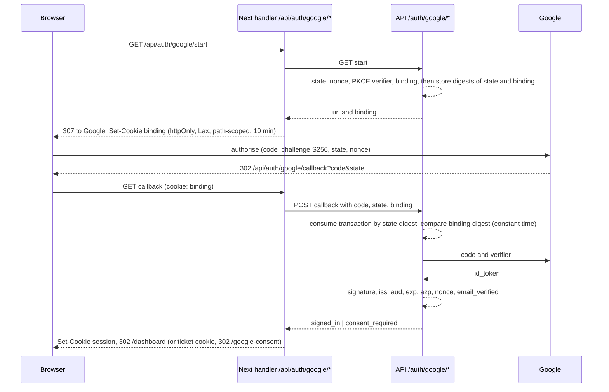

# Vendor accounts, sessions and PDPA rights — design

_Revision 2 (2026-10-06). Sprint 4. Jira TOR-94 (auth and roles), TOR-95 (auth flows),
TOR-96 (RBAC middleware), TOR-97 (PDPA export and delete). Realises **FR-D-1**, **FR-D-3**,
**NFR-S1**, **NFR-S2**._

_Revision 1 was reviewed against the code by a different-company model and failed on sixteen points,
three of them serious enough to stop the build: it allowed account takeover through Google sign-in,
it described a session topology that cannot physically work, and it left sign-in open to CSRF. The
corrections sit at the section that was wrong; §9 lists them._

## 1. What this is for

Nothing on the site knows who is asking, which is why the three things the 2026-10-06 review wanted
most — a dashboard of work on hand, matched TORs, and search that puts a vendor's own work first —
cannot be built. This slice is that identity and nothing more.

**In scope:** registration, email verification, sign-in by password and by Google, sessions, roles,
PDPA consent, export and deletion.
**Out of scope:** the vendor dashboard, matching, notification.

## 2. Decisions

### 2.1 Public sign-up only — no government identity, no national identifiers

Email and password, or Google. **No ThaiD.** No เลขประจำตัวประชาชน and no tax identifier is
collected, displayed or stored: the service cannot leak an identifier it never held (`NFR-S2`).

Two fields beyond the address are kept, each with a stated purpose, because a field without one is a
field that should not exist:

| Field | Why it is held | Lifetime |
| :--- | :--- | :--- |
| `displayName` | Shown in the account menu and on the profile; the vendor sets it, Google supplies it on first sign-in | Account lifetime; in the export; removed on deletion |
| `google.sub` | Google's stable subject, so a renamed or re-cased address still reaches the same account | Same |

No user-agent or device fingerprint is stored. Revision 1 proposed a `userAgentHash`; it served no
purpose in the flow and is the kind of quiet fingerprinting `NFR-S2` exists to prevent.

### 2.2 The browser's cookie belongs to the Next app; the session lives in the API

Revision 1 said the API sets the session cookie while Next calls the API server-to-server. That
cannot work: a `Set-Cookie` on a server-to-server fetch is received by the server that made the call,
never by the browser, and a cookie on the app's origin is not readable by a separate API origin.

The topology, stated once:

1. The browser posts to a **Next route handler** on the app's own origin — the rule every other
   privileged surface already follows.
2. Next calls the API, which creates a **session row** and returns its opaque id.
3. **Next** sets the browser cookie: `httpOnly`, `Secure` outside development, `SameSite=Lax`,
   host-only, `Path=/`, expiring with the session.
4. On every later request Next reads the cookie and passes the session id to the API in a header.
   The API resolves it to an account and a role on each call; nothing about the caller is believed
   from the cookie itself.

The cookie carries the session id and nothing else — no role, no account id, no claims.

### 2.3 Sessions are rows, so they can be withdrawn

`FR-D-3` lets a vendor demand deletion, and a self-contained token stays valid until it expires, so
"delete my account" would leave live credentials in the world. A row can be removed, and with it
every signed-in device.

**Every session is revoked when** the password changes, the role changes, the account is deleted, or
a reset completes. A promotion must not turn a stolen vendor session into an admin session.

### 2.4 Argon2id, with a dummy verification for unknown accounts

`NFR-S1` permits bcrypt or argon2; argon2id resists GPU attack in a way bcrypt's small memory
footprint does not. Parameters live in `core/config.ts` (`NFR-S7`).

`@node-rs/argon2` is the binding: it ships prebuilt binaries, and this project has already lost an
afternoon to a native module Windows Application Control refused to load.

An unknown address is verified against a **fixed dummy hash**, so the failing path does the same work
as the succeeding one. Revision 1 said "the same response time", which nobody can implement or test.

### 2.5 A password account is unusable until its address is verified

This closes the takeover revision 1 allowed: register with a victim's address and a password of your
choosing, wait for them to sign in with Google, and the automatic link hands you their account.

- Registration creates the account **unverified**; it cannot sign in and owns nothing.
- A single-use, hashed, expiring token sent by email verifies it.
- Google sign-in links to an existing account **only** when that account is already verified and
  Google asserts `email_verified` for the same address. Otherwise it creates its own account.
  _(2026-11-21: "creates its own account" cannot hold for an unverified password account, because the address is a
  unique key. See section 10.3 for what happens instead.)_

**This depends on outbound email, which does not exist yet** (TOR-33/34). Until it does, Google
sign-in is the only path that completes, and password registration is built but gated. The
dependency is stated here rather than discovered mid-build.

### 2.6 Google is validated claim by claim

> **Built 2026-11-21 (TOR-315); refined in section 10.** Where this section and section 10 differ, section 10 is the
> record of what shipped.

Authorisation Code with PKCE. The transaction — `state`, `nonce`, PKCE verifier, redirect URI — is a
short-lived server-side row consumed atomically on return, not a cookie that can be replayed.

The ID token is accepted only when issuer, audience, `azp`, expiry and `nonce` all match, and the
redirect URI equals the single registered value. Google's tokens are read once for the profile and
discarded; the platform never holds anything that would let it act as the vendor elsewhere.

### 2.7 Every state-changing route checks the origin

`SameSite=Lax` does not stop a cross-site form POST from establishing a session — an attacker can
sign a victim into the attacker's account and then read whatever the victim types into it. Register,
sign in, sign out, password change, deletion and every `/me/*` write check `Origin`/`Referer`
against the app's own origin and reject when it is foreign or absent.

### 2.8 Auth has its own rate limits

The existing limiter is mounted on `/intake` only. Auth gets its own, keyed on **both** the source
address and the normalised email, covering register, verify, sign in, reset, Google start and
callback, export and deletion. Limits live in `core/config.ts`. Exceeding one answers 429 and nothing
else.

### 2.9 Failure says one thing

An unknown address, a wrong password and an unverified account return one status and one body. An
address that is already registered receives an email saying so; the form says what it says to every
other registration. Registration without consent fails.

### 2.10 Roles are read from the record, and the staff gate is untouched

`vendor`, `admin`. The role is read from the account row on every request. One `requireRole`
middleware guards every non-public API route; public routes are listed, never assumed.

**Unchanged by this slice:** the Next staff cookie (`staff-session.ts`) guarding the review screens,
and the `ADMIN_API_KEYS` the app proxies to `/admin/*`. Revision 1 implied `requireRole` replaced
both; it does not. Moving admins onto accounts is its own design, after this works.

## 3. Data model

| Collection | Key | Fields |
| :--- | :--- | :--- |
| `accounts` | unique `email` (plain) | `displayName`, `passwordHash?`, `emailVerifiedAt?`, `google?: { sub }`, `role`, `consent`, `createdAt`, `updatedAt`, `deletedAt?` |
| `sessions` | `_id` random 256-bit | `accountId`, `createdAt`, `expiresAt`, `lastSeenAt` · TTL on `expiresAt` |
| `auth_tokens` | `tokenHash` | `accountId`, `purpose: "verify" \| "reset"`, `expiresAt`, `consumedAt?` · TTL |
| `oauth_transactions` | `_id` | `stateHash`, `nonce`, `codeVerifier`, `redirectUri`, `expiresAt`, `consumedAt?` · TTL |
| `reauth_grants` | `_id` | `accountId`, `sessionId`, `expiresAt`, `consumedAt?` · TTL |

**Deletion replaces the address with a tombstone** — `deleted:<random uuid>` — rather than emptying
it. Revision 2 called for a partial unique index on "where `deletedAt` is absent"; MongoDB rejects
`$exists: false` inside `partialFilterExpression` (verified against the running server, which is also
how the `$ne` restriction on the statistics index was settled).

The tombstone is the better answer regardless. Deletion has to remove the address, because the
address IS the personal data; a partial index would have kept it on the row for ever and called the
account deleted. A random tombstone is not reversible to the address it replaced — a hash of the
email would be, by dictionary — and uniqueness then holds with an ordinary index, so a second
deletion and a re-registration of the same address both work. Verified: two deletions and a
re-registration leave two rows and no collision.

`consent` records what was agreed to, not merely that something was:
`{ noticeVersion, noticeHash, agreedAt, action: "checkbox" }`. A version alone cannot show what the
text said once the text changes.

### 3.1 What an account owns

Export and deletion are only as good as this list, and `FR-D-3` covers everything the account holds,
not only its login:

| Collection | On export | On deletion |
| :--- | :--- | :--- |
| `accounts` | all fields | identifying fields removed, `deletedAt` set |
| `sessions` | count only | removed |
| vendor profile (TOR-29) | all fields | removed |
| bookmarks (TOR-52) | all rows | removed |
| matches and sent notifications (TOR-33/37) | all rows | removed, except a minimal record that an email was sent, which is an audit obligation rather than personal data |
| `tor_events`, `corrections` | staff actions, not vendor data — excluded | retained: they describe a document's history, and an admin's correction is not the vendor's personal data |

Every vendor-owned collection carries `accountId` for exactly this reason. A collection added later
without one cannot be exported or deleted, so the field is part of what "vendor-owned" means.

## 4. Routes

The contract `docs/API.md` already reserves is kept — revision 1 invented `/account/*`:

| Route | Does |
| :--- | :--- |
| `POST /auth/register` | Validates, records consent, hashes, creates an unverified account, sends the verification email |
| `POST /auth/verify` | Consumes the token, marks verified |
| `POST /auth/login` | Verifies against the hash or the dummy, creates a session |
| `POST /auth/logout` | Deletes the session row |
| `POST /auth/password/forgot` · `/auth/password/reset` | Single-use hashed expiring token; revokes every session |
| `POST /auth/password/change` | Requires the current password; revokes every other session |
| `GET /auth/google/start` · `/auth/google/callback` | §2.6 |
| `GET /api/v1/me` | The signed-in account |
| `GET /api/v1/me/export` | §3.1, as JSON (`FR-D-3`) |
| `DELETE /api/v1/me` | §3.1, after a re-authentication grant |

**Re-authentication before deletion** is a short-lived grant bound to the account and the session,
issued by re-entering the password or by a fresh Google sign-in (`prompt=login`), consumed atomically
by the delete. A long-lived stolen session cannot by itself destroy an account.

## 5. Configuration (`NFR-S7`)

`SESSION_SECRET` (required, no default) · `SESSION_LIFETIME_MS` · `ARGON2_MEMORY_KIB` ·
`ARGON2_ITERATIONS` · `ARGON2_PARALLELISM` · `AUTH_RATE_LIMIT_PER_IP` ·
`AUTH_RATE_LIMIT_PER_EMAIL` · `VERIFY_TOKEN_TTL_MS` · `RESET_TOKEN_TTL_MS` · `REAUTH_GRANT_TTL_MS` ·
`OAUTH_TRANSACTION_TTL_MS` · `GOOGLE_CLIENT_ID` · `GOOGLE_CLIENT_SECRET` · `GOOGLE_REDIRECT_URI` ·
`CONSENT_NOTICE_VERSION`.

_(2026-11-21: the three Google names were built as `GOOGLE_OAUTH_CLIENT_ID`, `GOOGLE_OAUTH_CLIENT_SECRET` and
`GOOGLE_OAUTH_REDIRECT_URI`, plus `GOOGLE_OAUTH_ENABLED`; see section 10.)_

## 6. Testing

Every control above is a test, because a security control nobody tested is a claim:

| Area | Cases |
| :--- | :--- |
| Enumeration | Unknown address, wrong password and unverified account return the identical status and body; the unknown path performs a dummy verification |
| CSRF | Register, sign in, sign out, password change and delete are refused with a foreign or absent `Origin` |
| Takeover | Google does NOT link to an unverified account; it links a verified account after the existing owner authenticates; an unverified Google address never links |
| OAuth | Mismatched `state`, replayed transaction, wrong `aud`/`azp`/issuer, expired token, and a redirect URI that is not the registered one are each refused |
| Sessions | Expired session rejected; cookie attributes exactly as §2.2; password change, role change and deletion revoke every session |
| Deletion | Re-authentication required; a second account with the same address can register afterwards; the first account's profile and bookmarks are gone |
| Consent | Registration without consent fails; the stored record names the notice version and hash; the export contains it |
| Rate limits | Each auth route answers 429 past its limit, keyed by address and by email |
| Live | Register, verify, sign in, sign out, delete — in a browser, against the composed stack |

## 7. Sequencing

1. Schema, config, session mechanism, `requireRole` — nothing user-visible.
2. Google sign-in end to end — the path that can complete today.
3. Password registration, verification and reset — **gated on outbound email** (TOR-33/34).
4. PDPA export and deletion.

## 8. Open

| Question | Needs |
| :--- | :--- |
| Outbound email does not exist, and verification and reset both need it | TOR-33/34, which this now blocks on |
| When do admins move off `ADMIN_API_KEYS` and the staff cookie onto accounts? | Its own design, after this |
| The consent notice text, and where it is versioned so a change is demonstrable | The PDPA notice copy (`NFR-S2`) |

## 9. What revision 1 got wrong

1. Google linked to any account with a matching address, so pre-registering a victim's address took it over.
2. The session topology could not work: an API `Set-Cookie` never reaches the browser through a server-to-server call.
3. Sign-in was open to CSRF; `SameSite=Lax` does not prevent it.
4. No session signing key or lifetime in configuration, against `NFR-S7`.
5. "The same response time" was unimplementable; a dummy hash verification is the rule.
6. Rate limits were assumed from a limiter mounted only on `/intake`.
7. No password reset or change existed, though revocation on password change was claimed.
8. A plain unique email index permits one deleted account, not two.
9. Export and deletion covered the login only, not the profile, bookmarks or matches `FR-D-3` means.
10. `userAgentHash` was fingerprinting with no stated purpose.
11. Consent as `{version, at}` could not show what was agreed to.
12. A role change left existing sessions standing.
13. Re-authentication before deletion was asserted, never designed.
14. Route names contradicted the `/me/*` contract already in `docs/API.md`.
15. The staff cookie and admin API key were described as replaced; they are not.
16. The tests named none of the security cases above.

## 10. Revision 2026-11-21 — Sign in with Google, as built (TOR-315)

Subtasks TOR-328 (login route), TOR-329 (token validation), TOR-330 (linking), TOR-331 (settings), TOR-332
(button and callback page). ASVS V10. This section follows sections 2.5 and 2.6 where they speak and records what
they left open.

### 10.1 The flow

- **The transaction is a server-side row**, as 2.6 says, keyed by the SHA-256 of `state` and consumed with
  `findOneAndDelete`: a forged, expired or replayed `state` finds nothing, and a wrong guess burns the attempt.
- **A cookie is added for one reason: login CSRF.** A server-side row alone does not tie the callback to the browser
  that started it, so an attacker could start a flow, stop before the callback, and feed the victim the callback URL,
  signing the victim in as the attacker. The browser holds a random `binding` in an httpOnly, `SameSite=Lax` cookie
  whose path is `/api/auth/google`; the API keeps only its digest and compares in constant time. The cookie carries
  no secret that can sign anyone in on its own, so it is not signed or encrypted.
- **Validation split.** `google-auth-library` (already a dependency, so no new one) verifies the signature against
  Google's published keys, the issuer, the audience and the expiry. The adapter adds `azp`; the service adds `nonce`
  (constant-time) and `email_verified === true`. The port (`GoogleOidc`) stops at the claims, so every rule above is
  tested with a stub, and the adapter's own checks are tested with a token signed by a local key.
- **Nothing sensitive is kept or logged.** The authorization code, ID token and verifier are used once and dropped;
  the verifier sits in the transaction row until it is consumed or expires (`OAUTH_TRANSACTION_TTL_MS`). The
  `prompt=select_account` parameter makes Google show its account chooser every time.
- The routes live under `/auth` only, are rate-limited like every auth route, and exist only while
  `GOOGLE_OAUTH_ENABLED` is on. The web handler turns every failure into `/login?error=google` with one Thai
  message; the reason is never put in the URL.

### 10.2 Linking and the account key

- A linked account is found by **`google.sub`** from then on, never by address. A renamed address at Google still
  reaches the same account.
- A first sign-in with an address that belongs to an existing, **verified** account links it (stores `google.sub`)
  only through a linking transaction started and completed with that account’s active TOR Radar session. The account keeps its password. An account already linked to a different
  `sub` is refused.
- `email_verified` must be true on the token for any of this, including the sub match: an address Google does not
  vouch for is not used to find, link or create anything.
- `google.sub` has a partial unique index, so one Google identity can own one account.

### 10.3 The unverified password account (the case 2.5 left open)

2.5 says Google "creates its own account" when the existing account is unverified, but the address is a unique key,
so a second account cannot exist. An unverified account owns nothing (2.5), and whoever registered it chose its
password without proving the address. Linking would hand that person the real owner's Google sign-in, which is the
takeover revision 1 allowed. So: the Google owner is asked for consent like any new vendor, and when it is given the
unverified row (and its tokens and sessions) is removed and a fresh account is created. The attacker's password does
not survive.

### 10.4 PDPA consent for a Google account

A first Google sign-in creates **no account**. The callback stores a short-lived `google_signups` row (digest of a
ticket, `sub`, address, name) and the browser is sent to `/google-consent`, holding the ticket in an httpOnly cookie.
Ticking the PDPA box posts to `google/complete`, which records exactly the consent a password registration records
(notice version and hash, `agreedAt`, `action: "checkbox"`), plus the optional, separate behaviour consent, then
creates the account (verified, no password) and the session. Unticked, the request is refused and nothing exists.

### 10.5 Accounts with no password

Every place that reads `passwordHash` was checked.

| Place | Behaviour for a Google-only account |
| :--- | :--- |
| `POST /login` | Fails with the same status and body as an unknown address, after the same dummy verification |
| `POST /password/change` | `401`: there is no current password to give |
| `POST /password/forgot` | Now **serves** it (it needs a verified address, not a password), so such a vendor can set one through the emailed link |
| `DELETE /me` | `400` with a Thai message saying to set a password through "forgot password" first, then delete. Re-authenticating by a fresh Google round trip (`prompt=login`, section 2.10) is not built |
| `GET /me/export` | Works; carries `google.sub`; never carries a hash |
| Deletion | `softDelete` unsets `google`, freeing the `sub` and the address |
| Disabled or deleted | Refused on the `sub` path and on the address path; a disabled account stays signed out everywhere |

### 10.6 Configuration

| Variable | Default | Meaning |
| :--- | :--- | :--- |
| `GOOGLE_OAUTH_ENABLED` | `false` | Mounts the routes and shows the button; the web server reads it too |
| `GOOGLE_OAUTH_CLIENT_ID` · `GOOGLE_OAUTH_CLIENT_SECRET` | none | Required when enabled (checked at load) |
| `GOOGLE_OAUTH_REDIRECT_URI` | `APP_ORIGIN` + `/api/auth/google/callback` | Must equal a URI registered on the OAuth client |
| `OAUTH_TRANSACTION_TTL_MS` | `600000` | Life of an attempt and of the consent ticket |

### 10.7 Not verified here

A real Google login needs an OAuth client and a person at a browser. What ran live: the start route redirects to
`accounts.google.com` with `code_challenge_method=S256`, `state` and `nonce`; a forged state, a missing binding cookie,
a declined consent and a wrong binding are each refused. The callback-to-session path is covered end to end by tests
with a stub verifier and by a local-key token for the adapter. The first run with a real client is the owner's
(docs/gcp-setup.md, 7.3b).

## Revision 2026-11-20 — session timeout and revocation (TOR-319, ASVS V7.2.4 / V7.4.1 / V14.3.1)

- Idle timeout: `resolve` rejects a session whose `lastSeenAt` is older than `SESSION_IDLE_TIMEOUT_MS` (default 30 min); `touch` has the same
  filter and never revives one. `lastSeenAt` had never been written outside creation; `resolve` now slides it, at most once per
  `SESSION_TOUCH_INTERVAL_MS` (default 60 s, capped at half the idle timeout) so a page of requests is not a page of writes. The absolute
  lifetime is the existing `SESSION_LIFETIME_MS`, enforced by the `expiresAt` check and the TTL index. No schema or index change.
- Login: the session id the request carried is deleted whoever it belonged to (fixation; a shared machine), then, when
  `SESSION_SINGLE_ACTIVE` is true (default), every other session of the account. A vendor using two devices is signed out of the first;
  the switch exists for that case.
- Logout deletes the row (unchanged). The web logout reply carries `Clear-Site-Data: "cache", "cookies", "storage"`: it is the reply the
  browser receives, the API's is not.
- A cookie the API rejects is dropped by `GET /api/auth/expired` and the reader lands on `/login?reason=expired` with a Thai message. The root
  layout triggers this for any page, public ones included, since it already asks `/me` once per render.

2026-11-21 revision: single-active session issuance serializes on the account in a MongoDB transaction. Every authentication provider calls SessionsRepository.create.

2026-11-21 linking revision: a matching verified address alone is refused. The account screen starts a browser-bound transaction with its authenticated account ID. Callback requires the same active account and matching email before storing a first Google subject. An ordinary returning login uses the linked subject.

2026-11-21 external signup revision: a verified Google ID token with a Gmail address or hosted-domain claim can proceed to consent directly. Other new applicants need both their browser signup ticket and a separate one-time proof sent to the current mailbox. Neither an account nor a recovery address exists before both are checked.

2026-11-21 revision: public pages render signed out after a rejected cookie. Only vendor account, profile, path and notification pages invoke the expired-session redirect. Email action URLs stay in the original browser navigation.

## Revision 2026-11-20 - breached passwords (TOR-320, ASVS V6.2.4)

A new password is refused when it is on the bundled common-password list (SecLists top-10k, MIT, always checked) or
the Have I Been Pwned range API has seen it (`HIBP_MIN_COUNT`, default 1). Applies to `POST /register`,
`/password/reset` and `/password/change`; the refusal is 422 `password_breached` with a Thai message.

- Only the first 5 hex characters of the SHA-1 leave the process (k-anonymity, `Add-Padding: true`); the suffix
  comparison is local. The password, its hash and its prefix are never logged.
- Fail open on the corpus: if HIBP is unreachable, slow (`HIBP_TIMEOUT_MS`) or answers non-2xx the password is
  accepted unless the local list caught it, and `breached_password_check_unavailable` is logged. An outage of a
  third party must not block registration or account recovery. `HIBP_ENABLED=false` skips HIBP entirely.
- Register checks before the account lookup (no existence oracle); reset checks before consuming the token.
- Wiring: port `ports/breached-passwords.port.ts`, adapter `adapters/hibp.breached-passwords.ts`, built in `app.ts`.

## Revision 2026-11-20 — the limiter sees the client, and search and downloads are limited (TOR-318)

Section 2.8 keyed on "the source address", but the browser never calls the API: the Next server does,
so every request arrived from the web server's address and the per-address limit was one global bucket
(threat model T01, T11). Search and document downloads had no limit at all.

**Scheme.** One header, `X-Forwarded-For`, honoured by the API only from configured proxy hops.

1. The web server (`apps/web/src/shared/api/client-ip.ts`) derives the client from the `X-Forwarded-For`
   it received: the entry just left of the `TRUSTED_PROXY_HOPS` entries (default 0) that infrastructure it
   trusts appended. It must be an IP address. It then sends the API exactly one `X-Forwarded-For` holding
   that address, **replacing** whatever arrived. With no trustworthy entry it sends none. Used by
   `apiRequest`, the document proxy and the dashboard fetch.
2. The API sets Express `trust proxy` from `TRUST_PROXY` (default `false`: nothing trusted; a hop count or
   an address list). `true` is refused at load, because it would believe any caller. `req.ip` is then the
   client, which the existing limiters key on (express-rate-limit v8 folds IPv6 into a /56 itself).
3. `GET /tors`, `GET /tors/facets` (`PUBLIC_SEARCH_RATE_LIMIT_PER_MIN`, 120) and `GET`/`HEAD
   /tors/:id/document` (`DOCUMENT_RATE_LIMIT_PER_MIN`, 60) each have their own per-address bucket,
   one minute window, empty `429`, no rate-limit headers (the same uniform answer as the login limiter;
   advertising the allowance helps only the one probing it).

**Spoofing analysis.**

| Deployment | Chain the API sees | `TRUST_PROXY` | Why a forged header does not help |
| :-- | :-- | :-- | :-- |
| Cloud Run | socket = Google front end; `X-Forwarded-For: <client>, <web instance>` (front end appends the peer it saw) | 2 | `api` is IAM-restricted, so only the web service can reach it, and web overwrites the header. A client's forged entries sit left of the real one at web (`TRUSTED_PROXY_HOPS=1` takes the last entry, the one Google's front end appended), so they never reach the API |
| Compose | Socket peer for both web and direct API traffic | false | Web discards forwarding headers by default (zero trusted hops). Requests through the web server share its API quota. |
| Direct call with no header | socket address | any | Keyed on the socket, as before |

Not verified here: the exact entries Google's front end appends on the web-to-api call. The hop counts
(`TRUSTED_PROXY_HOPS=1` on web, `TRUST_PROXY=2` on api) are config precisely so they can be corrected
after a look at a real request in the deployed environment.

## 10. Revision 2026-11-20 - security event logging (TOR-316)

Logins, refusals and admin actions are now logged (ASVS V16.3; threats T01, T15). `POST /login` logs
`auth.login.success`, or `auth.login.failure` with a `reason` (`unknown_email`, `bad_password`, `disabled`,
`unverified`); `POST /logout` logs `auth.logout`. The HTTP response to a failed login is unchanged and uniform
(section 2); only the log distinguishes the reasons. No log line holds a password, an email address, a session
id or a cookie. The event vocabulary and fields are in `docs/ARCHITECTURE.md`, "Logging and security events".
