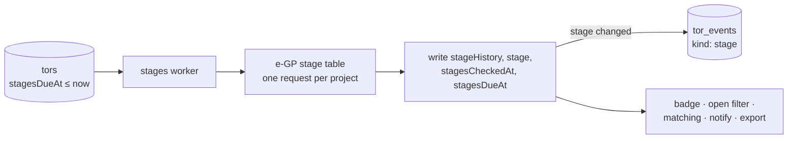

# Project stages on one record — design

**Cards:** TOR-205 (story), TOR-233 (schema), TOR-234 (stages on one record), TOR-235 (tests and docs) · **Date:** 2026-11-23
**Builds on:** [e-GP project stages spike](2026-11-23-egp-project-stages-design.md) · [e-GP project linking](2026-09-16-egp-project-linking-design.md) · [national e-GP source](2026-10-04-national-egp-source-design.md)
**Requirements:** FR-A-3, FR-E-5, NFR-F6, NFR-F7, NFR-S7 · **Feeds:** TOR-206 (timeline), TOR-207 (stage notifications), TOR-221 (winners)

## 1. Problem

A real project publishes several times: draft TOR, median price, invitation to bid, winner, sometimes a
cancellation. Today a TOR record knows only its own document, plus a deadline borrowed from its project's
invitation. It cannot say which stage the project has reached, so a TOR whose project has a winner still
shows "เปิดรับข้อเสนอ" until extraction happens to read otherwise, and TOR-206 and TOR-207 have nothing to
show or to notify about.

## 2. Decisions

| # | Question | Decision |
| :--- | :--- | :--- |
| 1 | Where the stages come from | **e-GP's own stage table** (`fetchProjectStages`, spike §2), one request per project. It lists every stage with its date, including stages whose documents we never collect (median price, winner). Chosen by the team on 2026-11-23 over "only the documents we hold" |
| 2 | Which record carries them | Every **public TOR record** of the project (`documentType` absent or `"tor"`, `duplicateOf: null`), keyed by `sourceProject.projectId`. Invitation records stay supporting documents and carry none. Duplicates already point at their canonical record (FR-A-3), so one project's stages live on its one record |
| 3 | A stage we hold the document of | The stage row carries `recordId` of that record (the invitation record for `D0`, the TOR itself for `B0`), so TOR-206 links to the original we stored. Otherwise the row links to e-GP's public project search (`PROJECT_SEARCH_URL`), as the record's source link already does |
| 4 | How often it is re-read | A **stages worker**, once per record per `STAGES_REFRESH_HOURS` (default 24), for records whose project has not reached a final stage. Chosen by the team over "at import only", because TOR-207 must notice a stage moving |
| 5 | Load on e-GP | One request per project per refresh, paced by `STAGES_REQUEST_DELAY_MS` (default 2000). Three failed lookups in a row (e-GP answers `429` under load, seen on 2026-11-23) pause the worker for `STAGES_BACKOFF_MS` (default 1 h). The worker never retries faster than that |
| 6 | When a project stops being re-read | When its stage is final (`awarded` or `cancelled`), or when its newest stage is older than `STAGES_MAX_AGE_DAYS` (default 180): a project e-GP never closes must not be polled for ever |
| 7 | The status badge | **The source's stage decides when it is final.** A record whose stage is `awarded` or `cancelled` shows "ประกาศผู้ชนะแล้ว" / "ยกเลิกแล้ว" and is not open, whatever extraction read. Otherwise the badge is decided as today, from `torStatus` and the deadline. Chosen by the team: the stage is a value the source system states, the extracted `torStatus` is a model's reading of a document that predates it |
| 8 | The extracted `torStatus` | **Never rewritten.** It stays exactly as extracted and is still shown as an extracted field with its confidence (NFR-F6, NFR-F7). Decision 7 changes which value the badge reads, not the field |
| 9 | One place decides | The badge, the open filter, matching, notification, the dashboard's state counts and the export all ask `lib/tor-state.ts`, which already defines the five states (§6). Today ten modules read `fields.torStatus.value`; the ones that decide "is it open" move onto the shared rule |
| 10 | The audit trail | A stage change writes a `tor_events` entry with `kind: "stage"`, `from` (null the first time) and `to` as stage codes, `source: "national-egp"`, `actor: "stages-worker"` (FR-E-5). The record's `statusHistory` stays pipeline-only. TOR-207 reads these entries to notify |
| 11 | Unknown codes | A code missing from the kind table is stored with `kind: "other"` and its code, and logged once per code (`stage_code_unknown`). It never decides the badge. The table grows as codes are confirmed (spike §4: winner and cancellation codes are still to be sampled) |

## 3. Stage kinds

| `kind` | e-GP codes | Final | Badge |
| :--- | :--- | :--- | :--- |
| `draft` | `B0`, `B3` | no | as today |
| `median-price` | `BOQ` | no | as today |
| `invitation` | `D0` | no | as today |
| `awarded` | `W0` (§10) | **yes** | ประกาศผู้ชนะแล้ว |
| `cancelled` | `D1` (§10) | **yes** | ยกเลิกแล้ว |
| `other` | anything else | no | as today |

The table lives in `sources/national-egp/stages.ts` beside the parser. Codes for `awarded` and `cancelled`
are added only from a sampled project, never guessed; until then no record reaches a final stage and the
badge behaves exactly as today.

## 4. Record shape (schema, TOR-233)

Added to `TorDocument`, all optional:

```ts
/** The project's published stages, oldest first, as the source lists them (TOR-205). */
stageHistory?: Array<{
  code: string;              // e-GP's announceType, e.g. "B0"
  kind: StageKind;           // §3
  description: string | null; // e-GP's Thai name, as given
  on: string;                // YYYY-MM-DD, Bangkok day
  recordId?: string;         // our record of that stage's document, when we hold one
}>;
/** The newest entry of stageHistory; what the badge and the filters read. */
stage?: { code: string; kind: StageKind; on: string };
/** When the stages were last read, and when they are next due. */
stagesCheckedAt?: Date;
stagesDueAt?: Date | null;   // null: final or too old, never re-read
```

`stageHistory` is bounded by the source (one row per stage, a handful per project) and capped at
`STAGE_HISTORY_MAX` (default 20) on write, so it cannot become the unbounded array `statusHistory`'s note
warns about. When two stages share a day, the table's own order is kept.

Indexes: `{ stagesDueAt: 1 }` partial on `stagesDueAt` existing, for the worker's claim; `{ "stage.kind": 1 }`
for the open filter.

## 5. Flow



- **New records:** whenever nothing is due, the worker gives every public e-GP TOR record that has never
  been read (`stagesCheckedAt` and `stagesDueAt` both absent) a due time of now. That covers the corpus
  that predates the worker and every record imported since, without the import or intake knowing about
  stages.
- **One pass:** claim up to `STAGES_BATCH` (default 50) due records, grouped by project; read each project's
  table once; write every record of that project; compute the next due time from decision 6; sleep
  `STAGES_REQUEST_DELAY_MS` between projects.
- **A claim** sets `stagesDueAt` forward by `STAGES_CLAIM_MS` before the request, so two worker
  processes never read the same project at once and a crashed pass is picked up again later.
- **BMA e-GP records** (`sourceProject.system: "bma-egp"`) are out of scope: that source has its own
  announcement list per project (linking spec §1), and no stage table has been found for it.

## 6. The shared rule (TOR-234)

The rule already has one home: `lib/tor-state.ts` names the five states the badges and the dashboard
use (`torStateOf` in memory, `stateFilter` as a query), and `tor-state.db.test.ts` fails if the two ever
disagree. The stage is added there, not beside it:

- `torStateOf({ torStatus, deadline, stageKind })`: a final stage kind returns `awarded` / `cancelled`
  first; otherwise the rule is unchanged.
- `stateFilter(state, today)`: every state gains the stage, so `open`, `awaiting-invitation` and `closed`
  exclude a final stage, and `awarded` / `cancelled` match the stage **or** the extracted status of a
  record with no final stage.
- `openFilter(today)`: the "still open" predicate the list's open filter, days-left bands and leading
  segment use (announced, deadline today or later or none, stage not final), so those stop writing
  `fields.torStatus.value: "announced"` by hand.

The API adds `torState` (a `TorState`; `state` is already the pipeline state on a row) to each list row
and to the detail record, computed by `torStateOf`. The web's `/search` and TOR-page badges and the CSV's
`สถานะ` column read `torState` instead of re-deriving it from `torStatus`. The detail record also carries
`stage` and `stageHistory` for TOR-206. `isOpenOn` (matching), the notification filter and the dashboard's state counts pass
the stage kind. Readers that report the extracted value as such (admin review, extraction grading)
keep reading `torStatus`.

## 7. Configuration

| Variable | Default | Meaning |
| :--- | :--- | :--- |
| `STAGES_REFRESH_HOURS` | 24 | How long a read stays fresh before the record is due again |
| `STAGES_REQUEST_DELAY_MS` | 2000 | Pause between two projects |
| `STAGES_BACKOFF_MS` | 3600000 | Pause after three failed lookups in a row |
| `STAGES_MAX_AGE_DAYS` | 180 | A project whose newest stage is older is no longer re-read |
| `STAGES_BATCH` | 50 | Records claimed per pass |
| `STAGES_CLAIM_MS` | 900000 | How long a claim holds a record |
| `STAGE_HISTORY_MAX` | 20 | Rows kept in `stageHistory` |

All in `core/config.ts` with these defaults and in `.env.example`. None is an SRS §8 open value.

## 8. Tests (TOR-235)

- Unit: kind table; unknown code kept as `other`; newest stage chosen, ties keep the table's order;
  next-due computation (final, too old, normal); `torStateOf` with every stage kind against every `torStatus`.
- Integration (mongo): a pass writes every TOR record of a project and none of its invitations; a stage
  change writes one `tor_events` entry and an unchanged read writes none; `recordId` links the held
  invitation; three failures in a row back off; a claimed record is not claimed twice;
  `tor-state.db.test.ts` gains records with final stages, so `stateFilter` and `torStateOf` still agree.
- Search, matching, notify and export tests gain one case each: a record extracted `announced` whose
  stage is final is not open.

## 9. Out of scope

- The timeline on the TOR page (TOR-206) and the stage e-mails (TOR-207): both read what this writes.
- Collecting the winner's document, price and bidders (TOR-221).
- Projects with an invitation but no TOR (linking spec §5).
- Writing stages onto BMA e-GP records.

## 10. Revision 2026-11-23 — codes confirmed, and a cancelled invitation is still followed

Four projects sampled once e-GP answered again (spike spec §3a) confirmed the final codes: `W0`
ประกาศรายชื่อผู้ชนะการเสนอราคา → `awarded`; `D1` ยกเลิกประกาศเชิญชวน → `cancelled`; and a second draft
code, `B3` ร่างเอกสารประกวดราคา(e-Bidding) → `draft`. `price` (สรุปข้อมูลการเสนอราคาเบื้องต้น) stays `other`:
it says bids were opened, not that the project is over.

**Decision 6 changes for `cancelled`.** `D1` cancels the *invitation*, and an agency can invite again in
the same project; that later `D0` is the newest stage and reopens the record. So only `awarded` stops the
re-reads. A cancelled project is still read every `STAGES_REFRESH_HOURS` until `STAGES_MAX_AGE_DAYS`, and
shows "ยกเลิกแล้ว" meanwhile (decision 7 is unchanged: both kinds are final for the badge).


## 11. Revision 2026-11-24 — codes seen across the whole corpus

The stage is the **newest** listed one (decision 4), so a code published after the winner must itself be
`awarded`, or it reopens the badge.

The first full read of the 991 e-GP projects logged four codes outside the table:

| Code | e-GP's name | Kind | Why |
| :---- | :---- | :---- | :---- |
| `W2` | เปลี่ยนแปลงประกาศรายชื่อผู้ชนะการเสนอราคา | `awarded` | The winner announcement amended after a `W0`: there is still a winner (69109402570) |
| `W1` | ยกเลิกประกาศรายชื่อผู้ชนะการเสนอราคา | `other` | The winner announcement withdrawn: the project is no longer awarded, but not over either. It may be awarded again, or its invitation cancelled (`D1`, as in 69099682131), so the badge falls back to the extracted status and the project is still followed |
| `I0` | ข้อมูลสาระสำคัญในสัญญา | `awarded` | The signed contract's key details, published after the winner. 33 projects list it after their `W0`; as the newest stage it would otherwise have taken them out of `awarded` |
| `price` | สรุปข้อมูลการเสนอราคาเบื้องต้น | `other` | Unchanged (§10) |

## 12. Revision 2026-11-24 — the timeline on the TOR page (TOR-206)

`StagePanel` (`apps/web/src/features/tor-detail/`) renders `stageHistory` on the detail page:

- **Order.** By day, oldest first. e-GP's table is not in date order (§10), and a stable sort keeps its
  order on a tie, so the last row is the stage `latestStage` calls current. That row is marked; a final one
  carries "ได้ผู้ชนะแล้ว" or "ยกเลิก".
- **Names.** The source's own Thai name, exactly as published (NFR-F7). Only a stage e-GP leaves unnamed
  (`BOQ`) gets our Thai name for its kind. Codes are never shown: they mean nothing to a vendor.
- **Links (TOR-237).** A draft stage whose `recordId` is this TOR, and an invitation stage when the reader
  can open the invitation (the same rule `originalDocuments` applies), link to the stored original. Every
  other stage relies on one link to the project on e-GP (`sourceProject.url`), because e-GP has no public
  per-stage address (spike spec §4).
- **Freshness (NFR-F6).** The footer names the source and the last read, from `stagesCheckedAt`, which the
  detail API now returns.
- A record with no stages (another source, or not read yet) shows no panel.
